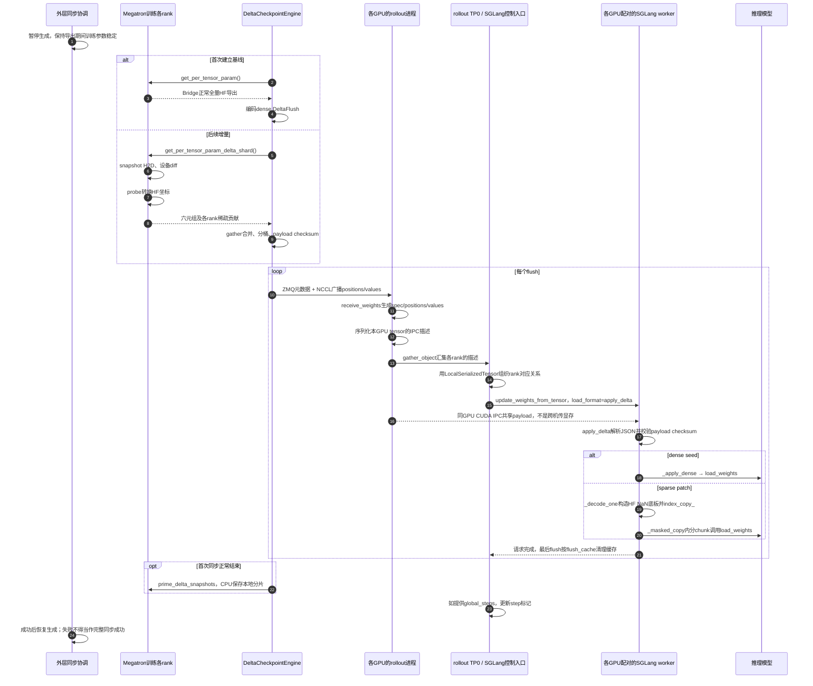
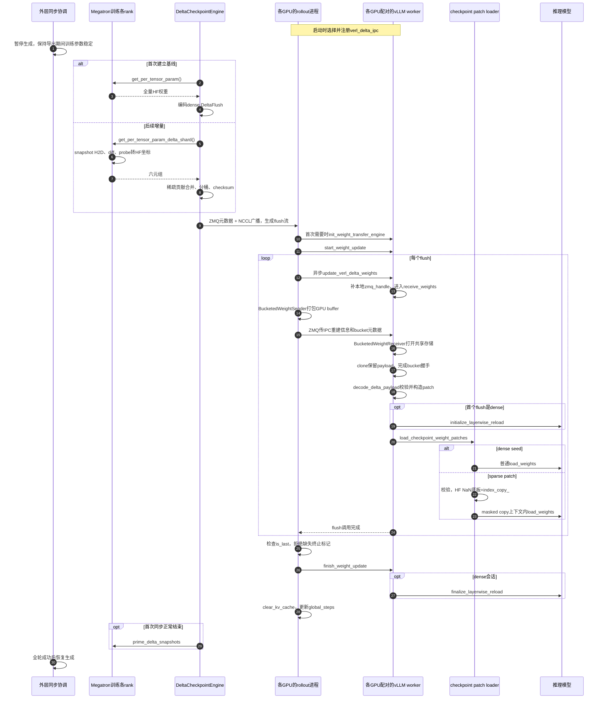

# verl + SGLang / vLLM：完整增量权重同步时序

整理日期：2026-10-24。本文依据本地代码阅读绘制，不表示新增多机、多卡或性能验证。两套图描述当前DeltaFlush与本地IPC路径，不是原生sparse_nccl或#18915 sparse_hccl直达路径。

- [IPC两端、每卡配对、多机边界及NCCL取舍](verl-vllm-sglang-ipc-topology.md)
- [NaN probe与slots、gather_group](nan-probe-principle.md)

## 1. 分支、版本和证据范围

表注：基线仅标识本地工作树起点，不表示全部本地修改已发布；链接使用固定commit便于定位。没有在本次新建训练/推理适配分支。

| 组件 | 分支/基线 | 本文使用范围 |
|---|---|---|
| verl | 官方main，本地HEAD 5026915b60fb0a99a0d6e929b4b5af9a4ceae1f8 | vLLM IPC适配相关文件在该基线存在；训练导出、SGLang等部分文件有本地修改 |
| vLLM | 本地detached HEAD e6bfe03ad73a3330cb427885aa90d97a12e1c704 | 本地部分checkpoint loader文件有修改，不等于干净上游提交 |
| SGLang接收路径 | 本地verl的sglang_rollout与delta_loader接线 | 不在本文声称某个SGLang上游branch已完成全部拓扑验证 |

固定版本入口：[verl vLLM delta适配器](https://github.com/verl-project/verl/blob/5026915b60fb0a99a0d6e929b4b5af9a4ceae1f8/verl/workers/rollout/vllm_rollout/delta_weight_transfer.py)、[IPC发送/接收](https://github.com/verl-project/verl/blob/5026915b60fb0a99a0d6e929b4b5af9a4ceae1f8/verl/workers/rollout/vllm_rollout/bucketed_weight_transfer.py)。本地证据目录：[来源版本](evidence/README.md)。

## 2. 两套流程共有的训练上游

```text
首次：全量HF导出 → dense DeltaFlush → 推理加载 → CPU本地Megatron snapshot初始化
后续：CPU snapshot H2D → 设备上Megatron shard diff
    → NaN probe转换为HF坐标 → 按slot和gather_group合并
    → 分桶编码DeltaFlush → ZMQ元数据 + NCCL广播到rollout接收rank
```

原本的真实权重gather在probe中替换为NaN占位模拟；后续稀疏贡献合并和NCCL广播是真实通信。values是当前绝对权重值。现有verl代码在生成增量时就刷新snapshot，不是推理成功后才提交。

每个rollout接收rank在自己的GPU持有payload，再交给同GPU的推理worker。这一最后一跳才是IPC，不是训练actor通过IPC跨机器访问推理显存。

## 3. verl + SGLang完整时序

图注：R代表各卡的rollout接收/转发进程，S代表与各R同GPU配对的SGLang TP worker；L是控制请求leader，可为TP0。图中IPC箭头表示逻辑共享关系，具体句柄经L转交。暂停/恢复由外层协调，不是apply_delta自动暂停全部请求。



### SGLang接口接线

```text
DeltaCheckpointEngine.receive_weights()
  → SGLangRollout._update_weights_delta(flushes, global_steps)
  → _update_weights_delta_flush(params_batch, flush_cache=is_last)
      → MultiprocessingSerializer.serialize(t.detach())
      → dist.gather_object：仅汇集描述
      → LocalSerializedTensor(values=各rank描述)
      → UpdateWeightsFromTensorReqInput(load_format=LOADER_FQN)
      → update_weights_from_tensor(req)
  → delta_loader.apply_delta(model, named_tensors)
      → checksum
      → dense普通加载，或sparse NaN解码+masked copy
```

**每张参与卡都有对应的rollout进程与SGLang worker。TP0汇总句柄并发控制请求，不代表所有卡都读取TP0那一份显存。** 跨节点使用时，每个worker仍必须选择本节点本卡对应的可访问描述；本次没有验证任意跨节点TP布局。

代码证据：[SGLang loader](evidence/sglang-loader.txt)；发送接线位于本地`verl/workers/rollout/sglang_rollout/sglang_rollout.py`约390～465行，该文件包含本地修改。该路径会恢复原copy_，但不提供整轮回滚；不能将checksum通过等同于最终模型状态已证明一致。

## 4. verl + vLLM完整时序

图注：R与V按同GPU配对；训练actor可在其他设备。当前vLLM后端是verl_delta_ipc，图中的NCCL到R不等于使用vLLM原生sparse_nccl。



NCCL接收与IPC发送实际可随flush流逐项推进；图中C→R一条箭头压缩表达流式接收，不表示必须先缓存整轮全部flush。

### vLLM接口接线

```text
checkpoint_engine.backend = delta_sharded
  → server选择weight_transfer_config.backend = verl_delta_ipc
  → worker注册VerlDeltaIPCWeightTransferEngine
  → VLLMRollout._update_delta_weights()
      → start_weight_update
      → update_verl_delta_weights + BucketedWeightSender
  → worker扩展补zmq_handle
  → VerlDeltaIPCWeightTransferEngine.receive_weights()
      → _receive_payload / BucketedWeightReceiver
      → decode_delta_payload
      → load_checkpoint_weight_patches
  → finish_weight_update
```

当前decode校验payload checksum，但没有将manifest所有字段纳入该摘要；适配器信任producer而关闭重复indices排序检查。失败会标记_update_failed，并要求重建全作业dense seed，因为训练snapshot可能已推进。不能只重启推理worker后无条件继续下一轮。

当前限制包括CUDA、推理DP1/PP1、BF16非量化、不支持speculative decoding；启动还限制MoE backend及EPLB等。多节点部署须额外验证rank/设备配对，不在本文声称已验证通过。

## 5. 两套流程的共同点与差异

表注：比较本地DeltaFlush增量路径；首次dense及后续sparse的数据类型不同，不能将所有flush都称为稀疏patch。

| 阶段 | verl + SGLang | verl + vLLM |
|---|---|---|
| 训练导出 | shard diff → probe → HF条目 | 相同职责 |
| 训练到rollout | ZMQ元数据 + NCCL payload | 相同职责 |
| 每卡最后一跳 | Serializer描述+控制请求，GPU IPC共享 | BucketedWeightSender/Receiver，ZMQ+GPU IPC |
| 接收入口 | custom loader apply_delta | VerlDeltaIPCWeightTransferEngine |
| sparse应用 | NaN底板+index_copy_+masked copy | checkpoint patch loader完成同类操作 |
| 收尾 | 最后flush携带flush_cache，更新step | finish后清KV cache并更新step |

当前两者最后一跳用IPC，是复用现有本地交接入口；NCCL直达推理worker也可设计，但需另外接线并保留协议保证。它可能减少中转，但不能在无benchmark时声称必然快于当前流程。详见[IPC与NCCL取舍](verl-vllm-sglang-ipc-topology.md#7-为什么最后一跳用ipc不直接继续用nccl)。
