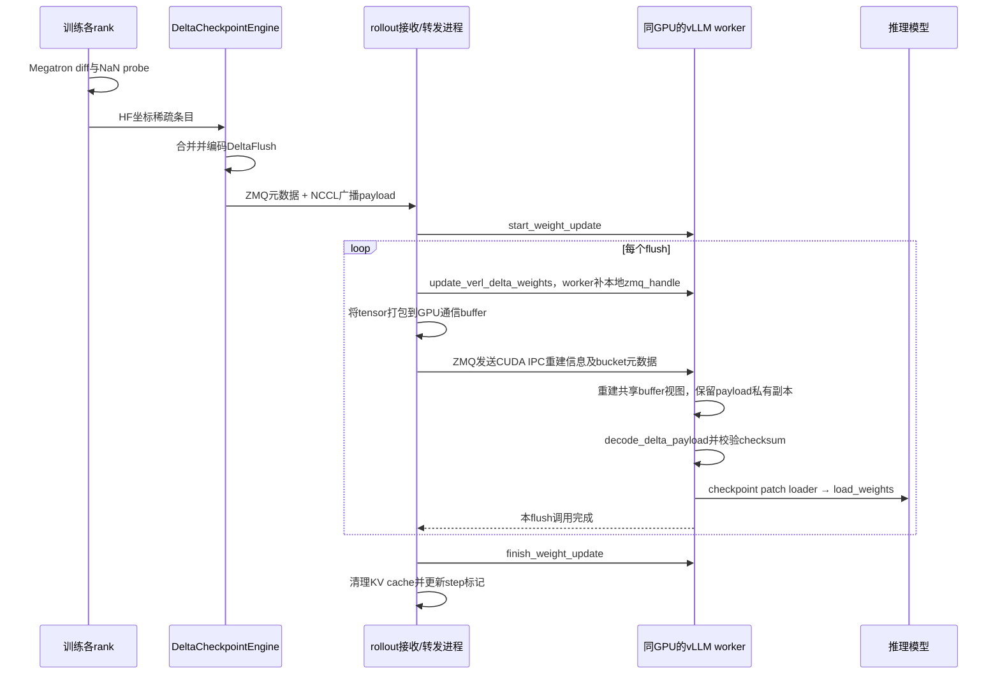

# verl + vLLM/SGLang：CUDA IPC两端是谁，是否需要共卡

核对日期：2026-10-24。基于本地代码阅读；未新增部署或多卡验证。本文讨论delta_sharded增量路径，不将框架其他同步路径的能力混入。

## 1. 结论：是共卡，但不必是训练actor与推理模型共卡

**这条路径的IPC两端，是verl rollout侧接收/转发进程与推理worker。它们按同一物理GPU配对部署。** 训练actor可以在另一组GPU、另一台机器上，数据先通过NCCL传到rollout侧，再在推理所在机器使用本地IPC。

之前称“推理侧单独IPC”容易误解。准确说法是“推理设备上的两个进程之间共享GPU张量”，并非推理模型自己给自己发送，也不是把远端训练显存直接映射到本机。

```text
训练机器/设备                          推理机器
Megatron actor                        GPU0
    │                                  ├─ verl rollout接收/转发进程
    └──── ZMQ元数据 + NCCL数据 ─────────→│      │
                                       │      └─ CUDA IPC句柄与本地握手
                                       └─ vLLM/SGLang推理worker
```

实际同机共卡部署也可以复用本地通道；是否由同一个训练worker兼任rollout侧角色取决于运行模式，不能仅凭IPC函数名称判断完整部署。本文确认的是最后一跳的配对要求和职责。

## 2. IPC并不等于整个推理只能单机

- 单次CUDA IPC句柄共享是同机进程间机制，不是跨机器网络传输。
- 当前同GPU适配要求发送进程与对应推理worker能访问同一物理GPU；CUDA_VISIBLE_DEVICES中的逻辑编号可以不同，代码会重建本地device编号。
- 整体推理部署是否跨节点是另一层问题：若框架支持该拓扑，每台节点可各有本地转发进程与推理worker配对。不能拿一个IPC句柄直接跨机器共享显存。
- 不应把CUDA IPC概念限定为永远只能同一GPU；硬件和访问条件可能允许其他方式。但本次核对的适配按同GPU通道理解，不能据此承诺任意同机不同卡都能直接接通。

共卡的是进程的设备访问关系，不意味着复制两份推理模型。转发进程主要持有接收payload和通信buffer；推理worker持有模型权重，实际峰值仍包含这些缓冲区和解码临时量。

## 3. 对应的verl分支与代码基线

**本次核实的vLLM适配位于verl官方main代码基线，不是一个独立命名的sparse_nccl适配分支。** 实际选择的是verl_delta_ipc后端。

表注：下面是已核实代码基线，而非核对日的上游最新HEAD。本地verl训练导出、SGLang等文件存在修改，不能将其全部等同于这个commit；表中的vLLM IPC适配文件本次检查为未修改。

| 组件 | 分支/基线 | 说明 |
|---|---|---|
| verl | 官方main，本地HEAD 5026915b60fb0a99a0d6e929b4b5af9a4ceae1f8 | 包含vLLM delta_weight_transfer.py及bucketed_weight_transfer.py |
| vLLM | 本地detached HEAD e6bfe03ad73a3330cb427885aa90d97a12e1c704 | 本地部分loader文件有修改；不能标为独立已发布适配分支 |

可直接查看的固定版本代码：

- [verl delta_weight_transfer.py](https://github.com/verl-project/verl/blob/5026915b60fb0a99a0d6e929b4b5af9a4ceae1f8/verl/workers/rollout/vllm_rollout/delta_weight_transfer.py)：后端名、decode_delta_payload、VerlDeltaIPCWeightTransferEngine。
- [verl bucketed_weight_transfer.py](https://github.com/verl-project/verl/blob/5026915b60fb0a99a0d6e929b4b5af9a4ceae1f8/verl/workers/rollout/vllm_rollout/bucketed_weight_transfer.py)：ZMQ握手、reduce_tensor、rebuild_ipc。
- [verl vllm_rollout.py](https://github.com/verl-project/verl/blob/5026915b60fb0a99a0d6e929b4b5af9a4ceae1f8/verl/workers/rollout/vllm_rollout/vllm_rollout.py)：_update_delta_weights最后一跳发送。

如需定位对应版本，按固定commit检出比只选择不断变化的main更明确。此处未新建或发布代码适配分支。

## 4. verl + vLLM实际时序

图注：图中rollout接收进程与对应vLLM worker同GPU；训练rank不要求因此共用该GPU。生成暂停/恢复由外层协调，图中展示数据及加载链路。



sender使用reduce_tensor生成GPU tensor重建信息，receiver使用rebuild_ipc打开共享存储。这不是把完整权重转成HTTP/JSON数值数组。也不能把整条链路称为零拷贝：sender有打包copy，delta接收引擎为防止buffer被下一bucket覆盖会clone payload，最后还要写入模型权重。

首次dense seed走相同DeltaFlush通道，但加载使用dense reload生命周期；后续sparse才使用NaN patch和masked copy。

本地适配明确限制CUDA、推理DP1、PP1、BF16、非量化，且不支持speculative decoding；启动逻辑还对MoE backend、EPLB等有限制。不能将“能使用CUDA IPC”理解成所有模型、跨节点布局和Ascend都已支持。

## 5. verl + SGLang为什么看起来相似

本地SGLang路径也先在rollout进程得到GPU上的DeltaFlush，再通过MultiprocessingSerializer序列化tensor重建信息，TP0汇集各rank的描述并调用update_weights_from_tensor。load_format指向verl的delta_loader.apply_delta，各推理worker取自己对应的本地tensor并应用。

```text
DeltaFlush到rollout各rank
  → 每rank序列化本GPU tensor的IPC相关信息
  → TP0 gather_object汇集描述（不是gather真实全量权重）
  → update_weights_from_tensor请求
  → SGLang各worker取对应本地tensor
  → apply_delta校验、解码、load_weights
```

HTTP/控制请求可以转交描述，不会让GPU IPC本身变成跨机器传输。这里同样需要本地进程与设备的正确配对。

表注：比较的是本次本地delta路径；共同的增量上游不意味着推理引擎下游使用同一个接口。

| 环节 | verl + vLLM | verl + SGLang |
|---|---|---|
| 上游数据 | DeltaFlush | DeltaFlush |
| 本地转发 | BucketedWeightSender/Receiver，ZMQ与CUDA IPC | MultiprocessingSerializer和update_weights_from_tensor |
| 推理接收 | VerlDeltaIPCWeightTransferEngine | 自定义delta_loader.apply_delta |
| 加载 | checkpoint patch loader → model.load_weights | apply_delta → model.load_weights |
| 共同目的 | 将rollout侧GPU张量交给对应推理进程 | 同左 |

本地SGLang证据：源文件`verl/workers/rollout/sglang_rollout/sglang_rollout.py`的`_update_weights_delta_flush`，约418～465行；该文件有本地修改，不能直接声称全部存在于上表固定commit。

## 6. 与原生sparse_nccl、#18915的关系

当前路径：

```text
训练 → NCCL到rollout接收进程 → CUDA IPC → 推理worker
```

原生sparse_nccl目标路径：

```text
训练侧适配sender → NCCL直接向推理workers发送SparseWeightPatch
```

后者不需要这段rollout→推理的IPC中转，但需要额外接线：基线建立、HF条目转SparseWeightPatch、通信组初始化、整轮生命周期、校验与失败恢复。不是改一个backend名称就完成。

#18915是Ascend sparse_hccl方向，不能直接使用本地明确要求CUDA的verl_delta_ipc。训练侧与推理侧异机/异卡时，采用NCCL/HCCL直传推理worker是另一种架构，不要求保留上述同卡IPC中转；是否完成适配需按具体代码和拓扑验证。

更多：[verl接口流程](verl-sglang-flow-and-interfaces.md)、[NaN probe实现原理](nan-probe-principle.md)。
