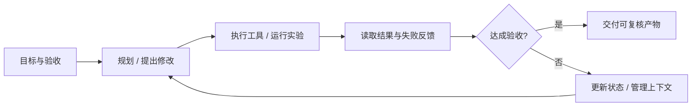
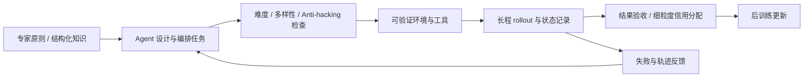
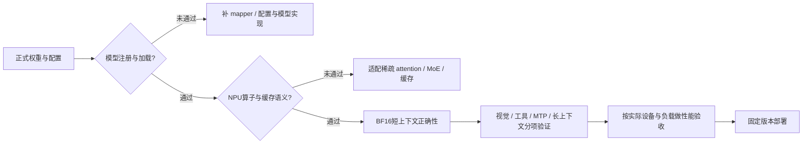

# Step 5 Preview：推理与 Agent 技术竞争力报告

**资料时点：2026-10-12，北京时间。**基于本次系列调研已读取的官方文档、代码、论文及标注来源的报道整理；部分动态页面于本轮复核。未在 NPU 上加载模型、运行 benchmark 或复现训练。

证据分为【官方配置/代码/论文】【官方测试】【独立评测】【非官方报道/博客】【工程解释/建议】。网络证据链接附在相关段落；文件名仅作交付索引。没有公开代码的机制不补造接口或参数，相关项目也不自动等于模型内部生产实现。

## 1. 核心判断与全球评分

**Step 5 的重点是以较低激活计算量承载旗舰级容量，把长上下文、工具反馈和持续执行结合起来，并通过配套 harness 控制长任务成本。**公开证据支持它在部分软件工程、金融研究任务中有竞争力；稀疏注意力与长程 RL 的技术细节主要来自媒体转述，值得具体讨论，但尚缺正式代码与消融来证明各项技术分别贡献了多少收益。

### 1.1 全球评分不错，具体体现在哪里

表注：以下为 **2026-10-12** 读取的 Artificial Analysis（AA）模型页，智能指数版本 **v4.3.2**。指数分不是准确率百分比。费用为 AA 指数任务的加权平均美元成本；速度为公开 API 输出阶段 tokens/s，不是同硬件推理内核测试。不同模型使用各自测试档位、端点和生成行为，不能据此推出所有业务均有同样差距。

| 模型 | AA 智能指数 | AA 单任务成本（USD） | API 输出速度（tokens/s） | 可以说明什么 |
|---|---:|---:|---:|---|
| Step 5 Preview | 44 | 1.03 | 89.2 | 综合能力接近下列两款旗舰，当前 AA 任务成本更低 |
| GLM-5.3 Max | 45 | 2.01 | 66.0 | 分数高 1 分；当前成本约为 Step 的 1.95 倍 |
| Kimi K3 Max | 44 | 2.00 | 40.2 | 公布整数分相同；当前成本约为 Step 的 1.94 倍 |

观测说明：Step 5 本轮重读输出速度为 89.2 tokens/s；GLM/Kimi 保留同日先前观测，非同时压测。API 速度是服务观测值，会变化。

来源：[AA Step 5](https://artificialanalysis.ai/models/step-5)、[AA GLM-5.3](https://artificialanalysis.ai/models/glm-5-3)、[AA Kimi K3](https://artificialanalysis.ai/models/kimi-k3)。

**【独立评测】更准确的表述是“综合智能有竞争力，能力与费用组合较有吸引力”。**Step 页面比较摘要将其置于领先模型之列；当前同价位/类型比较集合的指数中位数为 26。页面摘要显示的 `#40 / 227` 是 AA 按模型类别、价格区间等规则确定的比较集合，不能当作无条件的全球总榜名次。GLM、Kimi 的摘要则使用开放权重大模型集合，其分母不同，摘要名次不能直接拼接。

**【非官方报道】发布时的“全球开源前三”是当时媒体转述的厂商排名说法。**腾讯科技 9 月 20 日报道该说法；截至本次复核，AA 仍将 Step 5 标记为 proprietary，同日已读取的官方页快照写 10 月 15 日开放权重。因此可以说“面向开放权重的旗舰竞争者、发布时宣称进入相关前三”，不能写“当前已开源、全球所有模型第三”。[腾讯科技发布报道](https://news.qq.com/rain/a/20260920A06EUP00)、[官方发布页](https://www.stepfun.com/step-5-preview)

**成本数字需要随时间更新。**发布期报道中的 0.71/0.72 美元不能覆盖当前 AA 的 1.03 美元；不同日期的指数版本、计费规则及样本构成可能变化，本次未核实变化的单一原因。AA 当前还显示 Step 在整套评测产生约 160M 输出 tokens，高于该页比较集合的 82M 中位数。低单价是优势，但长输出会抵消部分收益，最终应比较任务总成本。[AA 当前结果与成本定义](https://artificialanalysis.ai/models/step-5)

### 1.2 哪些任务支撑这种评价

表注：2026-10-12 复核的 **Step 官方发布页**结果，属于厂商公布，不是本次独立复现。Step 为 High，GLM/Kimi 为 Max，计算预算未统一。单位为百分比；差值为百分点。† 为内部基准；StepCodeBench 使用 avg@4，不能解释成四次取最佳；SWE-Marathon 使用 Partial Score，不能解释成完整通过率。

| 与重点相关的基准 | Step 5 | GLM-5.3 | Kimi K3 | 重点解读 |
|---|---:|---:|---:|---|
| ProgramBench | 80.5 | 72.0 | 77.8 | 完整程序实现有优势信号，分别高 8.5 / 2.7 点 |
| SWE-Atlas-QnA | 63.6 | 59.6 | 59.5 | 仓库理解有优势信号，适合定位与改动分析 |
| StepCodeBench† | 49.0 | 40.2 | 43.9 | 多类型工程任务有优势信号，分别高 8.8 / 5.1 点 |
| DeepSWE v1.1 | 67.7 | 66.9 | 67.5 | 与两者接近，不应夸大微小差值 |
| AA-LCR v1.1 | 88.3 | 79.7 | 88.7 | 长上下文推理较强，与 K3 接近 |
| FrontierFinance | 66.4 | 64.1 | 62.6 | 特定金融研究优于这两项对照 |
| SWE-Marathon v1.1 | 72.7 | 67.4 | 84.4 | 长程开发仍低于 K3，不能笼统说长程全面领先 |
| AutomationBench public | 44.0 | 48.2 | 46.7 | 通用业务自动化不是当前优势 |

来源：[官方完整评测与设置](https://www.stepfun.com/step-5-preview)。DeepSWE 使用 SWE-agent、temperature=1.0、top_p=0.95；不能把该项设置默认推广到其余基准。官方金融图还列 DeepSeek V4.1 Flash：FrontierFinance 63.0，低于 Step 的 66.4；LiveSearch 76.7，高于 Step 的 74.5，说明优势有任务边界。尚缺 Step 5 与 Hy4 Preview 的可靠同条件对照。

## 2. 推理竞争力：Sparse GQA 与 MoE 作用在不同计算阶段

Step 5 官方公布 600B 总参数、27B 激活参数；非官方技术报道披露 92 层、Sparse GQA 与 Block-wise Token Merging。GQA 减少 KV heads，稀疏选择减少 query 访问的历史位置，MoE 减少每 token 执行的 FFN 参数路径。三者组合面向大容量、长上下文的计算预算，但权重存储、索引成本和跨机通信仍需承担。模型层次与算子原理详见同包 `03-模型结构与技术特性详解.md`。[官方参数](https://www.stepfun.com/step-5-preview)、[非官方技术报道](https://news.qq.com/rain/a/20260920A06EUP00)

报道中的 **Indexer/Top-k 成本降至 1/8** 是局部指标；缺少硬件、基线和端到端消融，不能写成推理快 8 倍。竞争力应通过长输入 TTFT、decode TPOT、吞吐、显存及任务正确率联合验证。Sparse Attention 并不自动把 KV cache 缩到 top-k 个 token，也不等于应用侧摘要压缩。

## 3. 重点二：长程任务——在反馈、失败和上下文变化中继续推进

### 3.1 长上下文与长程任务不是一件事

**1M 上下文解决单次请求能处理多少信息；长程能力解决多次行动能否保持目标、利用反馈、回退失败方案并最终完成验收。**任务累计使用数百万 tokens，可以由许多次请求组成，不表示模型一次接收数百万 tokens。持续运行数小时也不自动代表每一步正确。

图注：对官方长程案例的概念抽象，不是公开的 Step 5 内部调度源码。模型输出工具调用，宿主执行工具并返回结果，再请求模型；搜索、GPU、串口、文档操作能力由应用提供。涉及压缩时，要保留目标、关键结果和当前失败原因。[官方案例](https://www.stepfun.com/step-5-preview)、[API 工具能力边界](https://platform.stepfun.ai/docs/en/guides/models/step-5-preview)

### 3.2 用具体案例讲，避免只说“自主能力强”

表注：全部为 **官方发布案例**，2026-10-12 复核；本次未复现，不能推出平均成功率、生产 SLA 或各技术的单独贡献。小时为任务运行时长，累计 tokens 与单次上下文窗口区分；TFLOPS 是被优化 kernel 的计算吞吐，不是 Step 5 自身生成速度。

| 案例 | 官方条件与结果 | 值得讲的长程能力 | 适用范围 |
|---|---|---|---|
| MLA GPU Kernel 优化 | 单张 H100；head dim 512、batch 1、64 heads、8192 tokens；24 小时预算，每模型 4 次独立运行取最佳；约 22 小时达到前向+反向合计 508 TFLOPS | 实现→测速→放弃退化版本→从当前更优解继续搜索 | 单一优化任务；最佳值，不是平均值，也不是模型推理吞吐 |
| 自动后训练数据优化 | 24 小时；可访问 API annotator；改进 Qwen3-30B-A3B 的后训练流程；AIME24 从 53.3% 到 60.0% | 根据下游分数调整数据使用与训练方案 | 被提升的是 Qwen，不是 Step 5 自身；报告与 Opus 5 持平且 annotator tokens 更少，未公开完整成本账本 |
| 可编程硬件开发 | 提供开发文档与授权；调用相机、COM、截图与模拟鼠标；连续工作超过 3 小时 | 利用真实设备反馈迭代代码，而非只生成代码文本 | 授权环境中的案例，不等于任意硬件均能自动完成 |
| Pokémon Red | 无游戏专项优化；超过 3000 turns、累计接近 600 万 tokens；第 3082 步获得第三枚徽章，约主线三分之一 | 长期状态、资源和依赖管理，失败后重新规划 | 尚未通关；不能写成完全解决超长任务 |
| 大规模研究 | 1000 个地点、25 年；一次 Agent Action 内 950 次 Web Fetch；11 变量、30 万条月度记录 | 批量检索→数据整理→分析→产物 | 不等于一次 API 请求或平台全局工具并发上限为 950 |

来源：[Step 5 官方长程任务与专业工作案例](https://www.stepfun.com/step-5-preview)。

**StepCodeBench 补上了任务覆盖宽度。**官方称其覆盖 553 个独立仓库、9 类任务、20 个应用领域、33 种语言；9 类包括功能修改、bug 修复、重构、文档、性能调优、代码生成、CI/CD、代码转换和环境配置。它说明训练/评测视野超出“修一个 issue”；但仍是内部基准，不能用覆盖数量替代难度和泄漏控制审计。

### 3.3 长程 RL 的技术支撑：训推一致性、吞吐、信用分配

表注：本表 Step 5 技术细节来自 **腾讯科技 2026-09-20 对团队说明的转述【非官方报道】**，2026-10-12 复核。数值属于团队自述，缺少可复现的完整配置与消融；右列为工程解释。未将这些指标解释成线上推理 SLA。

| 技术或披露指标 | 要解决的问题 | 与长程推理的联系 |
|---|---|---|
| 确定性算子、树状归约；严格 on-policy 阶段 bit-wise 训推对齐，额外端到端开销低于 10% | 不同算子、并行度的浮点差异影响 MoE 路由与概率 | 降低同一输入在训练侧和采样侧的数值分叉；不是对任意硬件/量化组合的保证 |
| 异步阶段复用推理状态，logprob 偏差控制在 1e-2 内 | 异步路径下采样状态与重新计算状态可能不一致 | 减少训练信号偏差；报道未明确完整聚合口径，不能写成每 token 概率误差必低于某百分比 |
| 负载感知调度、跨机 EP | 长任务请求长度不一，专家/rank 热点产生拖尾 | 应同时控制请求积压与 rank 执行瓶颈；具体是否使用动态 EPLB/专家副本未核实 |
| MTP-3 投机解码、FP8 MoE、FP8 KV 量化感知训练、KV Cache 卸载；整体长程 RL 超过 3× 加速 | rollout 解码慢、长 KV 占存储、通信与内存压力 | 提高训练采样可承受规模；联合收益不是每项各自 3×，不是 API 时延直接除以 3 |
| 全生命周期样本账本；样本丢失率低于 1% | 长任务重试、状态转换、消费过程容易丢样本 | 改善采样→存储→训练消费的可追踪性；不等于失败任务少于 1% |
| 上下文管理纳入 RL；预训练 Critic 做 token 级信用分配；格式/奖励投机按 turn 单独处罚 | 长轨迹奖励稀疏，一次局部错误可能污染整段反馈 | 让模型学习何时保留/压缩历史，并把局部失败更准确地定位到行动 |

来源：[腾讯科技完整技术报道](https://news.qq.com/rain/a/20260920A06EUP00)。这些是“团队经媒体披露的 Step 5 技术”，不再仅用 StepTronOSS 接口顺序代替 Step 5 说明。

**【工程解释】MoE 的数值一致性为什么对 RL 敏感？**训练常使用采样策略与当前策略的概率比。当微小差异把 router 的临界 top-k 专家换掉，后续输出和 logprob 就可能分叉；较深网络和多轮调用会放大排查困难。对齐的目标是让训练学习到采样时真实发生的行为。树状归约等措施处理数值路径问题，**不会自动消除参数版本过时、任务分布变化或环境非确定性**。

**【工程解释】信用分配为什么不能只给最后一个分数？**任务最后失败，可能来自早期错误检索、某轮格式错误，也可能来自正确行动后的环境故障。token 级 Critic 与 turn 级局部惩罚对应不同时间尺度，有助于减少把整条长轨迹一概判负的问题。报道没有公开 critic 结构、优势估计和 RL loss，本文不把 MIS-PO、PPO 或 GRPO 指定为 Step 5 已采用配方。

### 3.4 EP 负载均衡怎样减少时延

**【非官方报道】Step 5 披露的是“负载感知调度 + 跨机专家并行”；没有可靠证据表明线上具体采用了某版动态 EPLB。**EP 只是把专家分布在多个设备，本身不会保证负载均衡。

**【工程解释】概念调用链：**`router 选择逻辑专家 → dispatch token 到专家所在 rank → rank 执行 FFN → combine 返回 → 继续下一层`。在不考虑重叠的简化模型中：

`T_MoE ≈ T_dispatch + max_r(T_expert_compute,r) + T_combine`

最忙 rank 决定计算阶段何时结束，因此把热点专家访问或执行负担分散，可以减少其他 rank 等待。不过均衡收益可能被额外通信、权重搬移或复制成本抵消。Step 5 图示只表达这个机制，不虚构其生产部署策略。

可借鉴的服务端方法是逻辑专家不变、物理放置可调整：热点专家增加等价副本或重排映射，并用观测负载更新布局。vLLM 的 `EplbState.step()`、`rearrange()` 和 `physical_to_logical_map` 是公开代码参考，**不是 Step 5 已使用的证据**。[vLLM EP/EPLB 文档](https://docs.vllm.ai/en/latest/serving/expert_parallel_deployment/)、[EPLB 接口](https://docs.vllm.ai/en/latest/api/vllm/distributed/eplb/eplb_state/)

验收应同时看 expert/rank 分配偏斜、跨机通信、每层耗时与请求 p95/p99。教学示意中最忙 rank 从 64 份分配降到 32 份，不足以推导整请求时延降低 50%。负载感知 rollout 调度与专家物理均衡也不是同一个层级的机制。

### 3.5 训练任务与数据闭环：长程能力需要什么环境

**【非官方报道】团队披露了模型参与下一轮数据生产：专家定原则与关键判断，确定性操作封装为工具，Agent 负责跨步骤编排；通过统一上下文、结构化知识和显式信号控制任务难度/多样性，并嵌入 Anti-hacking 审计，形成百万级可验证高难任务。**领域覆盖科学推理、软件工程、机器学习研发与专业工作。该规模为团队自述，不是已公开可下载的数据集。[腾讯科技数据体系说明](https://news.qq.com/rain/a/20260920A06EUP00)、[新智元技术报道](https://zhuanlan.zhihu.com/p/2085010148913845420)

**【工程解释】最值得借鉴的是把“任务生成”和“任务验收”分开。**Agent 可以提出任务、寻找失败点和生成轨迹，但完成信号需要由测试、计算、来源检查或专家准则验证。否则更强的模型可能学会满足评分器的表面规则，任务也可能不断趋同。轨迹、工具返回、失败原因和验收结果应一起保存，才能定位是策略、工具、环境还是评分器的问题。

图注：根据非官方报道抽象的训练数据闭环；任务生成、验收与 RL 更新的具体实现未公开。不是模型在每次在线业务会话中实时修改自身权重，也不表示所有数据完全无人审核。

系统组件也应按瓶颈理解：**MTP-3**减少逐 token 解码的串行轮次，实际收益取决于候选接受率与验证开销；**FP8 MoE/KV**减少权重或缓存的数据量，但必须检查路由、概率和任务质量；**KV 卸载**用带宽换更可承受的显存占用，并非天然降低每请求时延。这些是通用工程解释，Step 5 的候选验证、精度策略和卸载调度代码尚未核实。

## 4. Agent 竞争力：模型与 Step-Code 配合

Step 5 的工具决策和长程任务能力，需要宿主提供执行、上下文管理、预算及验收。官方在同一 Step 5 接入六个 Agent 的 Multi-Frame BMK 中报告 Step-Code 完成率 73.3%、每任务累计 5.09M tokens；这是官方框架对比信号，缺少完整公开配置与统计区间，不代表任意任务或昇腾平台均可复现。[官方测试](https://platform.stepfun.ai/step-code)

Step-Code 的 CLM 工作上下文、压缩完整性、子会话结果裁剪、Goal 生命周期、Skills/Plugin/MCP 及 MindSpeed-Agent 借鉴，单独写入 `04-StepCode机制优势与MindSpeedAgent借鉴.md`。这些属于 harness 贡献，不能全部归为模型参数或 RL 的收益。

## 5. 加入有质疑的博客：哪些问题必须保留

这些来源用于补充不同观察角度，**均为非官方分析，不替代官方规格或独立复现**。重复报道不视作多份独立技术验证。

1. **“低价格是否等于低任务成本？”**NewUJ 讨论 Step 5 输出冗长可能抵消低单价，且声明编辑流程使用 Claude 模型；其中历史成本数字按发布期看待。AA 当前 160M 输出与 1.03 美元单任务成本提供了可核查的补充。对业务应核对总输入/输出、缓存、工具费、运行时长与返工，而非只比较 $/M。[NewUJ 成本分析](https://newuj.com/en/n/stepfun-s-600b-step-5-scores-44-at-1-per-million-tokens-4cb2f7e4)
2. **“第三方权重和量化版本真能代表 API 吗？”**ai.rs 追踪镜像来源并质疑模型卡中的许可、缺失实现和 sparse indexer 被 dense fallback 替代；作者同时指出尚无镜像与官方 API 的完整对照。这是作者审计判断，本文未下载大权重复验；不采纳其绝对化的“家用无法运行”结论，而保留“能生成不等于实现等价”的技术提醒。[ai.rs 镜像与实现审计](https://ai.rs/ai-for-business/step-5-preview-weights-leak-hugging-face)
3. **“92 层配置、稀疏预算和 MTP 字段来自哪里？”**Muhammad Ahmed 的发布日博客读取当时公开配置，同时注意到开放状态和缺少正式说明的矛盾。该文是历史观察，不能据此把撤回/镜像配置当成当前稳定官方接口。可在备查中介绍，主图不采用未经正式核实的 352 experts、top-k=512 等数字。[发布日配置观察](https://muhammad-ahmed.com/blog/ai-brief-a-terabyte-of-proprietary-weights/)
4. **“8×、3×到底在哪一段？”**腾讯科技技术报道本身也提醒稀疏收益可能被索引和访存抵消。8×为 Indexer/Top-k 局部成本，超过 3×为联合系统优化后的长程 RL；都不是模型通用 API 端到端提速。本版图示将单位和范围写清。
5. **“长程能跑多久，是否就能做多好？”**官方 Pokémon 尚只完成约三分之一；Kernel 取 4 次最佳；SWE-Marathon 低于 K3。它们分别证明阶段进展、搜索上限和具体任务得分，不应合并成“所有长程任务领先”。

**对技术报道的采信方式：**92 层、Sparse GQA、块合并、bit-wise/异步 logprob、长程 RL 系统组合可作为明确标注的团队披露转述；正式 kernel、精确专家数、gate、attention 布局和 RL loss 仍需官方配置/代码。博客指出的镜像疑点用于解释证据限制，不意味着否定已可核查的 API、评分和业务案例。

## 6. 业务落地与借鉴重点

表注：下列是**工程建议**，不是 Step 官方已实现的收益或本次实测；“验收”指建议的可复核结果。三个技术主线的组合应按任务需要采用，而非统一增加所有组件。

| 场景 | 为什么对应这三个重点 | 最值得借鉴的组织方式 | 建议验收 |
|---|---|---|---|
| 仓库修改、重构与测试 | 大量代码/日志需要长上下文；任务跨文件、多轮失败修复 | 子会话按模块拆分；工作上下文控制旧日志；测试结果驱动继续 | 回归通过、修改范围、总成本与人工返工 |
| GPU Kernel / 数据训练实验 | 需要连续探索、测量和放弃退化方案 | 保留最佳版本、记录每次参数/结果、失败后恢复到明确基线 | 同硬件正确性、吞吐分布、最佳/平均结果分别报告 |
| 金融研究与数据勾稽 | 资料长且来源矛盾，需要工具计算与跨文件追溯 | 检索 skill + 口径/时点校验 + 可复算表格 + 引用验收 | 事实来源、公式、假设敏感性与证据不足标注 |
| 静态页面/交互式 Demo | 需要代码、浏览器反馈与最终分享产物 | 修改→预览→修复→验收→StepPage 版本发布/回滚 | 页面可访问、关键交互通过、版本可恢复 |

对其他模型最值得借鉴的点，不是笼统声称独有架构：**将长 prefill 的计算、训推一致性、长轨迹奖励和 harness 上下文作为一个连续问题优化。**现有证据不足以给 DeepSeek V4/V4.1、GLM-5.3、Kimi K3、Hy4 Preview 建立统一总体胜负；可以比较已给出的任务成绩，也可以把 Step 的系统方法作为设计与复验线索。

## 7. Step 5 Preview：目前不能把 vLLM-Ascend 当作现成部署配方

### 7.1 当前证据与判断

**第一道依赖是可用且身份明确的权重、配置和实现。**按本调研于 2026-10-12 已成功读取的官方发布页快照，权重计划于 2026-10-15 开放；本轮刷新超时，未取得该计划发生变化的证据，部署前需再核对正式发布状态。不将第三方镜像视为最终正式版本。官方 API 可用，仅证明接入 Step 服务，不证明这个模型在用户的 NPU 上执行。[官方发布页](https://www.stepfun.com/step-5-preview)

本次检查的上游 vLLM registry 有 `Step3p5ForCausalLM`、`Step3p7ForConditionalGeneration` 与 `Step3p5MTP`，没有找到 Step 5 专用注册名；同时检查完整、未截断的 vLLM/vLLM-Ascend 仓库树，未发现 Step 5 命名的模型或后端实现。**这是有范围的负证据：无法确认公开主线开箱支持；不排除另外的私有实现、运行时插件或后续合入。**也不能把给架构换别名、加 `--trust-remote-code` 解释成后端已经具备所有稀疏算子。[固定 core registry](https://github.com/vllm-project/vllm/blob/03091e28b8ba956634c153beab0e52decafdef31/vllm/model_executor/models/registry.py)、[vLLM-Ascend 仓库](https://github.com/vllm-project/vllm-ascend)

### 7.2 除通用环境外，还依赖哪些模型能力

表注：本表是**Step 5 昇腾适配所需的工程检查项**，不是已实现特性清单。92 层、Sparse GQA、块合并、MTP-3 等具体技术来自媒体转述；正式 kernel、cache 布局与权重映射必须在正式发布后核对，不以旧代配置替代。[技术报道](https://news.qq.com/rain/a/20260920A06EUP00)

| 依赖层 | 需要具备什么 | 不能省略的验证 |
|---|---|---|
| 模型识别与权重加载 | 正确的 config、architecture、tokenizer/模板、权重 mapper | 权重键/shape/层枚举一致；不遗漏 projector、shared experts、MTP/indexer 权重 |
| Sparse GQA / Indexer | NPU 索引评分、Top-k、块合并/选择、gather、稀疏 attention | 候选位置、因果关系、边界与输出对齐；不能悄悄改成 dense fallback 后仍称等价实现 |
| KV / 索引缓存 | 与模型真实布局一致的 KV 和 index cache、分页及 prefix 生命周期 | 跨请求/跨轮复用正确；块边界、长位置、缓存命中与权重重载后的失效规则 |
| MoE / EP | 真实专家数、top-k、shared expert、路由概率/bias、激活函数 | 每层路由与权重混合语义；dispatch/combine、跨机通信、热点与尾延迟 |
| 视觉与视频 | processor、vision encoder/projector、视频采帧与输入接口 | 文本跑通后分别测试图片和视频；共享语言路径不证明多模态路径通过 |
| MTP / 量化 | 精确 MTP 验证/拒绝采样与 KV 更新，匹配的 NPU 量化格式 | BF16 基线先行，再比较候选接受、输出质量、logprob 与量化敏感性 |
| API / Agent 协议 | reasoning/tool parser、流式 tool_calls、JSON 结构化输出 | 工具参数可执行，多轮工具结果拼接正确，停止/取消与错误返回可处理 |

**已有其他模型的稀疏算子不等于 Step 5 可直接调用。**例如 DeepSeek 的 SFA/LightningIndexer 与 Step 的 Sparse GQA 可能在 head 维度、压缩、评分、Top-k 粒度、KV layout 和调度上不同。能借用的是算子能力和工程模式；是否能直接复用需逐项对照。相同的“稀疏注意力”名称不是接口兼容证据。

### 7.3 直接部署的判定流程

图注：建议的适配与验收流程，**不是 Step 5 已通过的部署链**。任何前置项未通过，后续只可作适配研究，不能给用户承诺“pip 安装后直接运行”。

完整环境版本与跨模型适配条件见同包 `05-昇腾适配状态依赖与验证边界.md`；本报告没有确认 Step 5 主线开箱部署。
