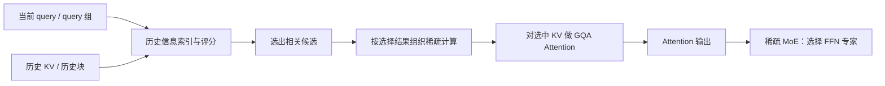
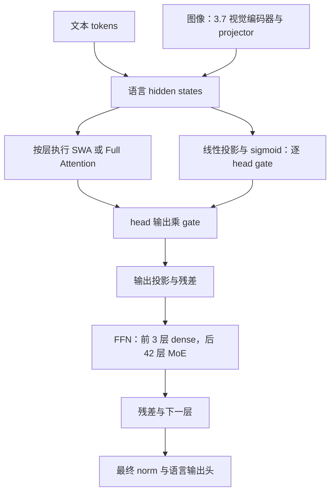
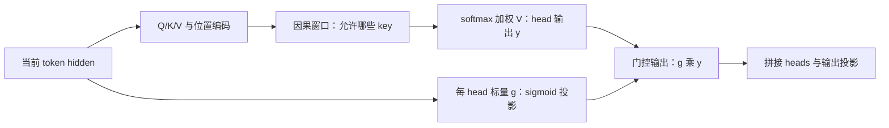
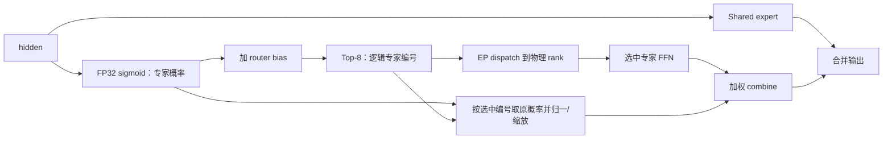
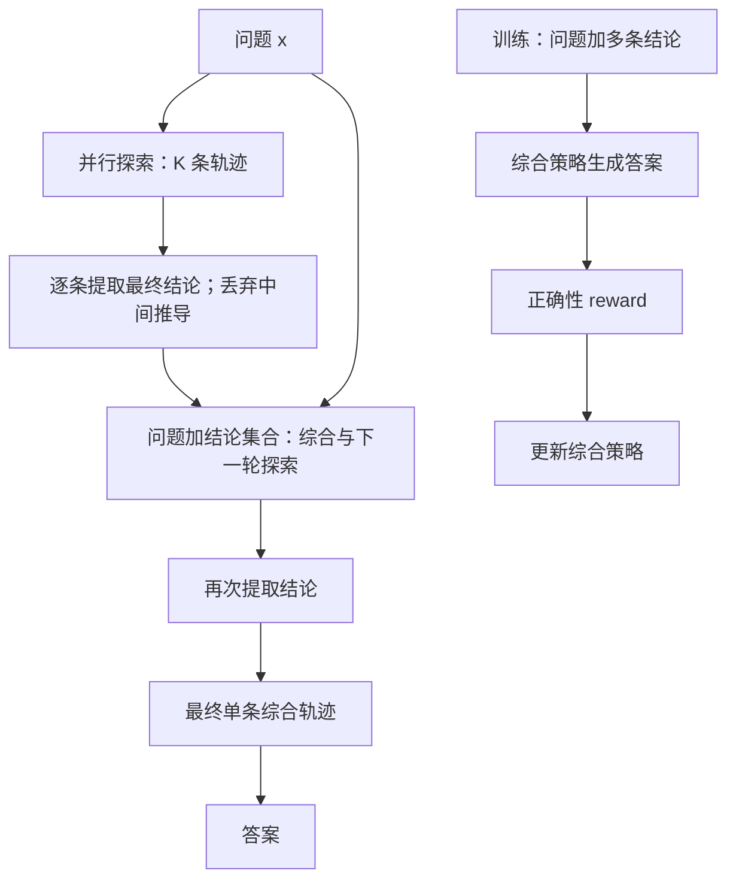

# Step 系列模型结构与技术特性详解

**资料时点：2026-10-12，北京时间。** 基于本次系列调研已读取的官方文档、代码、论文及标注来源的报道整理；部分动态页面于本轮复核。未在 NPU 上加载模型、运行 benchmark 或复现训练。

证据分为【官方配置/代码/论文】【官方测试】【独立评测】【非官方报道/博客】【工程解释/建议】。网络证据链接附在相关段落；文件名仅作交付索引。没有公开代码的机制不补造接口或参数，相关项目也不自动等于模型内部生产实现。

## 1. 模型结构与参数变化：公开参数、结构含义与未公开字段

表注：B 为十亿参数，M/K 为端点官方标记的 token 数量级，未擅自换算为统一整数。3.5/3.7 的主干与含视觉/MTP 口径不同；激活比例只是公布参数的比值，不是实际 FLOPs、显存占比或端到端提速。媒体字段与官方字段分开标识。

| 项目 | Step 3.5 / 3.7 简要背景 | Step 5 Preview 重点 |
|---|---|---|
| 参数 | 3.5 语言主干 196B / 11B；3.7 标称约 198B，加入约 1.8B 视觉编码器 | 【官方】600B 总参数 / 27B 激活，公布比值约 4.5% |
| 深度 | 开源主干 45 层 | 【非官方报道】92 层 Narrow but Deep，约为 45 层的 2.04 倍；hidden size 未按官方核实 |
| Attention | 开源混合 SWA + Full Attention | 【非官方报道】Sparse GQA + Block-wise Token Merging；具体层比例、heads、选择预算未按官方核实 |
| MoE | 开源配置有明确 routed experts 与 top-k | 【官方】稀疏 MoE；Step 5 精确专家数/top-k 本文不沿用旧代字段 |
| 上下文 / 输入输出 | 官方模型页 256K；各服务端点的独立上限见附录 A | 【官方 API】1M 上下文、最大输入 1M、最大输出 64K；输入与生成仍共享上下文预算 |
| 模态 | 3.5 文本，3.7 增加视觉 | 【官方 API】文本、图像、视频输入；文本输出 |
| 运行与开放状态 | 已有开放权重、配置或实现 | 【官方】API 预览可用，同日发布页快照计划 2026-10-15 开放权重 |

来源：[Step 5 发布页](https://www.stepfun.com/step-5-preview)、[Step 5 API](https://platform.stepfun.ai/docs/en/guides/models/step-5-preview)、[腾讯科技架构转述](https://news.qq.com/rain/a/20260920A06EUP00)、[3.5 技术报告](https://arxiv.org/html/2602.10604v2)、[3.7 配置](https://huggingface.co/stepfun-ai/Step-3.7-Flash/blob/main/config.json)。

**【工程解释】“窄而深”主要解释信息传播与容量配置，不能简单解释为更快。** 长工具结果、跨文件依赖和多跳分析，要求信息经多层变换逐渐组合；更深的堆叠提供更多组合步骤。代价是 decode 的串行层数、同步和稳定训练压力增加。“92 层为长 prefill 提供更长路径”是团队经媒体转述的设计动机，不是已证明层数翻倍就把 Agent 成功率翻倍。

从 3.5 到 Step 5，公布总参数约增至 3.06 倍、激活参数约增至 2.45 倍，API 上下文标称从 256K 到 1M。 **叙述重点应从旧代结构细节转向“容量扩大，同时用 attention 与 MoE 的双重稀疏控制有效计算”。** 600B 权重若全按 BF16 存储约 1.2 TB（十进制），尚不含 KV、激活和通信；27B 激活不会免除其他专家权重的存储。

### 1.1 Step 5 的结构应如何逐层理解

【官方与报道分层】可确认的是 MoE 参数规模与服务能力；92 层和 Sparse GQA 来自技术转述。下面按 Transformer 通用执行顺序解释模块作用，不声称还原了未公开的 norm 顺序、残差安排、全部视觉路径或层间布局。

1. **输入表示与位置。** 文本由 tokenizer 转为 token 表示；图像/视频还需 processor 与视觉表示进入语言路径。Step 5 API 支持这些输入，不足以确认其视觉编码器层数、projector 和采帧策略。
2. **Attention 路径。** 当前 hidden 产生查询及键值表示；GQA 让一组 query heads 共享 KV heads，稀疏选择进一步缩小历史访问集合。Indexer 的投影维度、评分公式、选择粒度、保留的局部/全局分支尚未核实。
3. **输出与跨层传播。** attention 聚合历史信息后，经输出变换和残差流向后续网络。更深网络增加逐层信息组合机会，也增加串行层执行、通信同步和数值对齐压力；不能由深度直接推导低时延。
4. **MoE FFN 路径。** router 为 token 选择少数专家，计算后加权合并。600B/27B 描述总量与激活量，不能反推出精确专家数、top-k 或共享专家结构；旧代 288/top-8 不可移植为 Step 5 参数。
5. **输出与加速分支。** 语言输出头生成 token 分布；MTP-3、FP8 MoE/KV 等是媒体披露的系统组合。MTP 的候选验证和量化缓存布局需要实际实现证明，不能画成三层普通 Transformer 主干。

Step 5 的竞争方向是扩大模型容量，同时控制历史访问和 FFN 激活计算；部署代价则是总权重容量、索引算子效率、EP 通信与长 KV 管理。hidden size、Q/KV heads、head dim、具体专家数、稀疏预算、gate 与混合层比例均保持未核实，不用镜像配置补齐。[官方模型能力](https://platform.stepfun.ai/docs/en/guides/models/step-5-preview)、[架构技术转述](https://news.qq.com/rain/a/20260920A06EUP00)

## 2. 重点一：Sparse Attention——从少算，到真正让 GPU 少做无效工作

### 2.1 Sparse GQA 在解决什么

**【非官方报道】腾讯科技、新智元对团队的技术转述指出：Step 5 使用 Sparse GQA，通过索引选择相关历史信息；Block-wise Token Merging 降低索引/Top-k 成本并减少相邻选择的碎片化。** 这些是本版纳入的 Step 5 技术说明，不再用“尚未知”一笔带过，但保留非官方来源标识。[腾讯科技](https://news.qq.com/rain/a/20260920A06EUP00)、[新智元技术解读](https://zhuanlan.zhihu.com/p/2085010148913845420)

**【工程解释】需要区分三个位置的节省：**

- **GQA：共享 KV。** 多组 query heads 共用较少的 KV heads，降低 KV 表示的存储和读取量；本身不等于只看少数历史 token。
- **Sparse Attention：选择历史位置。** 先用索引/选择机制决定当前 query 需要哪些历史 KV，再对候选位置计算 attention。它能保留远距离信息访问，不应直接画成“只看最近 512”的 SWA 窗口。
- **MoE：选择 FFN 专家。** 它控制后续 FFN 走哪些参数，与 attention 选择哪些历史位置是两个不同的稀疏维度。

对于长程 Agent，历史中既有目标、约束、代码，又有大量搜索片段、日志和失败尝试。关注相关历史的意义是**减少反复读取整段历史的计算，同时保持访问较远证据的路径**。这与把整个对话压缩成摘要不同：attention 稀疏发生在模型层内；上下文压缩改变发送给模型的工作历史。

### 2.2 概念数据流与复杂度



图注：面向 Step 5 的**概念流程**。Sparse GQA 与块合并来自非官方报道；实际融合顺序、Indexer 结构、块大小与 kernel 边界未公开核实。图中没有采用 3.5/3.7 的窗口、head 或专家数，也不表示远距离位置选择完全准确。[技术报道](https://news.qq.com/rain/a/20260920A06EUP00)

**【工程解释】** 完整 causal attention 的 prefill 核心计算约 O(N²d)，单步 decode 约 O(Nd)；若每个 query 只访问 k 个历史位置，选中部分约 O(Nkd)/O(kd)。这里 N 是历史长度，k 是候选数量，d 是 head 维度，忽略常数、heads 与其余网络。 **总成本还必须加 Indexer、Top-k、gather、访存和调度；不能只用 k/N 估算整体加速。** 索引可能仍扫描压缩后的整段历史，稀疏 attention 也不自动等于 KV 只需存 k 个 token。

### 2.3 Block-wise Token Merging 为什么值得突出

**【非官方报道，团队自述】Indexer 与 Top-k Selection 成本降至原来的 1/8；相邻 token 高度重叠的 Top-k 结果被合并，减少计算碎片。** 这个 8×对应局部索引/选择环节，未给出完整硬件、基线及端到端消融，不能写成“Step 5 推理速度提升 8 倍”。[腾讯科技](https://news.qq.com/rain/a/20260920A06EUP00)、[Pandaily 转述](https://pandaily.com/stepfun-step-5-preview-600b-moe-1m-context/)

**【工程解释】可借鉴的是把邻近 query 的共性转化为可执行的数据布局。** 逐 token 独立选历史，可能产生很多细碎、重复的 gather，算子启动和内存搬运吞掉理论节省。块级算法若支持共享选择，可能摊薄选择成本；执行层若支持共同调度，可能复用重叠候选的数据访问；具体是否采取并集、共享索引或其他压缩，仍需正式实现确认。

一个局部收益如何传到整体的示意：假设索引/选择占原 attention 路径耗时 40%，其余 60% 不变，把前者降到 1/8 后，总时间为 `0.4/8 + 0.6 = 0.65`，约 **1.54×** 加速，而非 8×。 **这只是 Amdahl 定律教学假设，不是 Step 5 实测。** 如果额外搬运增大，整体收益还会更低。

### 2.4 推理侧最值得借鉴的验证方式

固定模型与输入集，分别测长 prefill 的 TTFT、decode 的每 token 时延、索引/选择占比、KV gather 带宽、GPU 利用率，以及多跳任务质量。输入长度应覆盖短、中、长多个区间，工具结果也要包含日志、重复片段与远距离证据；仅用随机文本吞吐不能证明 Agent 效果。

**结论：Sparse GQA 的主要亮点是“历史位置选择 + GPU 可执行的块级组织”，而不是单纯稀疏率。** Step 5 的官方 attention 代码尚未核实，本文不提供伪装为真实接口的 `step5_indexer()` 或未经证实的 top-k 数值。SWA/Gated SWA 可保留为背景机制图，但不应占 Step 5 主图，也不能据此断言 Step 5 使用旧代同款 gate。

## 3. Prefill、Indexer 与 K/V 复用：原理说明

【工程解释】每层先由输入 hidden states 投影生成 Q/K/V，再计算 attention。生成全部输入 token 的 K/V，并不意味着 attention 已经完成。Indexer 用于选择 query 关注的历史位置，通常不决定哪些输入 token 才生成 K/V；未来 query 可能仍需要当前未选中的位置。Indexer 可以使用专门的低维投影/索引表示，不能假定它直接扫描完整主 attention K 张量。

```text
本层输入 X → Q=XWq，K=XWk，V=XWv
          → 索引评分与 Top-k 选择（实际依赖由模型定义）
          → 对选中位置计算 softmax(QKᵀ/√d + mask)V
          → attention 输出投影、残差与后续 FFN
```

Prefill 同时拿到本次输入中多个位置的 query，例如 q4、q5、q6；它们分别只能访问因果允许的位置。若 q4、q5 都选中历史位置 {1,3}，融合算子可把 K{1,3}/V{1,3} 加载到片上后供两个 query 使用。各自的点积、softmax 和输出仍独立；未被某 query 选中的位置必须屏蔽。收益来自减少重复 HBM 读取与零散访问，K/V 投影原本就不需要为每个 query 重算。

普通自回归 decode 每个请求每轮通常只有一个新 query，不具备同一请求内一组相邻 query 同时可用的条件；chunked prefill 的块内、推测解码的多 token 验证阶段则可能具备。跨请求 batch 通常对应不同 K/V，不能只因请求同时运行就当作共享历史。

历史块 H1 是教学抽象，可以代表多个历史 token 的 K/V；它不等于已确认的 Step 5 索引单位、KV cache page 或压缩向量。候选块、物理缓存页与 kernel tile 是不同概念。只有调度与数据布局实现片上复用，索引列表去重才可能转化为搬运节省。若每个 query 仍独立启动 kernel，不能保证获得该收益。

**K/V 搬运复用与 Indexer/Top-k 计算复用分别判断。** 选择结果重叠不代表评分相同；Top-k 算完再去重，不能减少已经发生的评分成本。共享候选或合并查询需要模型/算法明确支持。这里解释通用原理，不据此断言 Step 5 的 1/8 指标只发生在 prefill，也不将其归因为某个已公开 kernel。[IO-aware attention 的公开实现参考](https://github.com/Dao-AILab/flash-attention)、[FlashAttention 论文](https://arxiv.org/abs/2205.14135)


## 4. Step 3.5 / 3.7：参数、结构与代际差异

表注：B 为十亿参数；主干层数与 MTP 分开。3.5 的 196B/11B 为论文语言主干口径，含 MTP 另列 198B/13B；3.7 标称约 198B 由 196B 语言主干加约 1.8B 视觉构成，不能混同两个 198B 口径。API 独立上限受服务端点约束，详见本文附录 A。

| 项目 | Step 3.5 Flash | Step 3.7 Flash |
| --- | --- | --- |
| 总参数 / 激活参数 | 主干 196B / 11B | 标称约 198B / 约 11B；196B 语言主干 + 1.8B 视觉编码器 |
| 主干层数 / hidden size | 45 / 4096 | 45 / 4096 |
| 主干 FFN 布局 | 3 dense + 42 MoE | 3 dense + 42 MoE |
| 注意力布局 | 33 SWA + 12 Full，S3F1 混合 | 同左 |
| SWA window | 512 | 512 |
| Query heads / KV heads | Full 64、SWA 96；KV 8；head dim 128 | 同左 |
| 门控 | head-wise attention output gate | 同左，代码可核实 |
| 每层 routed / shared experts | 288 / 1；每 token routed top-8 | 同左 |
| Expert intermediate size | 1280 | 1280 |
| MTP | 3 个预测层 | 3 个预测层 |
| 上下文窗口 | 开源配置与官方 API 模型页均为 256K | 开源配置与官方 API 模型页均为 256K |
| API 最大输入 | Step 直连未给独立数值；受 256K 总上下文约束，见附录 A | 百炼列 262,144；OpenRouter 端点未给独立值，见附录 A |
| API 最大输出 | OpenRouter/SiliconFlow：65,536；Step 直连未给独立硬上限 | 百炼：262,144；OpenRouter/StepFun：230,400；Novita：256,000 |
| 模态 | 文本 | 文本与视觉；47 层视觉编码器 + projector |
| 可用形态 | 开放权重与技术报告 | 开放权重、量化版本与部署说明 |

来源：[3.5 论文架构与附录](https://arxiv.org/html/2602.10604v2)、[3.7 配置](https://huggingface.co/stepfun-ai/Step-3.7-Flash/blob/main/config.json)、[3.7 官方说明](https://github.com/stepfun-ai/Step-3.7-Flash)。3.5→3.7 可复用语言主干分析，但视觉编码、图像 token 与任务差异会改变计算和上下文开销；参数接近不意味着端到端耗时相同。

## 5. Step 3.5 / 3.7：推理架构与技术原理

### 5.1 模型内部计算：Attention 与 MoE 分工



图注：Step 3.5/3.7 主干的概念流程；省略部分 norm、位置编码和缓存细节；视觉分支仅对应 3.7。不是 Step 5 已公开系统图。[模型实现](https://huggingface.co/stepfun-ai/Step-3.7-Flash/blob/main/modeling_step3p7.py)

### 5.2 SWA 与 Gated SWA

SWA（滑动窗口注意力）限制每个 query 的直接可见范围。以窗口含当前 token 的教学约定为例，第 12 个 token、窗口 4，只看 9–12；Full causal attention 看 1–12。SWA 的 attention 主计算由 prefill 约 O(N²) 降至 O(Nw)，decode 每个 query 读取约 w 个 KV，而不是 N 个。该复杂度不包括整个模型的 FFN、投影与通信。

Step 3.5/3.7 用局部与全局层混合：**33 SWA + 12 Full，window=512**。Full 层保留直接全局路径，多层 hidden 也传递上下文信息，因此不能说“整个模型只记住 512 tokens”。只有窗口内核和缓存管理真正生效，SWA 层才可获得相应内存收益；Full 层 KV 仍随序列增长。[论文 §2.2](https://arxiv.org/html/2602.10604v2)



图注：Gated SWA 的门控在 attention 输出侧。**窗口控制看哪里，gate 控制每个 head 的结果注入多少**；gate 不扩大窗口，也不自动跳过已完成的 attention 计算。Step 的逐 head 输出门控也用于混合布局中的 Full attention。

代码证据是 `g_proj(hidden_states)` 产生 head 数量的 gate，再以 `gate_states.unsqueeze(-1).sigmoid()` 乘 head 输出，最后 `o_proj`。一个 head 的所有 head_dim 分量共享该标量。门控有助于抑制当前窗口无用信息，但不能由此宣称全模型任意任务提分或推理自动加速。[官方 attention 代码](https://huggingface.co/stepfun-ai/Step-3.7-Flash/blob/main/modeling_step3p7.py#L686)

### 5.3 稀疏 MoE 与 EP 负载平衡

MoE 专家是 FFN 子网络。Step 3.5/3.7 每个 MoE 层从 **288 个 routed experts 选 8 个，另加 1 个 shared expert**；每 token、每层重新路由。8/288 只是专家数量比例，不是整个模型的激活参数比例。



图注：路由语义依据官方模型代码；跨 rank dispatch/combine 是 EP 的分布式执行流程，不表示该 Transformers 参考实现本身完成了高性能分布式通信。

官方关键代码节选：

```python
gate_prob = torch.sigmoid(gating_output.float())
gate_prob_with_bias = gate_prob + self.router_bias.unsqueeze(0)
_, indices = torch.topk(gate_prob_with_bias, k=topk, dim=1)
topk_prob = torch.gather(gate_prob, 1, indices)
```

接口含义：bias 影响专家选择；混合系数来自未加 bias 的概率，后续还会归一/缩放。推理后端应保持这一语义，不能直接用普通 softmax top-k 替换。[路由实现](https://huggingface.co/stepfun-ai/Step-3.7-Flash/blob/main/modeling_step3p7.py#L537)

**EP 不均的两级训练方案：** Step 3.5 用 loss-free bias 调整平衡全局专家调用；再加 EP-group 辅助损失，约束 micro-batch 的 rank 负载。全局专家均衡不保证当前 batch 各卡均衡。论文给出 `L_EP = G × Σ_g f_g p_g`，其中 f_g 为实际 token–expert 分配份额，p_g 为该 rank 上专家平均路由概率之和，G 为 rank/group 数；预训练系数 0.001。这是软约束，非每步强制平均，也不是可直接照搬到 rollout 的运行参数。[论文 §2.2、§4.2](https://arxiv.org/html/2602.10604v2)

服务侧可另用 EPLB 重排专家、复制热点专家并将请求分到等价副本，改变物理映射而保持逻辑专家选择。代价是显存、迁移与调度开销；支持情况需按模型/后端确认。RL 中若临时改路由 bias 或 top-k，会改变策略概率；专家副本还必须同步权重版本。[vLLM EPLB](https://docs.vllm.ai/en/latest/serving/expert_parallel_deployment/)、[vLLM-Ascend EPLB](https://github.com/vllm-project/vllm-ascend/blob/main/docs/source/user_guide/feature_guide/expert_parallelism_load_balancer.md)

### 5.4 MTP：减少串行解码，收益依赖负载

MTP 的执行流程为 **生成候选 tokens → target 模型验证 → 接受前缀进入 cache → 拒绝处按后端规则处理**。接受率、并发与额外计算决定净收益；用于 RL 时，不能把 draft 概率冒充 target 策略概率。

表注：Step 3.7 官方实验；GB200、TP4、NVFP4，约 250 输入 tokens/1.6K 输出 tokens，decode-heavy 负载；单位为总输出 tok/s，非单请求速度，也非完整 RL 吞吐。

| 并发 | 开 MTP | 关 MTP | 相对吞吐 |
|---:|---:|---:|---:|
| 8 | 1309 | 1155 | 1.13 倍 |
| 32 | 4391 | 3480 | 1.26 倍 |
| 64 | 8229 | 5667 | 1.45 倍 |

来源：[官方 MTP 部署与实验](https://github.com/stepfun-ai/Step-3.7-Flash)。同页 GPQA avg@16 点估计为开 MTP 77.81、关闭 78.41；缺少不确定性时不宣称严格无损，也不外推到昇腾、长 prefill 或 Step 5。

### 5.5 结构特性对后端实现的具体要求

**混合注意力**要求后端逐层识别 SWA/Full，而不是整模型只配置一个窗口；SWA cache eviction 与全局层 KV 生命周期也不同。**输出 Gate**要求在 attention head 输出和最终输出投影之间保留缩放语义；gate 接近零不意味着已跳过 attention kernel。

**MoE 路由**要求 FP32 sigmoid、选择 bias、选后概率归一/缩放与 shared expert 路径保持一致；替换为通用 softmax router 可能改变逻辑专家选择和输出。**SwiGLU/激活处理**也要按该模型实现，不能只满足权重 shape 后套用任意 fused MoE。Ascend patch 中的 gate、router scaling、bias 与激活分支正是这些语义的接入点。[Ascend 模型 patch](https://github.com/vllm-project/vllm-ascend/blob/c076a131097fdfac9db4b57c8cf55bfd45ea0ca5/vllm_ascend/patch/worker/patch_step3p5.py)

**3.7 视觉分支**由视觉编码器/projector 转成语言输入特征，后续复用语言模型；47 层视觉编码器不计入45层语言主干。图像 token 改变 prefill、KV 和输入预算，纯文本 HTTP 成功不证明视觉路径通过。[3.7 vLLM 模型入口](https://github.com/vllm-project/vllm/blob/03091e28b8ba956634c153beab0e52decafdef31/vllm/model_executor/models/step3p7.py)

**MTP**是带独立状态维护的候选生成/验证路径，要处理位置、KV 更新与拒绝后的恢复，不能只增加一个生成参数。其 NPU 接入可读 `AscendStep3p5MTPProposer`；具体类与接口以所选 commit 为准。[Ascend MTP 文件](https://github.com/vllm-project/vllm-ascend/blob/c076a131097fdfac9db4b57c8cf55bfd45ea0ca5/vllm_ascend/spec_decode/step3p5.py)


## 附录 A：输入输出与服务端点规格（同日已核验快照）

输入输出与服务端点补注（2026-10-12，北京时间）：复核了 Step 官方中英文模型页、Chat Completions 参数说明、OpenRouter 实时端点 API 和百炼模型页。Step 直连文档的 `max_tokens` 默认 INF，表示不额外设置请求级生成限制；同一文档明确输入与生成 tokens 总和受模型上下文限制，不能解释为无限输出。3.5/3.7 官方模型页只明确 256K 上下文；能够进一步确认的独立上限如下。

表注：单位均为 tokens，保留端点原始整数，避免将十进制 256,000 和二进制 262,144 混写成同一个 256K。以下是服务端点公开规格，不是本次实测，也不代表所有部署共享相同限制。`max_prompt_tokens=null` 表示该 API 未提供独立输入字段值，不表示无限输入；输入需计入系统提示、历史、工具定义/结果及多模态 token，并为生成保留上下文预算。

| 模型 / 服务端点 | 上下文窗口 | 独立最大输入 | 独立最大输出 | 证据与适用范围 |
|---|---:|---:|---:|---|
| Step 5 Preview / Step 官方 API | 官方标记 1M | 官方标记 1M | 官方标记 64K | [官方模型页](https://platform.stepfun.ai/docs/en/guides/models/step-5-preview)；输入与输出仍共享上下文预算 |
| Step 3.5 / OpenRouter → SiliconFlow | 262,144 | `max_prompt_tokens=null`；受上下文预算约束 | 65,536（64 × 1024） | [实时端点 API](https://openrouter.ai/api/v1/models/stepfun/step-3.5-flash/endpoints)、[模型页 FAQ](https://openrouter.ai/stepfun/step-3.5-flash)；不能直接作为 Step 直连上限 |
| Step 3.7 / 百炼，页面声明推理服务供应商为 StepFun | 262,144 | 262,144 | 262,144 | [百炼官方模型页](https://docs.bailian.console.aliyun.com/zh/model-studio/step-3-7-flash)；思考模式也列相同数值，仍需遵守总上下文预算 |
| Step 3.7 / OpenRouter → StepFun | 256,000 | `max_prompt_tokens=null`；受上下文预算约束 | 230,400 | [实时端点 API](https://openrouter.ai/api/v1/models/stepfun/step-3.7-flash/endpoints) 中 `provider_name=StepFun`；不是 Novita 的规格 |
| Step 3.7 / OpenRouter → Novita | 262,144 | `max_prompt_tokens=null`；受上下文预算约束 | 256,000 | [同一实时端点 API](https://openrouter.ai/api/v1/models/stepfun/step-3.7-flash/endpoints) 中 `provider_name=Novita`；模型页 FAQ 的最大输出汇总值不应覆盖所有 provider |

预算关系：按 [Step 官方 Chat Completions 文档](https://platform.stepfun.com/docs/zh/api-reference/chat/chat-completion-create)，输入 tokens + 生成 tokens ≤ 模型上下文窗口。例如仅用于说明预算：若上下文为 262,144、输入为 200,000，则剩余生成预算最多为 62,144，此外还要遵守该端点自身的输出上限。Step Plan 的 `step-router-v1` 另列 `max_tokens` 上限 250K，是自动路由通道的约束，不能归到 Step 3.5 或 Step 3.7 的固定上限。价格页的“1M tokens”是计费单位，原表据此将 Step 3.7 上下文写成 1M，已纠正。

## 附录 B：PaCoRe 独立技术背景

**证据范围：** 以下 HMMT 对照来自论文的 RLVR-8B 与 PaCoRe，不是 Step 3.5/3.7 的同条件测量；保留作此前讨论的独立推理方法。



图注：PaCoRe 论文流程。Low/Medium/High 探索配置为 `[4]`、`[16]`、`[32,4]`，最终收敛到一条轨迹；论文实现轮间使用同一模型权重。压缩是提取每条最终结论，不是额外摘要模型必然介入。总 TTC 可跨轨迹累计，单次上下文仍受限制。[论文 §2](https://arxiv.org/html/2601.05593v1)

训练通过 outcome reward 鼓励模型综合、交叉检查和纠错，而非简单多数投票。HMMT 2025 中基础 RLVR-8B 为 **75.4% / 48K TTC**，PaCoRe High 为 **94.5% / 1796K TTC**，总 token 约 37.4 倍。基础模型与训练/配置同时改变，不能把这个差值视为仅增加并发的消融收益，也不能外推所有业务。[官方结果与实现入口](https://github.com/stepfun-ai/PaCoRe)
