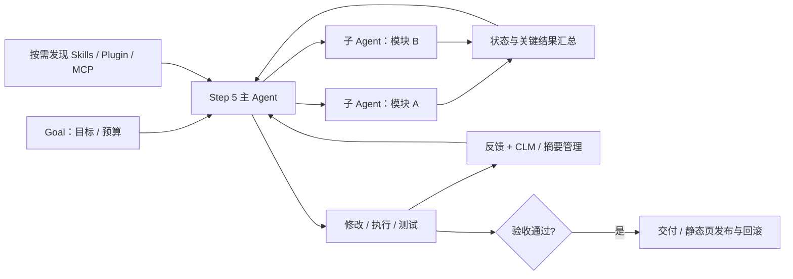
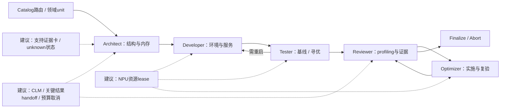

# Step-Code：机制、技术优势与 MindSpeed-Agent 借鉴

**资料时点：2026-10-12，北京时间。**基于本次系列调研已读取的官方文档、代码、论文及标注来源的报道整理；部分动态页面于本轮复核。未在 NPU 上加载模型、运行 benchmark 或复现训练。

证据分为【官方配置/代码/论文】【官方测试】【独立评测】【非官方报道/博客】【工程解释/建议】。网络证据链接附在相关段落；文件名仅作交付索引。没有公开代码的机制不补造接口或参数，相关项目也不自动等于模型内部生产实现。

Step-Code 是模型外部的执行框架：模型决定下一步，宿主管理工具执行、会话、上下文和交付。技术竞争力应通过相同模型、任务、预算下的完成质量和总成本评估。下面将公开实现、官方测试与建议改造分开。

## 1. 机制与优势证据

### 1.1 先给出有依据的优势

**【官方产品测试】同一个 Step 5 Preview 接入 6 个 Agent，在 Multi-Frame BMK 上，Step-Code 报告完成率 73.3%、每任务 5.09M tokens，并称两项均最佳。**这比单纯列 Skills/MCP 更能支撑“harness 有贡献”的讨论，因为比较至少控制了模型身份。[Step-Code 产品页](https://platform.stepfun.ai/step-code)

**边界：**本次未见完整公开任务集、六框架全部配置、重复次数、置信区间及 token 计量明细，所以应写“官方同模型框架对比中的优势”，不能写“独立证明优于所有 Coding Agents”。5.09M 是累计任务消耗，不是单次上下文；这也不是只开一个 skill 就产生的增益。

### 1.2 最值得讲的四项工程机制

表注：下列机制均可在 **官方 Step-Code 仓库 main 分支，2026-10-12 读取**的文档/实现找到。main 为动态分支，接口名用于定位，不保证后续版本保持原样。业务价值为工程解释，未给固定节省百分比。上下文管理的应用实现与 Step 5 模型训练中的上下文管理是两层证据。

| 重点机制 | 具体做法与接口流程 | 对 Step 5 长任务的价值 | 代码/文档证据 |
|---|---|---|---|
| 模型管理工作上下文（CLM） | 默认压缩模式 `clm-v1`；阈值触发后模型对可编辑的旧观察提出缩短操作；验证工作视图，保留 canonical history；失败则退回原生摘要 | 控制重复日志与旧工具结果占用，同时保留审计历史、用户要求及当前工具组 | [context-management.md](https://github.com/stepfun-ai/Step-Code/blob/main/packages/coding-agent/docs/context-management.md) |
| 原生压缩的完整性保护 | `shouldCompact → prepareCompaction → compact / generateSummaryWithUsage → CompactionEntry → 重建上下文`；旧摘要保留，必须生成的空摘要被拒绝 | 压缩失败不覆盖有效历史，避免目标和已验证结果因空摘要消失 | [compaction.ts](https://github.com/stepfun-ai/Step-Code/blob/main/packages/coding-agent/src/core/compaction/compaction.ts)、[完整性文档](https://github.com/stepfun-ai/Step-Code/blob/main/docs/compaction-integrity.md) |
| 子 Agent 协作与结果裁剪 | `executeSubagent` 支持 single/parallel/chain、受限并发、独立 child session；可选 worktree；`chainResultText` 保留步骤状态和关键最终输出，早期正文放入 details | 把模块分析、实现与审查拆开；减少主上下文反复塞入所有中间输出 | [execute.ts](https://github.com/stepfun-ai/Step-Code/blob/main/packages/coding-agent/src/features/subagent/execute.ts)、[子会话 runner](https://github.com/stepfun-ai/Step-Code/blob/main/packages/coding-agent/src/features/step-subagent.ts) |
| Goal 生命周期与 StepPage 交付 | `create_goal/get_goal/update_goal` 管理目标；宿主在当前轮结束后续跑；预算/取消状态持久化；StepPage 插件连接 MCP，发布目录/zip、预览、版本与回滚 | 长任务可持续推进并有明确停止状态；静态 Demo 从生成、测试走到可访问产物 | [goal-lifecycle.md](https://github.com/stepfun-ai/Step-Code/blob/main/docs/goal-lifecycle.md)、[StepPage manifest](https://github.com/stepfun-ai/Step-Code/blob/main/plugins/steppage/step.plugin.json) |

**CLM 是本版应突出补充的点。**它不是每次把全部历史盲目摘要：优先修改可编辑的旧工具观察，保留原始会话历史，并验证本次投影是否仍对应当前会话/版本。原生摘要是后备路径。官方文档明确保护用户要求和当前工具组；这些校验保障结构完整性，**不自动保证非空摘要在语义上完全正确，也不保证实际缓存命中**。[上下文管理说明](https://github.com/stepfun-ai/Step-Code/blob/main/packages/coding-agent/docs/context-management.md)



图注：Step-Code **可组合的概念工作流**，不是每个任务都强制并行、调用所有技能或发布网页。普通代码产物不需要 StepPage。Goal 托管、上下文管理和子会话属于 harness；Step 5 提供推理与工具调用决策。各组件接口来自上述官方仓库。

### 1.3 Skills、Plugin、MCP 各承担什么

- **Skills 是任务方法与资源入口。**`loadSkillsFromDir` 发现目录，加载 `SKILL.md`；`loadSkillFromFile` 解析/校验名称描述；`formatSkillsForPrompt` 输出可发现信息。值得借鉴“先暴露简要索引、按需读取内容”，减少无关说明挤占长任务上下文。[skills.ts](https://github.com/stepfun-ai/Step-Code/blob/main/packages/coding-agent/src/core/skills.ts)
- **Plugin 是组件封装与加载。**`readStepPluginManifest → parseStepPluginManifest` 读取插件声明，装载其资源与 MCP 配置；StepPage 的 manifest 就声明了 `steppage-mcp`。适合把业务能力按版本组织，而非在 prompt 中手工拼接一切。[plugins.ts](https://github.com/stepfun-ai/Step-Code/blob/main/packages/coding-agent/src/step/plugins.ts)、[StepPage 插件](https://github.com/stepfun-ai/Step-Code/blob/main/plugins/steppage/step.plugin.json)
- **MCP 是工具接入。**检索、数据库、执行与发布服务由宿主/工具提供；“模型支持工具调用”不等于模型内置了这些服务。官方 README 说明多数 Claude Code 插件兼容，并支持迁移既有 MCP 配置，降低接入成本。[中文 README](https://github.com/stepfun-ai/Step-Code/blob/main/README.zh-CN.md)

`/cron` 可作为定期任务补充，不需要在技术主图展开。**Step-Code 最值得借鉴的是“工作上下文可编辑但历史可追踪、子会话结果有控制、目标生命周期可停止、产物可验收”这一组合。**Skills/MCP 通用兼容不是独有能力；官方 Goal 文档还说明完成由工作 Agent 的 `update_goal` 决定，当前没有独立完成 evaluator，因此验收仍需真实测试/产物证据，不能只信自报完成。

## 2. Step-Code 对 MindSpeed-Agent：贡献重点是运行机制，不是再加一套插件清单

### 2.1 MindSpeed-Agent 已有的能力

本次读取的是**官方** `https://gitcode.com/Ascend/MindSpeed-Agent.git`，commit `f56bb671309ee1bd9f9fdf6c6c7b17b488f4a448`；不用搜索结果中的个人 fork 代替。

已确认：Plugin→Agent→Skill；`catalog` 仓库/任务/插件路由；core+领域按需安装；推理优化 YAML 与 `next_state()`/`verify_log()`；architect、developer、tester、reviewer、optimizer 等角色；结构门禁与 reviewer 证据字段；另外还有 prompt-first 的 NPU migration `goal` 入口与 specialist skills。后者明确采用单写入者原则，**不复用推理优化插件的固定状态机**。因此，不能笼统建议“从零增加 Skills、多 Agent、Goal 或阶段验收”。[官方 README](https://gitcode.com/Ascend/MindSpeed-Agent/blob/f56bb671309ee1bd9f9fdf6c6c7b17b488f4a448/README.md)、[架构说明](https://gitcode.com/Ascend/MindSpeed-Agent/blob/f56bb671309ee1bd9f9fdf6c6c7b17b488f4a448/docs/ARCHITECTURE.md)

现有调用链可核查为：`catalog 确定 repo/task/plugin → 领域 unit/角色 → 工具与结构化产物 → handoff → next_state 计算下一状态 → 日志/verify_log 重放审计 → finalize/abort`。具体 YAML 当前还含 tester→developer 的重启路径及 reviewer↔optimizer 的闭环，不要只按 README 的旧“四角色”简称判断实现。[优化 YAML](https://gitcode.com/Ascend/MindSpeed-Agent/blob/f56bb671309ee1bd9f9fdf6c6c7b17b488f4a448/plugins/inference-model-optimize/workflows/optimize-pipeline.yaml)、[状态机接口](https://gitcode.com/Ascend/MindSpeed-Agent/blob/f56bb671309ee1bd9f9fdf6c6c7b17b488f4a448/plugins/inference-model-optimize/engine/state_machine.py)

**直接接入 Step-Code 也需要宿主适配。**当前 MindSpeed-Agent 声明的平台为 Claude Code、Codex、DSH，catalog 中没有 Step-Code 平台；Step-Code 自述兼容多数 Claude Code 插件，不能据此认定 MindSpeed-Agent 的角色派发、hook、状态机 backend、取消和统计都直接可用。贡献 Step-Code 平台 adapter 时，应分别检查 manifest/skill 布局、子任务 API、回调与取消、handoff/门禁，并测试实际运行，不只做文档安装别名。[平台与安装声明](https://gitcode.com/Ascend/MindSpeed-Agent/blob/f56bb671309ee1bd9f9fdf6c6c7b17b488f4a448/catalog/plugins.yaml)、[Step-Code 兼容说明](https://github.com/stepfun-ai/Step-Code/blob/main/README.zh-CN.md)

### 2.2 具体贡献方向与落点

表注：本表是**建议方案**，不是已经实现或已提交的变更。P0/P1 为本报告优先级。MindSpeed-Agent、Step-Code 代码已读；“未找到”只限于所查相关插件/架构，不断言所有其他宿主均没有该能力。运行机制需宿主支持，不能只靠新增一个 SKILL.md 自动保证。

| 优先级 / 贡献 | Step-Code 可借鉴机制 | MindSpeed-Agent 对应现状/落点 | 对昇腾任务的具体价值 |
|---|---|---|---|
| P0：上下文保真与压缩 | CLM 修改旧观察的工作视图，保留 canonical history；空摘要拒绝与 fallback | 在现有 handoff/结构化输出之上制定宿主上下文契约；只查相关插件未发现统一 CLM 实现 | profiler/编译/运行日志很长，把摘要与日志索引交给模型，保留完整证据用于验收 |
| P0：子任务结果裁剪 | 子会话独立、chain 只向主会话输出关键结果/状态，完整正文留 details | 已有角色和 `context: fork` 概念，可细化统一 `task_result`/handoff 数据 | 分别分析算子、通信、内存时，不把所有 trace 重复塞进主上下文 |
| P0：任务生命周期与资源预算 | Goal 的预算、取消、持久状态，宿主负责自动续跑 | 已有 migration `goal` 和状态机 iteration/spawn cap；新增运行时间/token/NPU预算契约需适配宿主 | 控制“运行多久、何时停、如何恢复”；取消不仅停止模型采样，还要处理远程进程与 NPU 租约 |
| P0：NPU 资源租约与单写入者执行 | 借鉴受限并发和独立 workspace，而非无限并行 | migration 已明确单写入者原则；建议将设备/端口/服务重启绑定可审计 lease | 多 Agent 不能同时在同一组 NPU 改 TP、重启服务、压测或采 profiling；只读分析可并行 |
| P0：模型支持证据卡 | Goal 必须用实际证据判完成，保留目标/约束/验证结果 | 扩展 `model_profile`、developer/tester 产物与 `validateArchitect/Developer/Tester` | 记录 model revision、core/plugin/CANN、硬件、Runner、dtype、MTP、输入模态及各项 support 状态；避免 health pass 被包装成全面支持 |
| P1：实验恢复与最佳配置保留 | 长任务状态保留与明确完成/阻断，失败不覆盖有效上下文 | 保留已有 `next_state/verify_log`，补实验 ID、服务会话/日志、最优 checkpoint 与回退状态 | 多小时寻优中断后恢复到已验证配置，退化版本与失败结果仍可追踪 |
| P1：插件宿主与模型服务分离 | Skills/Plugin/MCP 兼容与按需发现 | 现有 core+unit/catalog 已做到按需安装，重点是清单/字段转换和平台能力矩阵 | 领域技能可服务本地 vLLM-Ascend 或远端 Step API；前者为模型本地 NPU 推理，后者只是 Agent 控制端调用 |
| P1：同模型同预算 harness benchmark | Step-Code 同 Step 5 对照多个 harness 的方法 | 固定任务/模型/环境后，对比现有 MindSpeed-Agent 与增强上下文/预算版本 | 测任务成功、人工返工、token/NPU小时、恢复与错误支持声明；不沿用 73.3% / 5.09M 为预期收益 |

Step-Code 证据：[CLM](https://github.com/stepfun-ai/Step-Code/blob/main/packages/coding-agent/docs/context-management.md)、[压缩完整性](https://github.com/stepfun-ai/Step-Code/blob/main/docs/compaction-integrity.md)、[子会话与结果裁剪](https://github.com/stepfun-ai/Step-Code/blob/main/packages/coding-agent/src/features/subagent/execute.ts)、[Goal 生命周期](https://github.com/stepfun-ai/Step-Code/blob/main/docs/goal-lifecycle.md)。MindSpeed-Agent 门禁入口：[gates.js](https://gitcode.com/Ascend/MindSpeed-Agent/blob/f56bb671309ee1bd9f9fdf6c6c7b17b488f4a448/plugins/inference-model-optimize/workflows/gates.js)、[migration 插件边界](https://gitcode.com/Ascend/MindSpeed-Agent/blob/f56bb671309ee1bd9f9fdf6c6c7b17b488f4a448/plugins/ecosystem-code-repository-npu-migration/README.md)。

### 2.3 一个非常具体的改进点：未知参数不能被门禁逼成“假已知”

现有 `validateArchitect()` 要求 architecture、num_layers、hidden_size、num_parameters 等字段存在。这对公开配置完善的 3.5/3.7 很有帮助；面对 Step 5 正式配置尚未核实的情况，**应允许明确的 unknown/blocked 状态，并要求来源和下一步核实项，而不是拿 3.5 的 hidden size 填进去通过门禁**。推荐让支持证据卡含：

```text
model_revision / source
core_commit / ascend_commit / CANN / torch_npu / hardware
runner / dtype / TP-DP-EP / context_budget
feature = {text, vision, tools, MTP, prefix_cache, long_context, logprob}
status = {unverified, code_present, function_verified, accuracy_verified, performance_verified}
evidence = {command, exit_code, raw_log, metric, input_case, timestamp, config_hash}
```

图注：建议的数据契约，不是仓库当前已存在的 schema。状态按每个 feature 记录，不用一个 `supported=true` 包掉所有能力。架构确实未知时停止进入部署阶段，继续文档/源码核实即可。[当前门禁代码](https://gitcode.com/Ascend/MindSpeed-Agent/blob/f56bb671309ee1bd9f9fdf6c6c7b17b488f4a448/plugins/inference-model-optimize/workflows/gates.js)

### 2.4 与现有优化流水线结合的流程图



图注：实线简化表示已读到的优化 YAML 角色流程；虚线为新增建议，非现有实现证明。该图只对应 `inference-model-optimize`，**不要求另一套 prompt-first NPU migration 插件强制改成这条状态机**。CLM 与取消需要宿主执行支持，领域 skill 提供规则不能代替运行时保证。

## 3. 适配边界与建议验收

Step-Code在控制端调用远程Step API，并通过工具操作昇腾环境，并不意味着Step模型本身部署在NPU。若改用本地vLLM-Ascend端点，应分别检查鉴权、chat template、tool calling解析、reasoning字段、上下文预算、流式事件、取消以及token用量；OpenAI兼容URL不保证全部协议语义一致。

CLM保护结构与历史，不保证每次摘要的事实完全正确；Goal状态并不是独立完成判定器；多Agent如果争用同一设备、端口或工作区可能拖慢任务。优先在现有MindSpeed-Agent中落实证据保留、主子任务结果契约、设备租约、超时取消与恢复，再增加并行规模。

建议固定模型revision、任务集、设备、代码版本及token/时间预算，对比基线与每项增强；指标为完成率、错误完成声明、回归质量、token与NPU小时、人工返工和中断恢复率。先做上下文压缩单项、再做子任务裁剪单项、最后组合，才能区分组件贡献。该建议不预设73.3%或某个固定节省比例。
