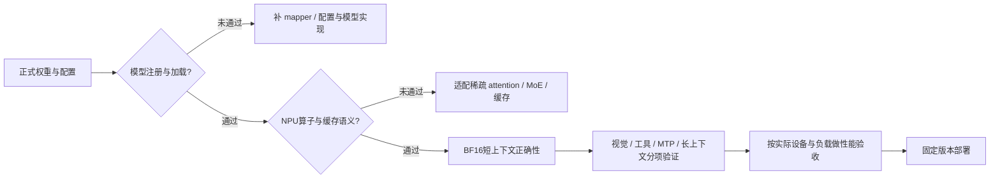

# 昇腾适配：状态、依赖与验证边界

**投入口径更新（2026-10-12，北京时间）：Step 3.5/3.7的vLLM-Ascend基础推理支持已完成并合入，本文后续检查项用于目标环境部署验收或新增功能组合，不代表从零适配仍待完成。MRV2迁移属于独立增量任务。** [已合入支持PR](https://github.com/vllm-project/vllm-ascend/pull/10556)。

**资料时点：2026-10-12，北京时间。** 基于本次系列调研已读取的官方文档、代码、论文及标注来源的报道整理；部分动态页面于本轮复核。未在 NPU 上加载模型、运行 benchmark 或复现训练。

证据分为【官方配置/代码/论文】【官方测试】【独立评测】【非官方报道/博客】【工程解释/建议】。网络证据链接附在相关段落；文件名仅作交付索引。没有公开代码的机制不补造接口或参数，相关项目也不自动等于模型内部生产实现。

## 1. 结论摘要

表注：状态截至 2026-10-12；“未确认”表示当前公开证据不足，不是理论上无法在该硬件运行。PR 的设备验证不自动覆盖当前所有版本/特性。本次没有真机复现。A3/950 指原资料中的硬件平台，不能无条件推广到 910B、310P 或其他型号。

| 对象 | 当前可以给出的结论 | 最关键的限制 |
|---|---|---|
| Step 5 Preview + vLLM-Ascend | **尚不能确认为正式开箱部署模型，需要模型与算子适配/验收** | 正式权重/配置发布计划与本地推理支持是两件事；公开 core registry/Ascend 树没有找到 Step 5 专用适配入口 |
| Step 3.5 Flash | **已有昇腾适配、功能验证及 MTP 代码，可选择匹配组合部署验证** | 官方合入 PR 记录 A3/950；不意味着所有 Runner、量化、图模式和长上下文组合均通过 |
| Step 3.7 Flash | **已有昇腾适配，文本/MTP 路径有明确证据** | 视觉输入、长上下文等需分别验收；MRV2 适配任务仍 open，尚未取得完整完成验收证据 |
| Step-Code → MindSpeed-Agent | **可借鉴 harness 的上下文、任务生命周期和协作机制** | MindSpeed-Agent 已有路由/技能/状态机/门禁，重点应补运行与数据契约；不能把 73.3% 等 Step 5 框架成绩直接转成昇腾收益 |

主要依据：[Step 3.5/3.7 Ascend PR #10556](https://github.com/vllm-project/vllm-ascend/pull/10556)、[v0.26.0rc1 release](https://github.com/vllm-project/vllm-ascend/releases/tag/v0.26.0rc1)、[MRV2 任务 #14205](https://github.com/vllm-project/vllm-ascend/issues/14205)、[MindSpeed-Agent 官方仓库](https://gitcode.com/Ascend/MindSpeed-Agent)。

## 2. Step 5 Preview：目前不能把 vLLM-Ascend 当作现成部署配方

### 2.1 当前证据与判断

**第一道依赖是可用且身份明确的权重、配置和实现。** 按本调研于 2026-10-12 已成功读取的官方发布页快照，权重计划于 2026-10-15 开放；本轮刷新超时，未取得该计划发生变化的证据，部署前需再核对正式发布状态。不将第三方镜像视为最终正式版本。官方 API 可用，仅证明接入 Step 服务，不证明这个模型在用户的 NPU 上执行。[官方发布页](https://www.stepfun.com/step-5-preview)

本次检查的上游 vLLM registry 有 `Step3p5ForCausalLM`、`Step3p7ForConditionalGeneration` 与 `Step3p5MTP`，没有找到 Step 5 专用注册名；同时检查完整、未截断的 vLLM/vLLM-Ascend 仓库树，未发现 Step 5 命名的模型或后端实现。 **这是有范围的负证据：无法确认公开主线开箱支持；不排除另外的私有实现、运行时插件或后续合入。** 也不能把给架构换别名、加 `--trust-remote-code` 解释成后端已经具备所有稀疏算子。[固定 core registry](https://github.com/vllm-project/vllm/blob/03091e28b8ba956634c153beab0e52decafdef31/vllm/model_executor/models/registry.py)、[vLLM-Ascend 仓库](https://github.com/vllm-project/vllm-ascend)

### 2.2 除通用环境外，还依赖哪些模型能力

表注：本表是**Step 5 昇腾适配所需的工程检查项**，不是已实现特性清单。92 层、Sparse GQA、块合并、MTP-3 等具体技术来自媒体转述；正式 kernel、cache 布局与权重映射必须在正式发布后核对，不以旧代配置替代。[技术报道](https://news.qq.com/rain/a/20260920A06EUP00)

| 依赖层 | 需要具备什么 | 不能省略的验证 |
|---|---|---|
| 模型识别与权重加载 | 正确的 config、architecture、tokenizer/模板、权重 mapper | 权重键/shape/层枚举一致；不遗漏 projector、shared experts、MTP/indexer 权重 |
| Sparse GQA / Indexer | NPU 索引评分、Top-k、块合并/选择、gather、稀疏 attention | 候选位置、因果关系、边界与输出对齐；不能悄悄改成 dense fallback 后仍称等价实现 |
| KV / 索引缓存 | 与模型真实布局一致的 KV 和 index cache、分页及 prefix 生命周期 | 跨请求/跨轮复用正确；块边界、长位置、缓存命中与权重重载后的失效规则 |
| MoE / EP | 真实专家数、top-k、shared expert、路由概率/bias、激活函数 | 每层路由与权重混合语义；dispatch/combine、跨机通信、热点与尾延迟 |
| 视觉与视频 | processor、vision encoder/projector、视频采帧与输入接口 | 文本跑通后分别测试图片和视频；共享语言路径不证明多模态路径通过 |
| MTP / 量化 | 精确 MTP 验证/拒绝采样与 KV 更新，匹配的 NPU 量化格式 | BF16 基线先行，再比较候选接受、输出质量、logprob 与量化敏感性 |
| API / Agent 协议 | reasoning/tool parser、流式 tool_calls、JSON 结构化输出 | 工具参数可执行，多轮工具结果拼接正确，停止/取消与错误返回可处理 |

**已有其他模型的稀疏算子不等于 Step 5 可直接调用。** 例如 DeepSeek 的 SFA/LightningIndexer 与 Step 的 Sparse GQA 可能在 head 维度、压缩、评分、Top-k 粒度、KV layout 和调度上不同。能借用的是算子能力和工程模式；是否能直接复用需逐项对照。相同的“稀疏注意力”名称不是接口兼容证据。

### 2.3 直接部署的判定流程



图注：建议的适配与验收流程，**不是 Step 5 已通过的部署链**。任何前置项未通过，后续只可作适配研究，不能给用户承诺“pip 安装后直接运行”。

## 3. Step 3.5 / 3.7：已有支持，但按设备、版本与特性分层说明

### 3.1 硬证据与适用范围

**PR #10556 已于 2026-07-13 合入**，标题为支持 Step 3.5/3.7 Flash on Ascend 950，正文同时记录 A3 与 950 的验证，并包含融合 Q/K norm + RoPE、FlashComm1 等工作。3.7 日志展示 API 200 和 MTP 接受统计；这些是具体功能证据，不能从短日志推导稳定吞吐 SLA。[PR 内容与合入状态](https://github.com/vllm-project/vllm-ascend/pull/10556)

**v0.26.0rc1 发布说明明确列出 Step 3.5/3.7 的 Ascend 950 支持。** 同一 release 也明确它是 model-restricted 版本，列出的充分验证集合为 Kimi K3、GLM-5.2、DeepSeek V4 两个版本，其他模型可用性不保证。因此同时承认“有适配”与“未进入该 release 的全部充分验证集合”，避免只摘支持一句话。[release 原文](https://github.com/vllm-project/vllm-ascend/releases/tag/v0.26.0rc1)

**3.7 MRV2 任务 #14205 当前仍 open。** 任务说明 MRV1 路径可用，并要求迁移 proposer、attention metadata 和采样。未关闭任务不等于没有任何 MRV2 实验代码，但不足以声称完成精度/性能验收。近期版本将部分 context-parallel 能力迁到 MRV2，因此 Step 的 MRV1/MRV2 与长上下文功能组合必须单列，不能分别看到“模型支持”和“PCP 支持”就认为交集可用。[MRV2 任务](https://github.com/vllm-project/vllm-ascend/issues/14205)

表注：2026-10-12 公开证据快照；“另验”不表示功能不存在。A3/950 为合入 PR 的设备范围；910B 为社区分支观察，证据等级不同。本次未真机复现。

| 场景 | Step 3.5 | Step 3.7 | 证据与限制 |
|---|---|---|---|
| A3/950 文本推理 | 有适配与验证记录 | 有适配与功能记录 | #10556，不推广为任意 tag/参数组合 |
| MTP-3 | 有 Ascend proposer 与测试入口 | 共用相关 MTP 路径及测试模型列表 | 测试代码存在不代表最新 CI 已执行通过 |
| 图片/视觉 | 3.5 为文本模型 | 上游有 vision encoder/projector 与语言接入 | 3.7 图片输入需独立验证，不用纯文本 API 200 代替 |
| 256K/并发/缓存复用 | 另验实际 cache 和部署容量 | 另验并包含图像 token | 开源上下文长度不是给定设备上的容量证明 |
| MRV2 + MTP/CP | 不给统一可用结论 | 未取得完整完成验收证据 | #14205；Runner/metadata/采样须一致 |
| 910B | 社区有已验证分支报道 | 未由本次材料证明同样完整支持 | [上海适配团队分支说明](https://github.com/Ascend-ShangHai-LLM)，不是所有 910B 安装的保证 |

### 3.2 具体接入代码流程

```text
HF architecture
  → vLLM ModelRegistry
  → Step3p5ForCausalLM / Step3p7ForConditionalGeneration
  → 3.7 视觉编码与 projector（视觉请求）+ text_config 对应语言模型
  → Ascend 模型 patch / DeviceOperator
  → QKV + Q/K norm/RoPE → Attention → head gate → o_proj
  → FusedMoEFactory：路由/bias/缩放/激活/EP
  → 主模型 logits 与采样
  → 若启用 MTP：AscendStep3p5MTPProposer → 验证/接受与 cache 更新
```

图注：根据固定源码整理的接口链；不是每次请求都走视觉或 MTP。3.7 使用 `config.text_config` 加载语言模型，不应随意扁平化嵌套配置。源码入口：[3.7 模型](https://github.com/vllm-project/vllm/blob/03091e28b8ba956634c153beab0e52decafdef31/vllm/model_executor/models/step3p7.py)、[Ascend Step patch](https://github.com/vllm-project/vllm-ascend/blob/c076a131097fdfac9db4b57c8cf55bfd45ea0ca5/vllm_ascend/patch/worker/patch_step3p5.py)、[MTP proposer](https://github.com/vllm-project/vllm-ascend/blob/c076a131097fdfac9db4b57c8cf55bfd45ea0ca5/vllm_ascend/spec_decode/step3p5.py)。

代码中的 Gate 仍是在 attention 输出后乘 `sigmoid(g_proj(hidden))`，再做输出投影；NPU 融合优化不应改变这一语义。MoE 配置还涉及 `router_bias`、`moe_router_scaling_factor`、`swiglustep` 等，不能把它当成任意普通 softmax MoE 自动替换。[对应 patch](https://github.com/vllm-project/vllm-ascend/blob/c076a131097fdfac9db4b57c8cf55bfd45ea0ca5/vllm_ascend/patch/worker/patch_step3p5.py)

**测试证据要按实际内容读。** 当前四卡 MTP 测试的 `MODELS` 同时列 3.5/3.7；函数名虽带 `tp8`，实际配置 `tensor_parallel_size=4`、`max_model_len=8192`、MTP=3。主要断言候选位置接受率，不是完整验证“所有生成 token 与 HF/无 MTP 完全一致”，也不是 256K 或图片测试。[e2e 测试](https://github.com/vllm-project/vllm-ascend/blob/c076a131097fdfac9db4b57c8cf55bfd45ea0ca5/tests/e2e/pull_request/four_card/spec_decode/test_mtp_step3p5.py)

另有 source regression 对 metadata、query 起点、draft window、reject token 参数的 AST 检查；它可保护接口契约，但并非真机算子精度或性能测试。[接口回归测试](https://github.com/vllm-project/vllm-ascend/blob/c076a131097fdfac9db4b57c8cf55bfd45ea0ca5/tests/ut/spec_decode/test_step3p5_source_regression.py)

## 4. 部署依赖：环境配套、模型特性与硬件容量分别确认

### 4.1 可引用的配套版本

表注：以下是 2026-10-12 读取的**相应 release/源码依赖**，不是本次已经安装的环境，也不是 Step 5 专属认证环境。v0.23.0 与 v0.26.0rc1 的 core 必须分开配套；不能用任意 main 代替。HDK 的 driver/firmware 需按实际卡和 CANN 文档匹配。

| 组件 | v0.23.0 公开配置 | v0.26.0rc1 release 配套 | 作用 / 注意点 |
|---|---|---|---|
| vLLM core / Ascend | core v0.23.0 + Ascend 同 release 行 | core v0.26.0 + Ascend v0.26.0rc1 | 插件接口、Runner、patch/采样必须匹配 |
| Python | >=3.10、<3.13；Dockerfile 用 3.12 | >=3.10、<3.13 | 也要匹配 wheel/构建工具 |
| CANN | 9.1.0（对应平台安装包） | 9.1.0 | toolkit、算子包、runtime 与设备匹配 |
| PyTorch / torch_npu | 2.10.0 / 2.10.0.post4 | 2.10.0 / 2.10.0.post4 | torch-npu 与 torch 的 ABI/版本配套 |
| Triton Ascend | 3.2.2 | 3.2.2（A2/A3/950，非 300I DUO） | NPU Triton kernels，不是 CUDA Triton |
| Transformers / torchvision | requirements 列 5.5.4 / 0.25.0 | 依镜像完整锁定 | 配置、processor、视觉依赖；不能只安装 vLLM 插件 |
| 多机 / KV 通信 | HCCL；镜像含 Mooncake 0.3.11.post1 | 镜像含 Mooncake 0.3.11.post1 | EP/TP 用 HCCL；P/D/KV Pool 的 connector 与额外库按方案启用，不是最小单机服务全部必需 |

来源：[v0.23.0 requirements](https://github.com/vllm-project/vllm-ascend/blob/v0.23.0/requirements.txt)、[v0.23.0 Dockerfile](https://github.com/vllm-project/vllm-ascend/blob/v0.23.0/Dockerfile)、[v0.26.0rc1 release](https://github.com/vllm-project/vllm-ascend/releases/tag/v0.26.0rc1)、[官方版本策略](https://github.com/vllm-project/vllm-ascend/blob/main/docs/source/community/versioning_policy.md)。上述表帮助锁环境，不构成对该版本 Step 所有特性的认证。

**main 分支按 verified core commit 配套。** 本次 Ascend 快照为 `c076a131097fdfac9db4b57c8cf55bfd45ea0ca5`，其中 `.github/vllm-main-verified.commit` 指向 `ced6857afa0ea7b2e3f0846a62e1394e90f15607`。本报告用于观察模型 registry 的另一个 upstream HEAD，不能被当作已验证配对；实装应采用 checked-out Ascend 的 verified 文件。[配套 commit 文件](https://github.com/vllm-project/vllm-ascend/blob/c076a131097fdfac9db4b57c8cf55bfd45ea0ca5/.github/vllm-main-verified.commit)

同样，当前 main 的 `patch_step3p5.py` 路径在本次 v0.23.0 树中未找到，而旧 tag 有 Step MTP proposer；说明实现位置/接入方式随版本变化。不要向旧 tag 机械复制 main patch 后宣称同一支持组合。

### 4.2 与你已有安装流程的关系

你提供的 `VLLM_TARGET_DEVICE=empty` 用于上游构建避开 CUDA 目标；它不是 NPU 运行支持证明。`COMPILE_CUSTOM_KERNELS=1` 需要对应 CANN 头文件、编译工具与正确 SoC 目标。自定义算子 `vendors/custom_transformer/bin/set_env.bash` 设置库环境，也不替代 driver/firmware、CANN 或相关算子的真实编译和可用性。

按以下顺序形成环境记录即可：**设备/driver/firmware → CANN/算子包 → torch/torch_npu → core/Ascend commit → Triton/自定义 op → checkpoint/config/processor → 服务特性**。如果某依赖不适用，写清具体原因；不要把 `pip install -e .` 成功、CPU 构建成功或 `/health=200` 当作模型 NPU 正确性通过。

### 4.3 内存与上下文预算

表注：仅按标称参数估算权重数据量，单位十进制 GB/TB；不含 MTP/embedding 口径差异、quant scales、激活、KV、workspace、通信 buffer 与复制。FP8/INT4 仅为数据量算术，**不表示这些 checkpoint 格式已经在目标 Ascend 模型上支持**。

| 模型参数口径 | BF16（2 bytes/参数） | 8-bit（1 byte/参数） | 4-bit（0.5 byte/参数） |
|---|---:|---:|---:|
| 3.5 语言主干 196B | 约 392 GB | 约 196 GB | 约 98 GB |
| 3.7 标称约 198B | 约 396 GB | 约 198 GB | 约 99 GB |
| Step 5 标称 600B | 约 1.2 TB | 约 600 GB | 约 300 GB |

MoE 的 11B/27B 激活参数主要描述本 token 的计算路径，不免除未选专家权重的存储。模型能装入也不说明长上下文/并发 KV 容量足够。NVFP4 是官方 NVIDIA 版本的一种格式，不能只把 `--quantization` 名称带到 NPU 上；量化算子、packing、scale、激活和精度验收都要匹配。

对 3.5/3.7，一个**理想化全局 KV 数据量**估计为：

`KV bytes ≈ 2 × bytes_per_KV × head_dim × KV_heads × (L_full × N + L_SWA × min(N,w)) × concurrent_sequences`

以 BF16、head_dim=128、KV_heads=8、12 Full+33 SWA、w=512、N=262144、单序列计算，约为 **12.06 GiB**（二进制），只是理想有效缓存总量。TP 分片/复制、分页、临时内存与实际后端保留策略会改变每卡占用，SWA 若不做 eviction 会更多。**Step 5 的正式 KV 布局未核实，不用这条旧代公式估它的 1M 请求。**[3.7 配置](https://huggingface.co/stepfun-ai/Step-3.7-Flash/blob/main/config.json)

## 5. Agent 适配专题入口

MindSpeed-Agent已有角色、技能、路由、状态机和门禁；Step-Code可借鉴的重点是上下文、子任务结果、预算/取消恢复及NPU资源契约。完整代码落点与平台兼容边界单列于 `04-StepCode机制优势与MindSpeedAgent借鉴.md`。

## 6. 其他值得补充的昇腾技术点

### 6.1 RL 不能只验“文本看起来对”

Step 3.5 MIS-PO、Step 5 经媒体披露的 bit-wise/异步 logprob 对齐都提醒：训练/rollout 两侧路由、量化、kernel、TP 归约和权重版本会影响概率。迁移到昇腾建议比较 token/logprob、路由一致性、不同 batch/TP 的数值变化、过滤保留率与验证集收益。Step 5 的 `1e-2` 等媒体指标不直接视为 NPU 保证；代码 patch 的数学语义正确也不自动保证 bit-wise 一致。[3.5 RL 报告](https://arxiv.org/html/2602.10604v2)、[Step 5 技术转述](https://news.qq.com/rain/a/20260920A06EUP00)

可将推理 gate 分成：BF16 短输入 → 确定性重复与 batch 变化 → teacher/target logprob → MTP greedy/non-greedy → prefix/KV 生命周期 → 图/量化 → 长序列。不同模型和算法可调整指标，但需先写验收口径。未经运行的测试入口只能标 `code_present`。

### 6.2 EP 均衡与通信要按 NPU 路径重新量化

旧代全局 router bias 与 micro-batch rank loss 的思路仍值得参考，但运行时应分别观察 rank 专家分配、HCCL dispatch/combine、计算等待及请求 p95/p99。动态 EPLB 要有专家副本权重一致性与映射版本管理；不能为性能临时修改逻辑 top-k 而忽略 RL 策略概率。Atlas 不同代设备的通信拓扑和算子实现不同，GPU 结果不直接套到 NPU。

### 6.3 长程 Agent 的瓶颈可能不在模型

搜索、编译、HCCL 初始化、权重加载、图捕获、工具队列、profiler 采集都会占时间。建议记录 `prefill / decode / tool / startup / compile / profiling / retry` 的任务级时间，以及“每成功任务 token + NPU小时 + 人工返工”。Sparse Attention 1/8 或长程 RL >3×的局部/联合指标，不能用来估整个昇腾 Agent 流程。

StepMesh 的 A/F 分离可作为资源池设计参考，但其通信/内存路径必须与 HCCL/CANN 和设备内存注册重新匹配，不能因为采用 RDMA 就认为可在 NPU 上即插即用。MindSpeed-Agent 是开发工作流技能/编排项目，也不等同于 MindSpeed-RL 或 MindSpeed-LLM 的训练引擎。

### 6.4 建议的最小试点

先用有证据的 Step 3.5/3.7 路径固定软硬件，完成 **短文本 BF16 + API → 工具参数/多轮 → MTP/图 → 视觉（3.7）→ 量化/长上下文/并发** 的分项验收；每步只改变少量变量。Step 5 放在模型/算子适配研究队列，待正式权重、registry 与 NPU 路径有直接证据后再推进。

MindSpeed-Agent 首批贡献可聚焦三个可审阅设计：**支持证据卡与 unknown 门禁、上下文/子任务结果契约、NPU lease 与任务取消/恢复契约**。这些是方案与具体代码落点，本次未提交代码或实现 PR；如要实施，应先确定宿主和目标版本，按你的代码修改确认流程推进。

## 7. 核验范围与代码索引

表注：下面为 2026-10-12 实际读取的源码快照，commit 用于证据定位；当前 upstream HEAD 不是天然兼容 Ascend 的 verified partner。源码存在/PR合入不替代 NPU 实测。全仓树检查 `truncated=false`。

| 来源 | 本次快照 / 状态 | 证明范围 |
|---|---|---|
| vLLM-Ascend main | `c076a131097fdfac9db4b57c8cf55bfd45ea0ca5` | Step patch/proposer、测试与目录；未找到 Step5 命名适配 |
| Ascend verified core | `ced6857afa0ea7b2e3f0846a62e1394e90f15607` | main 快照声明的上游配套，不表示本次已运行 |
| upstream vLLM HEAD | `03091e28b8ba956634c153beab0e52decafdef31` | registry 与 Step3p7 模型；未找到 Step5 注册/命名入口 |
| vLLM-Ascend v0.23.0 | `5cb98caaadeff42b5b62b996e34bb2aaa29d20fd` | tag 树、MTP proposer、requirements/Dockerfile；与 main 路径不同 |
| PR #10556 | merged，2026-07-13 | 3.5/3.7 A3/950 适配与验证记录 |
| Issue #14205 | open；API 当前状态复核 | 3.7 MRV2 完整验收未获得完成证据 |
| 官方 MindSpeed-Agent | `f56bb671309ee1bd9f9fdf6c6c7b17b488f4a448` | catalog、YAML、next_state/verify_log、gates、migration 入口与宿主范围 |

GitCode 网页抓取部分返回 SPA 空壳/API 401，不据此认定官方仓库不可访问；本次 `git ls-remote` 与只读 clone 成功，代码证据来自官方 origin。GitHub 的 MindSpeed-Agent 同名入口本次返回 404，报告使用可读的官方 GitCode URL。证据链接均为网络地址，采集副本仅作审计。
