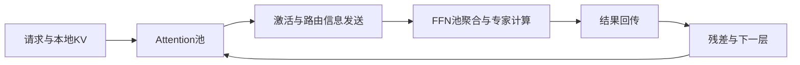

# Step-3：模型与系统共同决定解码成本

**资料时点：2026-10-12，北京时间。** 依据论文正文及已读取的公开接口整理。论文结果不是本次复现；流程中的工程扩展均明确标注，不代表官方生产实现或昇腾已适配。

**论文重点。** MFA在QK路径引入低秩分解，目标是兼顾KV体积、计算量和表达能力；AFD将attention与FFN部署到独立资源池，使缓存需求和FFN批处理分别优化。它与P/D分离、EP是不同维度，能够组合使用。StepMesh利用CPU驱动的RDMA、预注册张量和异步通信配合流水线。论文还指出，MoE过度稀疏可能令每个专家批量过小，削弱硬件效率。

**代表性证据。** 作者在Hopper、4K上下文、FP8、无MTP、50ms TPOT约束下报告每GPU吞吐4039 tok/s，对照DeepSeek-V3为2324；这是指定系统实验，不是单请求速度。论文的910B成本采用估算价格与理论分析，不能当作昇腾实测或开箱支持证明。[论文：结构、AFD、成本与实验](https://arxiv.org/html/2507.19427)

**推荐展开的工程问题：**

- 如何用算力/带宽比判断attention是访存瓶颈还是计算瓶颈，而不是只比KV大小？
- FFN批量增大能否抵消权重读取开销，何时又被时延上限卡住？
- A/F分开后，每层通信和排队增加多少，通信能否被其他批次计算覆盖？
- 跨卡专家均衡与A/F资源池容量如何共同调节，而不是只优化一个router统计值？

代码入口可从StepMesh的worker/server接口阅读：attention侧`PushPull/ZBatchPushPull`提交，FFN侧`GetBatch`取任务，计算后`Respond`，调用侧`Wait`等待完成。需按实际backend确认设备内存与同步语义。[StepMesh公开接口](https://github.com/stepfun-ai/StepMesh)

推荐配图：**Attention资源池 → 通信 → FFN资源池 → 返回Attention**，同时画多批次时间轴。纵轴为资源池、横轴为时间，突出吞吐与单请求时延的区别。它比只画“RDMA更快”更能解释设计价值。

## 执行流程：为什么拆分可能有效

【工程解释】普通decode的一次请求要逐层执行attention和FFN，但同一批设备要同时容纳KV、专家权重和中间buffer。AFD将这些资源需求拆开，使多个attention实例的输出可以汇聚到FFN池。FFN可提高矩阵乘批量，attention可随上下文长度增加资源；两边容量比必须随真实负载调整。

图注：一次层计算的概念数据流；省略归一化、位置编码和调度细节。FFN池不是把不同层权重混成同一矩阵；批处理必须匹配层、专家和模型版本。

【工程解释】单请求仍存在依赖，拆分并不自动消除通信时间。多个独立批次可以在A、F和通信阶段交错执行，提升资源利用率；服务需同时约束排队等待与TPOT。简化看，每层时延包括attention、发送/等待、FFN和返回；流水线吞吐由最慢阶段约束。把网络带宽提升一倍，不能直接推导请求速度提升一倍。

## MFA、EP与RDMA的阅读重点

MFA的低秩查询变换与KV共享应结合论文模型卡和数学计算量分析理解；不要用“压缩KV”替代全部解释，也不能把它写成Step5的Sparse GQA。论文给出61层、hidden 7168、查询低秩维2048、64个256维query heads；主干316B加5B视觉为321B，38B为每文本token激活口径。[模型卡与成本分析](https://arxiv.org/html/2507.19427#S2)

【工程解释】EP关注专家分布及token去向，AFD关注attention与FFN资源池划分，二者可组合。专家负载均衡后，A/F吞吐不匹配仍可能阻塞；FFN批量足够时，热点专家仍可能成为拖尾。

StepMesh的可读接口链为`PushPull/ZBatchPushPull → GetBatch → FFN计算 → Respond → Wait`。阅读时核对张量注册、buffer所有权、完成通知与释放时机。RDMA直接传输设备数据不等于没有同步、CPU调度或网络拥塞；跨设备后端需重新匹配内存注册和stream语义。[StepMesh](https://github.com/stepfun-ai/StepMesh)

## 面向推理与RL的验证建议

固定模型、精度、上下文和输出负载，再比较单体部署与AFD。记录请求级TPOT/p95/p99、每设备吞吐、FFN有效批量、专家偏斜、通信字节、等待占比和设备成本。RL还应计入有效轨迹保留率与训练/采样logprob一致性。较快decode只有在样本质量不退化时才能转化为有效rollout收益。
