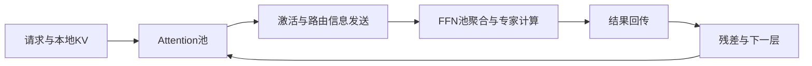

# Step-3：模型与系统共同决定解码成本

**资料时点：2026-10-12，北京时间。** 依据论文正文及已读取的公开接口整理。论文结果不是本次复现；流程中的工程扩展均明确标注，不代表官方生产实现或昇腾已适配。

## 技术分析一：MFA为什么不能只看KV压缩率

【通用原理】每个decode query要读取历史K/V并计算注意力。硬件耗时至少受到两个下界约束：

`T_attention ≥ max(F / P_eff, D / BW_eff)`

其中F为FLOPs、D为实际访存字节，P_eff和BW_eff为相应负载下的有效算力与带宽。这个roofline下界忽略启动、同步和排队，不是完整时延预测。算术强度`I=F/D`需要与设备算力带宽比匹配：减少D但大幅增加F，可能只是从带宽瓶颈转成计算瓶颈。

【论文设计与解释】Step-3将query从hidden维度压到低秩空间，再归一化并展开到多头；可用`x → W_down → norm → W_up → 多个query heads`理解这条路径。共享K/V减少历史状态，而多头query保留不同关注方式。低秩限制也可能约束表达，必须用模型质量验证；该示意省略位置变换和其他投影，不能替代完整attention公式。

因此可借鉴的是**同时约束表示能力、KV读取与算术强度**。它与“只选择少数历史位置”的稀疏attention不同：不能由MFA名称推导存在Indexer或Top-k历史选择。[论文§2、§4、§5.1](https://arxiv.org/html/2507.19427)

## 技术分析二：MoE越稀疏，为何反而可能更难跑满

【简化推导】设E个等规模routed experts，每token选k个，批量B且路由均匀，则每专家平均收到`B×k/E`份token。忽略shared expert、复制和偏斜，若希望每专家至少收到m份，需`B ≥ m×E/k`。这解释了稀疏度升高时总批量需求变大，不能作为实际容量公式。

例如E=256、k=8、B=256，均匀情况下平均每专家只有8份token；如果该设备的高效计算点需要32份，则平均意义下总批量需升至1024。**这里是教学假设，不是Step-3专家配置或测试数据。** 实际热点与冷门专家会进一步拉大利用率差距。

论文用活跃比例S近似分析，得到`B_MoE≈B_dense/S`。更大的B需要更多KV容量、传输和排队时间；因此“batch拉大”会与TPOT上限冲突。AFD把FFN聚合与attention的KV存储分开，有机会缓解这一矛盾，但不能消除网络与热点约束。[论文§5.3–5.4](https://arxiv.org/html/2507.19427#S5)

## 技术分析三：AFD换来了什么，又付出了什么

表注：以下为机制分析，非实测收益；阶段时间包含在真实部署中测得的排队和执行，不能直接用理论峰值代替。

| 设计 | 潜在收益 | 代价或失效条件 | 验证方式 |
|---|---|---|---|
| 独立A/F资源池 | 随上下文分别扩容，减少FFN等attention | 每层多次跨池依赖 | A/F利用率、逐层等待和端到端TPOT |
| FFN聚合批量 | 摊薄专家权重读取，提高矩阵乘效率 | 凑批等待、热点专家、小负载不足 | 每专家batch分布和p99排队 |
| 通信/计算流水 | 多个批次交错提高吞吐 | 最慢阶段限制流水；单请求依赖仍在 | 时间线与稳态吞吐，不只看kernel耗时 |
| 预注册设备buffer | 避免重复注册及不必要拷贝 | 生命周期、容量、故障恢复复杂 | buffer复用正确性、峰值占用和重试行为 |

【落地判断】如果部署规模小、网络慢或任务严格单请求低延迟，拆分收益可能小于通信代价。对昇腾应重新测NPU计算/访存与通信，而不是照抄Hopper上的A/F比例；910B论文成本估算不是现成部署结论。

## 论文依据、执行流程与落地补充

**论文重点。** MFA在QK路径引入低秩分解，目标是兼顾KV体积、计算量和表达能力；AFD将attention与FFN部署到独立资源池，使缓存需求和FFN批处理分别优化。它与P/D分离、EP是不同维度，能够组合使用。StepMesh利用CPU驱动的RDMA、预注册张量和异步通信配合流水线。论文还指出，MoE过度稀疏可能令每个专家批量过小，削弱硬件效率。

**代表性证据。** 作者在Hopper、4K上下文、FP8、无MTP、50ms TPOT约束下报告每GPU吞吐4039 tok/s，对照DeepSeek-V3为2324；这是指定系统实验，不是单请求速度。论文的910B成本采用估算价格与理论分析，不能当作昇腾实测或开箱支持证明。[论文：结构、AFD、成本与实验](https://arxiv.org/html/2507.19427)

**推荐展开的工程问题：**

- 如何用算力/带宽比判断attention是访存瓶颈还是计算瓶颈，而不是只比KV大小？
- FFN批量增大能否抵消权重读取开销，何时又被时延上限卡住？
- A/F分开后，每层通信和排队增加多少，通信能否被其他批次计算覆盖？
- 跨卡专家均衡与A/F资源池容量如何共同调节，而不是只优化一个router统计值？

代码入口可从StepMesh的worker/server接口阅读：attention侧`PushPull/ZBatchPushPull`提交，FFN侧`GetBatch`取任务，计算后`Respond`，调用侧`Wait`等待完成。需按实际backend确认设备内存与同步语义。[StepMesh公开接口](https://github.com/stepfun-ai/StepMesh)

## 执行流程：为什么拆分可能有效

【工程解释】普通decode的一次请求要逐层执行attention和FFN，但同一批设备要同时容纳KV、专家权重和中间buffer。AFD将这些资源需求拆开，使多个attention实例的输出可以汇聚到FFN池。FFN可提高矩阵乘批量，attention可随上下文长度增加资源；两边容量比必须随真实负载调整。

图注：一次层计算的概念数据流；省略归一化、位置编码和调度细节。FFN池不是把不同层权重混成同一矩阵；批处理必须匹配层、专家和模型版本。

【工程解释】单请求仍存在依赖，拆分并不自动消除通信时间。多个独立批次可以在A、F和通信阶段交错执行，提升资源利用率；服务需同时约束排队等待与TPOT。简化看，每层时延包括attention、发送/等待、FFN和返回；流水线吞吐由最慢阶段约束。把网络带宽提升一倍，不能直接推导请求速度提升一倍。

## MFA、EP与RDMA的阅读重点

MFA的低秩查询变换与KV共享应结合论文模型卡和数学计算量分析理解；不要用“压缩KV”替代全部解释，也不能把它写成Step5的Sparse GQA。论文给出61层、hidden 7168、查询低秩维2048、64个256维query heads；主干316B加5B视觉为321B，38B为每文本token激活口径。[模型卡与成本分析](https://arxiv.org/html/2507.19427#S2)

【工程解释】EP关注专家分布及token去向，AFD关注attention与FFN资源池划分，二者可组合。专家负载均衡后，A/F吞吐不匹配仍可能阻塞；FFN批量足够时，热点专家仍可能成为拖尾。

StepMesh的可读接口链为`PushPull/ZBatchPushPull → GetBatch → FFN计算 → Respond → Wait`。阅读时核对张量注册、buffer所有权、完成通知与释放时机。RDMA直接传输设备数据不等于没有同步、CPU调度或网络拥塞；跨设备后端需重新匹配内存注册和stream语义。[StepMesh](https://github.com/stepfun-ai/StepMesh)

## 面向推理与RL的验证建议

固定模型、精度、上下文和输出负载，再比较单体部署与AFD。记录请求级TPOT/p95/p99、每设备吞吐、FFN有效批量、专家偏斜、通信字节、等待占比和设备成本。RL还应计入有效轨迹保留率与训练/采样logprob一致性。较快decode只有在样本质量不退化时才能转化为有效rollout收益。
