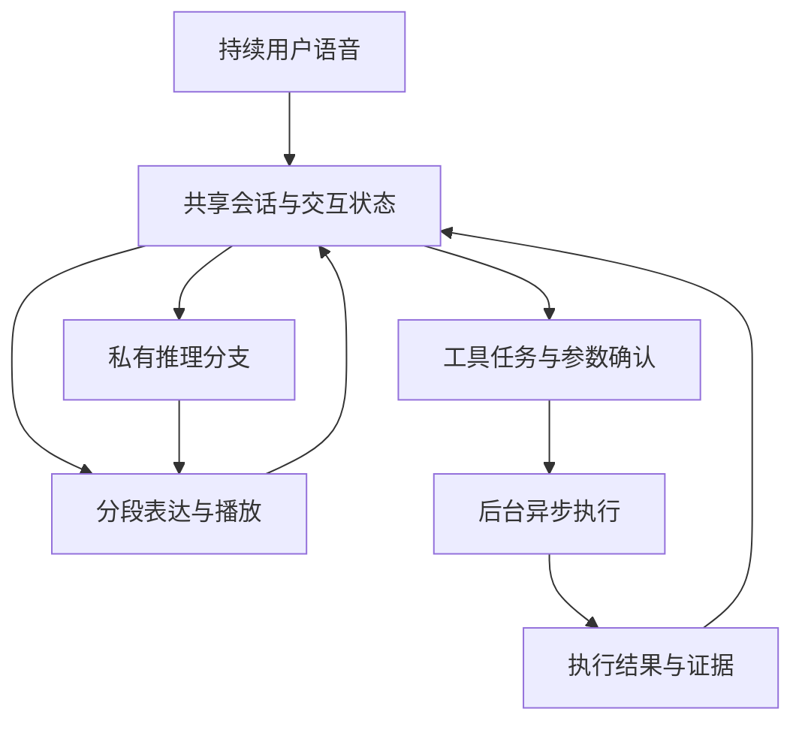

# StepAudio 3 Realtime：实时推理与Voice Agent技术分析

**资料时点：2026-10-12，北京时间。** 依据论文正文及已读取的公开接口整理。论文结果不是本次复现；流程中的工程扩展均明确标注，不代表官方生产实现或昇腾已适配。

## 技术分析一：全双工是轮次控制问题，不只是输入输出流式化

【论文机制】系统把用户音频、模型正在输出的音频和会话上下文放在共同时间线上，以320ms音频块配合状态或文本token增量建模。这样，“嗯”可以依据语境被理解为附和，也可以是纠正前奏。VAD仅回答有没有语音，不能单独判断用户是否说完、是否在对助手讲话或是否要求让出话语权。[论文§5](https://arxiv.org/html/2609.14005#S5)

【原理与边界】必须区分采集块长度、端点判断时间、模型首token和首段可播放音频。320ms是论文的表示组织粒度，不等于320ms端到端时延。音频采集、传输、排队、推理与播放buffer都可能增加延迟；回声处理等工程环节也不能由“双流”自动推导已完成。

## 技术分析二：Think-While-Speaking如何改变关键路径

【通用推导】若先完整思考再说，首音路径近似为`听取/判轮 + 推理等待 + 首段生成 + 播放缓冲`。让推理与表达并发后，首段表达可不等待完整推理，缩短首音路径；但最终答案仍依赖推理完成，计算总量还可能因两个调用而增加。

因此应同时比较`首音延迟`、`首次有信息量回答的延迟`、`最终正确结论时间`和`总设备成本`。仅用一句占位话提前出声，不能证明任务处理更快。

【论文与风险】表达分支依据已完成的推理片段和已说内容继续生成。调度要知道用户实际听到哪里，防止重复、矛盾或纠正尚未播放的内容。Speak-First与Think-First是在响应速度和提前承诺风险之间取舍，不是两个质量等价的配置。[论文§6.3](https://arxiv.org/html/2609.14005#S6.SS3)

## 技术分析三：MTP和Adaptive Thinking优化的是不同变量

MTP减少一次推理中的串行target步骤；Adaptive Thinking决定哪些轮次投入显式推理。两者分别作用于“每次想多久”和“多少轮需要想”，不能把收益倍数简单相乘。宽松接受提高候选通过机会，但允许分布变化；严格接受也不证明推理内容必然正确。

表注：作者论文StepAudioChat实验，非本次复现；得分为原评测尺度，wall-clock倍率使用各自计时配置，不能视为完整语音服务或同条件MTP深度消融。

| 观察 | 技术含义 | 不应得出的结论 |
|---|---|---|
| Adaptive Thinking的Reasoning得分66.80，Direct SFT为71.89 | 少思考存在质量代价，需要任务级校准 | 自适应策略普遍无损 |
| MTP3严格验证1.76×，典型接受2.05× | 候选验证策略影响收益与分布 | 整段通话快2.05倍 |
| MTP5典型接受的接受数更多，但报告计时1.72× | 接受率不是唯一性能指标 | 增加预测头必然更快 |

来源：[论文§6.3.1–6.3.2及其测试边界](https://arxiv.org/html/2609.14005#S6.SS3)。需共同观察推理长度、质量、验证算力与并发资源竞争。

## 技术分析四：异步Tool Calling本质是任务一致性

【工程分析】模型能输出tool call只是起点。后台任务继续执行时，前台用户可能追加约束或切换话题；必须防止工具结果串到错误任务、过时结果覆盖新需求、重复执行外部操作以及无证据宣称完成。

可采用事件驱动流程：`RequestCreated → Clarified → Submitted → Running → ResultReceived → Verified → Reported`。失败、取消与需求修订为分支；这是建议的状态模型，不是论文现有接口名称。每个结果关联任务ID与需求版本，执行完成和已向用户播报完成分开记录。

对MindSpeed-Agent的迁移价值在于长耗时工具期间仍保持可控交互。设备租约、进程取消、日志与产物版本需要执行器保障；这比复制一段“继续工作”的提示词更关键。建议验收用最终文件/数据库状态，而非仅判断语音回复是否听起来自然。

## 论文依据、执行流程与落地补充

**论文重点。** 全双工输入同时考虑用户与模型音频，区分停顿、附和和真正打断。Think-While-Speaking通过同一音频模型的两个并发调用，让推理和分段表达协作，并按播放进度调度。私有推理采用MTP宽松接受时允许分布改变；对外表达保留严格验证。异步工具执行期间仍可接收用户补充，将返回结果作为后续回答依据。

**不能省略的边界。** 提前开口可能需要后续补充或纠正；少思考不等于质量不变。论文τ-Voice宏平均56.0%，其对照Grok为56.5%，不能写成Agent全面第一；实时系统结果也不等同于纯推理checkpoint成绩。[论文：§5、§6.3、§7](https://arxiv.org/html/2609.14005)

**推荐展开的工程问题：**

1. 听说状态如何与任务状态分开维护？用户打断播放，不一定意味着取消后台任务。
2. 用户在任务执行期间改需求，如何绑定原任务、更新参数、判定结果是否过时？
3. 工具结果尚未返回时，如何避免说出“已完成”？对用户表达必须由实际执行证据支持。
4. 播放缓冲、推理分段和工具回调如何协调？首段语音快不代表最终正确答案快。

建议的实现契约是`conversation_id / task_id / revision / status / evidence`，这是本报告的工程建议，不是论文公开schema。MindSpeed-Agent可借鉴其中的异步任务归属、进度反馈、取消与恢复机制；不能只增加一个“实时语音skill”就获得这些运行能力。


## 推理与Agent是两条并发链



图注：依据论文概念归纳。两次并发模型调用不是新增两个独立训练模型；播放、推理和工具任务有各自进度。图中反馈表示更新会话状态，不表示音频回声直接不加处理地输入模型。[Realtime论文](https://arxiv.org/html/2609.14005)

## 可借鉴的状态与接口契约

下述为宿主实现建议，不是论文源码字段。会话层保留已听到、已说出和未播放内容；任务层保留任务ID、需求版本、执行阶段、结果证据和取消状态。两者通过事件连接。

```text
用户修订请求
→ 判断修订属于哪个task_id
→ 递增需求revision并检查外部执行状态
→ 可取消则请求取消；不可取消则报告真实状态并规划补偿
→ 工具返回时校验task_id/revision
→ 对过期结果标记失效或仅供参考
→ 根据有效证据更新语音回答
```

播放被打断时，应停止或截断尚未播出的内容，记录实际已播边界；是否取消工具任务由用户意图和任务状态另行决定。比如“停一下，我补充条件”与“取消订单操作”不是相同事件。任务执行完成也不等于已经向用户完整播报。

## 推理预算与正确性边界

【工程解释】Think-While-Speaking把首段响应和最终结论分开优化。提前发出的内容应限制为当前证据支持的部分；后续推理改变结论时，需要明确纠正，不能只在内部更新。Adaptive Thinking的选择质量应看节省计算后任务是否退化，不能只看思考比例。

论文区分私有推理的宽松MTP接受和对外表达的严格验证。宽松接受允许采样分布变化，因此不应标为普遍“无损加速”；即使表达严格验证，先前推理错误仍可能传入回答。公开计时比值仅适用原实验设置。[推理与MTP章节](https://arxiv.org/html/2609.14005#S6.SS3)

## MindSpeed-Agent可借鉴什么

建议在已有角色与门禁之上增加事件契约：运行中可接受补充约束、结果关联需求版本、取消后释放设备租约、重启后恢复任务状态。对NPU长时间编译/压测任务，可以边执行边报告真实进度，但不得把“已启动”说成“已通过”。这是框架控制能力，需要宿主与远程执行器共同实现，单独Skill文档不能保证。

验收用可重放事件序列：用户在工具执行前/中/后修改要求，工具超时或返回旧结果，播放中断后恢复。分别检查数据库/文件最终状态、回答证据、取消延迟和重复执行次数；语音自然度与任务完成正确率分开统计。
