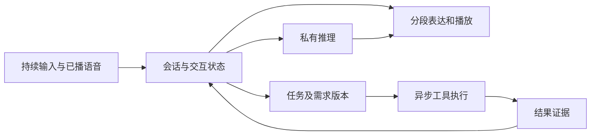

# Agent技术：上下文、任务状态与实时执行

**资料时点：2026-10-12（北京时间）。** 本文为现有调研的压缩技术版，不代表新增实测。标识约定：**[公开实现/论文]**、**[厂商测试]**、**[独立评测]**、**[媒体转述]**、**[工程分析/建议]**。动态支持状态、价格与排名仅适用原观测时点。

## 1. 分层职责

`模型决策 → 宿主调度 → 工具执行 → 证据返回 → 验收与继续/终止`构成执行闭环。Skill描述方法与资源，Plugin组织组件，MCP接入外部工具；它们不能替代宿主的取消、持久化、并发和预算控制。

## 2. Step-Code：长任务运行机制

表注：下列接口来自已读取的Step-Code文档/代码；main分支可变化。价值为机制分析，未复现性能收益。

| 机制 | 数据/控制流程 | 技术价值与边界 |
|---|---|---|
| CLM | 识别可编辑旧观察→修改工作上下文→校验→失败回退摘要 | 控制日志占用并保留canonical history；结构校验不保证摘要语义无损 |
| 压缩完整性 | shouldCompact→prepareCompaction→摘要→CompactionEntry→重建上下文 | 避免空摘要覆盖有效历史；目标、约束与结果证据仍需保护 |
| 子会话 | executeSubagent→独立执行→返回状态和关键结果，完整正文留details | 减少主上下文重复内容；并行可能增加总成本和资源争用 |
| Goal | 创建目标→宿主续跑→预算/取消/完成状态持久化 | 任务持续执行可控；自报完成必须由测试或产物验收 |

代码：[CLM](https://github.com/stepfun-ai/Step-Code/blob/main/packages/coding-agent/docs/context-management.md)、[压缩](https://github.com/stepfun-ai/Step-Code/blob/main/packages/coding-agent/src/core/compaction/compaction.ts)、[子会话](https://github.com/stepfun-ai/Step-Code/blob/main/packages/coding-agent/src/features/subagent/execute.ts)、[Goal](https://github.com/stepfun-ai/Step-Code/blob/main/docs/goal-lifecycle.md)。

[厂商测试] 相同Step5接入六个Agent的对照中，Step-Code报告73.3%完成率、每任务累计5.09M tokens。完整设置与不确定性不足，不能直接外推到3.5/3.7或NPU任务；应固定模型、任务与预算再比较框架。[产品测试](https://platform.stepfun.ai/step-code)

## 3. Realtime：听说、推理和工具任务分别推进

图注：Realtime论文机制的概念归纳。任务版本字段是工程建议，不是论文已公开schema；图示不保证工具事务支持撤销。

**轮次控制。** 同时利用用户音频、模型语音与历史，识别停顿、附和和打断。VAD只能检测语音活动，不能单独决定语义轮次。论文320ms音频块是表示粒度，不是端到端响应时间。[Realtime§5](https://arxiv.org/html/2609.14005#S5)

**Think-While-Speaking。** 两个并发调用分别推进推理与表达，以可用推理和已播内容生成下一段。它缩短首段响应的关键路径，但可能增加计算、提前承诺和纠正成本。须同时测首音、首个有效回答、最终正确结论时间与总费用。[Realtime§6.3](https://arxiv.org/html/2609.14005#S6.SS3)

**异步工具一致性。** 用户修改要求时，必须关联正在执行的任务并判断旧结果是否过期。播放停止不等于后台任务取消；“工具已启动”“执行已成功”“结果已验收”“已向用户播报”应为不同状态。[论文工具机制](https://arxiv.org/html/2609.14005#S7)

## 4. 可编辑计划：生成Agent的控制接口

Audio3 Music通过ABC计划再生成音乐，允许语言模型先编辑结构；Gen的ROLE/DIRECTOR/SCRIPT将人物、场景与时序显式化。共同价值是把部分控制从反复重采样转移到可检查的中间表示。

计划合法、成品符合计划、成品质量合格是三个独立验收项。Music论文的计划编辑收益有限，不能推导为所有创作任务普遍显著提升。工程上应将plan revision、seed、模型配置和产物绑定。[Music计划实验](https://arxiv.org/html/2609.16034#S5)、[Gen控制格式](https://arxiv.org/html/2609.12945)

## 5. MindSpeed-Agent优先借鉴项

现有项目已有catalog、角色、Skill、状态机与门禁。建议补足运行契约，避免重复搭建同类目录结构。[官方流程](https://gitcode.com/Ascend/MindSpeed-Agent/blob/f56bb671309ee1bd9f9fdf6c6c7b17b488f4a448/plugins/inference-model-optimize/workflows/optimize-pipeline.yaml)

表注：以下为建议，未提交目标项目实现；要由宿主与执行器支持，不能仅依赖Skill文本。

| 优先项 | 最小契约 | 验收目标 |
|---|---|---|
| 证据化handoff | task_id、需求revision、状态、关键结果、完整日志位置 | 结果可追溯，旧结果不覆盖新需求 |
| 上下文管理 | 保留要求/结论/失败原因；原始历史与工作视图分离 | 长日志压缩后仍可完成同一任务 |
| NPU资源租约 | 设备、端口、进程、工作区与所有者关联 | 多Agent不同时重启同一服务或污染压测 |
| 取消与恢复 | 超时、远程进程处理、已完成副作用、恢复点 | 重启后不重复执行、不丢失有效结果 |
| 完成门禁 | 命令、退出码、测试、产物和配置版本 | “完成”由证据支持，不以模型声明替代 |

平台接入还需检查工具协议、stream事件和hook；兼容插件格式不等于MindSpeed-Agent所有宿主行为在Step-Code上直接可用。

代码仓、具体接口流程与工程投入分级见[重点对象代码参考与工程投入](https://github.com/wangx700/Transmission-Transfer-Station/blob/main/step%E7%B3%BB%E5%88%97%E6%8E%A8%E7%90%86%E5%92%8Cagent%E8%B0%83%E7%A0%94%E8%AF%B4%E6%98%8E/%E6%A0%B8%E5%BF%83%E6%8A%80%E6%9C%AF%E6%8A%A5%E5%91%8A/04-%E9%87%8D%E7%82%B9%E5%AF%B9%E8%B1%A1%E4%BB%A3%E7%A0%81%E5%8F%82%E8%80%83%E4%B8%8E%E5%B7%A5%E7%A8%8B%E6%8A%95%E5%85%A5.md)。
