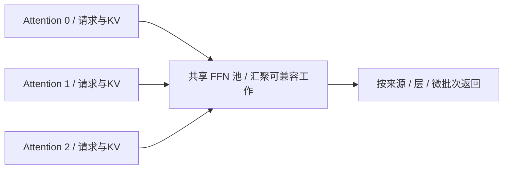

# AFD 与 StepMesh：机制优势、代码参考及昇腾工程判断

资料时点：**2026-10-12（北京时间）**。本文整理公开论文、源码与上游支持范围；未进行 NPU 真机测试。标识为 **[公开实现/论文]** 的内容有公开依据，**[工程分析/建议]** 是基于机制的判断，不能当作已测收益。

## 1. 核心结论

**AFD 的核心收益是解耦 Attention 与 FFN 的资源配置和有效 batch；StepMesh 负责使跨池交接足够快；DBO 负责两个微批次的计算与通信重叠。** AFD 不是异步执行的同义词，也不是 DBO 的替代品。是否值得部署，要比较相同总设备资源、相同质量和延迟约束下的系统吞吐及成本。

昇腾已有 `afd-plugin` 的 NPU worker、runner 和 CAMP2P/CAM Connector，应优先复用并验证。将 StepMesh 移植到 NPU、将 Step 模型接入 AFD、验证已有 Ascend Connector 是三项不同工作。**建议近期投入验证与瓶颈测量；满足收益门槛后，再重点投入模型接入和系统优化；不默认重写一套 StepMesh NPU 通信后端。**

## 2. 机制与优势的原理

### 2.1 拆分边界及接口流程

[公开实现/论文] 普通 Transformer 层在 Attention 之后执行 FFN/MoE。AFD 将两部分映射到不同设备池；KV Cache 通常保留在 Attention 池，逐层发送的是中间激活及执行/路由元数据，返回的是 FFN 输出。`1A1F` 可以由一张 Attention 设备和一张 FFN 设备实现；rank 是进程编号，必须结合设备映射理解。归一化、残差、gate、shared expert 的归属取决于模型切分点。


图注：表示一轮前向的逻辑接口流程，不表示所有模块都在单一 rank 上；同一微批次必须取得本层 FFN 输出后才能进入后续层。客户端请求发往 Attention 服务；FFN 由内部 Connector 驱动，不负责请求 KV 或采样。[Attention 设计](https://github.com/vllm-project/afd-plugin/blob/bf5bd280b7481358fc0df4a8ec5897b12be73802/docs/design/module/attention_runtime.md)、[FFN 设计](https://github.com/vllm-project/afd-plugin/blob/bf5bd280b7481358fc0df4a8ec5897b12be73802/docs/design/module/ffn_runtime.md)。

### 2.2 优势一：分别配置显存、算力与并行拓扑

[工程分析] Attention 持有随请求数、上下文长度增长的 KV；FFN 主要持有模型权重，其工作量随本轮 token 数和路由分布变化。长上下文 Decode 常出现 KV 读取压力，FFN 的矩阵计算效率则对专家有效 batch 敏感。两者不必采用同一资源比例或拓扑。

分离后，Attention 侧不加载被迁移的 FFN 权重，可将腾出的空间用于 KV。一个简化容量关系是 `可用KV空间 ≈ 设备内存 − 本角色权重 − 激活/工作区 − 通信缓冲 − 保留空间`。收益不能只按“移走的权重大小”计算，因为 AFD 缓冲区、图缓存和工作区也占内存。

A/F 两侧可分别选择 DP、TP、EP 组合和设备数量。增加 Attention 容量不必同步复制同等 FFN 服务容量；FFN 成为瓶颈时也可调整专家配置。扩容仍需要权重、连接、路由及请求状态协调，不能理解成无成本的在线弹性。专家权重复制能否减少，取决于原有部署：原本已由 EP 共享专家的部署，不保证再省一份权重。

### 2.3 优势二：跨 Attention 实例汇聚专家 batch

[工程分析] MoE 中，若总 batch 为 B、每 token 选择 k 个专家、共有 E 个等规模专家且均匀路由，则每专家平均有效 batch 约为 `B×k/E`。单个 Attention 实例 token 少时，每专家矩阵乘可能很小，权重读取和启动开销难以摊薄。多个 Attention 实例向共享 FFN 池交接，提供更大的 token 来源，有机会提高每专家 batch、权重复用和有效算力。



图注：汇聚的是同层、执行条件兼容的工作；不是把任意层的 token 拼在一起。实际聚合策略由 Connector 和调度实现决定。均匀路由公式忽略 shared experts、热点及分片，不能当作容量公式。

增大 batch 会带来等待和尾延迟，因此应约束 FFN 聚合窗口和队列长度。AFD 提供汇聚机会，不保证每轮都凑到高效 batch。最忙专家也可能决定整轮完成时间，需要同时分析专家负载和返回完成条件。

### 2.4 优势三：不同微批次的 A/F/通信流水线

[公开实现/论文] 对当前微批次，Attention→FFN→下一层的依赖不变；可与其他独立微批次交错执行，使 Attention 计算下一批时 FFN 计算上一批。异步提交、独立缓冲区和事件提供实现这种重叠的条件。[StepMesh 技术说明](https://github.com/stepfun-ai/StepMesh/blob/1a668434ee7494138ac67e48981fb700e6548305/Introduction_cn.md)。

```text
逻辑时间 →
Attention池： A_i(batch0)    A_i(batch1)    A_i(batch2)
FFN池：                     F_i(batch0)    F_i(batch1)    F_i(batch2)
通信：          A→F batch0      返回0 / 发送1      返回1 / 发送2
```

图注：用于解释不同批次重叠，不是实测时间线；算子和通信时长不相等时会出现空闲。下一层同批次仍等待自己的结果，异步 API 不等于单请求时延下降。

### 2.5 相对 DBO 的新增价值

表注：比较机制提供的优化空间，不代表性能排名。DBO 指两个 microbatch 的交错执行；AFD 可同步或异步，是否组合 DBO 受后端支持限制。

| 维度 | DBO | AFD |
|---|---|---|
| 主要作用 | 遮蔽计算与通信等待 | 分离 A/F 资源与执行拓扑 |
| 权重/KV 布局 | 本身不改变两侧部署布局 | 可减少 Attention 侧 FFN 权重占用 |
| batch 范围 | 拆分当前 batch 并交错执行 | 可汇聚多个 Attention 实例的 FFN 工作 |
| 资源比例 | 本身不改变 A/F 配额 | 可分别配置 A/F 设备数量 |
| 代价 | 微批次划分、调度及小算子效率变化 | 跨池通信、队列、同步及运维复杂度 |

[工程分析] 若现有瓶颈主要是 EP 通信等待，优先验证 DBO；若瓶颈是 KV 容量、专家有效 batch 或 A/F 资源失配，AFD 才有额外优化空间。低并发、单请求延迟优先时，缺少可重叠工作，AFD 更容易暴露往返代价。

### 2.6 通信成本与性能证据边界

[工程分析] 同步简化关键路径是 `T_token ≈ Σ层(T_A + T_A→F + T_F + T_F→A + T_queue) + T_output`。一次完整 hidden-state 发送并返回同尺寸输出的简化流量为 `2×B×H×s 字节/层`，其中 B 是该次交接 token 数、H 是 hidden size、s 是每元素字节数。真实流量受 TP 分片、Top-k、广播、量化、padding 及通信融合影响。

MoE EP 原本已有 dispatch/combine，AFD 可能复用、融合或重新组织这条通信路径；不能把全部 A/F 流量都算作新增，也不能宣称通信免费。应比较新旧部署的完整关键路径，而非仅比较传输字节。

[厂商实验] Step-3 报告在 Hopper、4K 上下文、FP8、无 MTP、50ms TPOT 约束下达到 4039 tok/s/GPU，对照 DeepSeek-V3 为 2324。该结果包含模型结构与系统设计差异，**不是纯 AFD 对 DBO 的消融，不是单请求速度，也不是昇腾实测**。[Step-3 §7](https://arxiv.org/html/2507.19427#S7)。MFA 对 KV 和 Attention 的收益必须与 AFD 分别归因。

## 3. StepMesh 的职责与代码证据

[公开实现] StepMesh 基于 BytePS，为 A/F 二部图交接提供异步张量通信。接口流程为：

```text
Attention / AFTensorWorker
  → ZBatchPushPull：提交发送与接收缓冲，记录完成标识
  → 后台线程等待输入产生事件，推进传输
FFN / AFTensorServer
  → GetBatch：取得输入
  → 应用执行 FFN（StepMesh 不执行模型 FFN）
  → Respond：返回输出
Attention
  → Wait：确认交接完成
  → 消费结果，继续后续计算
```

代码入口：[af_tensor_app.h](https://github.com/stepfun-ai/StepMesh/blob/1a668434ee7494138ac67e48981fb700e6548305/include/ps/af_tensor_app.h)。`ZBatchPushPull()` 将请求放入 `pushpull_queue_` 并返回 timestamp；`PushPullWorker()` 等待事件后调用内部传输；`Wait()` 等待本批关联完成标识。`ZPush_()` 遍历 server 发送，说明公开路径含广播：不能将其默认等同于按专家稀疏 All-to-All。

其优势来源是预注册独立微批次缓冲区、GPUDirect RDMA 和 CPU 网络线程推进传输。设计目标是减少拷贝及 GPU SM 竞争，但网络带宽、CPU 抖动、缓冲容量和慢节点仍有成本。FFN 内部的 AllGather/专家并行通信不自动由 StepMesh 全部接管。[官方说明](https://github.com/stepfun-ai/StepMesh/blob/1a668434ee7494138ac67e48981fb700e6548305/Introduction.md)。

## 4. 主要参考仓与技术文档

表注：源码快照于2026-10-12核验；固定 SHA 用于复查，主分支文档可能继续变化。下表区分机制、执行实现和设备支持，不能互相替代。

| 仓 / 文档 | 主要参考价值 | 阅读重点 |
|---|---|---|
| [Step-3 技术报告](https://arxiv.org/html/2507.19427) | 模型与系统协同设计、AFD部署及实验 | MFA 与 AFD 分开归因、硬件与 SLA 条件 |
| [StepMesh 仓](https://github.com/stepfun-ai/StepMesh/tree/1a668434ee7494138ac67e48981fb700e6548305) | A/F通信接口、异步缓冲和RDMA实现 | Worker/Server、事件与完成语义 |
| [StepMesh 中文技术说明](https://github.com/stepfun-ai/StepMesh/blob/1a668434ee7494138ac67e48981fb700e6548305/Introduction_cn.md) | 微批次流水线、通信预算、慢节点分析 | 预算依赖层数、流水线深度和TPOT；不是通用实测时延 |
| [StepMesh Backend 文档](https://github.com/stepfun-ai/StepMesh/blob/1a668434ee7494138ac67e48981fb700e6548305/docs/backend.md) | 设备内存、事件和后端注册抽象 | 移植接口不等于已具备NPU直连能力 |
| [vLLM AFD Plugin](https://github.com/vllm-project/afd-plugin/tree/bf5bd280b7481358fc0df4a8ec5897b12be73802) | 角色worker、模型wrapper、Connector及Ascend实现 | [Connector契约](https://github.com/vllm-project/afd-plugin/blob/bf5bd280b7481358fc0df4a8ec5897b12be73802/docs/design/module/connector_contracts.md)、[运行矩阵](https://github.com/vllm-project/afd-plugin/blob/bf5bd280b7481358fc0df4a8ec5897b12be73802/docs/design/module/execution_platforms.md) |
| [vLLM-Ascend](https://github.com/vllm-project/vllm-ascend) | NPU基础推理、算子和模型支持 | 不从基础支持推导AFD支持 |
| [AFD设计空间研究](https://arxiv.org/abs/2605.28302) | 分析模型、负载、拓扑与延迟约束的适用边界 | 区分模拟、内核测量和生产验证 |

### 4.1 Step-3.5 / 3.7 是否延续使用

[公开资料边界] Step-3 明确报告 AFD。所核验的 [Step-3.5 v2报告](https://arxiv.org/html/2602.10604v2) 与 [Step-3.7官方模型卡](https://huggingface.co/stepfun-ai/Step-3.7-Flash) 未提供继续使用 AFD/StepMesh 的明确部署证据。3.7公开 vLLM 命令使用 TP、EP 和 MTP，不含独立 A/F 服务配置。**未披露不等于弃用；也不能将后继模型速度归因于 AFD。**

## 5. 昇腾适配：已有实现与新增工作的边界

### 5.1 已有 Ascend AFD 路径可复用

[公开实现] AFD 通过外部插件接入 vLLM/vLLM-Ascend。该快照 README 目标为 vLLM `0.30.0 / ced6857a` 与 vLLM-Ascend `8d4409d6`；历史 recipe 中存在0.19/0.26环境，必须按对应快照理解，不能混用版本或实验结论。[版本与支持说明](https://github.com/vllm-project/afd-plugin/blob/bf5bd280b7481358fc0df4a8ec5897b12be73802/README.md)。

表注：截至2026-10-12的插件快照；以下是实现边界，具体模型/拓扑必须查硬件证据。910C/A3验证不能自动推广到910B或950。

| Ascend 路径 | 已有实现 | 重要限制 |
|---|---|---|
| 同步 CAMP2P | HCCL/CAMP2P 自定义算子及控制元数据交接 | 图模式随Runner版本变化；NPU V1原生DBO限两个微批次，V2不支持DBO |
| 异步 CAM | 异步工作项、dispatch/combine、插件管理的两阶段MoE流水线 | eager执行，无图支持；不支持原生DBO，部分组合有已知正确性问题 |
| Step 模型接入 AFD | 当前模型wrapper列表未列Step-3/3.5/3.7 | 不能把DeepSeek上的NPU验证当作Step AFD已完成 |
| StepMesh NPU后端 | 公开StepMesh已列CPU/CUDA，xPU为占位 | 若选用StepMesh，需要新增设备后端及完整数据路径验证 |

代码证据：[NPU FFN Runner](https://github.com/vllm-project/afd-plugin/blob/bf5bd280b7481358fc0df4a8ec5897b12be73802/afd_plugin/v1/worker/npu/ffn_model_runner.py) 直接继承 vLLM-Ascend `NPUModelRunner`，`get_kv_cache_spec()` 返回空字典。同步路径为 `recv_attn_output → ascend_forward_context → compute_ffn_output → 返回输出`；异步路径为 `recv_ffn_work_item → 按实际layer/token信息计算 → 返回工作项输出`。通信实现分别见 [camp2p.py](https://github.com/vllm-project/afd-plugin/blob/bf5bd280b7481358fc0df4a8ec5897b12be73802/afd_plugin/connectors/npu/camp2p.py) 与 [async_cam.py](https://github.com/vllm-project/afd-plugin/blob/bf5bd280b7481358fc0df4a8ec5897b12be73802/afd_plugin/connectors/npu/async_cam.py)。

### 5.2 如果接入 Step 模型，需要适配什么

[工程分析/建议] 优先沿用已有Ascend Connector，新增模型切分和执行契约：

1. **模型与权重角色化**：确定dense/MoE层、gate/shared experts、归一化和残差边界；两侧只构造所需组件，保持原始路由及数值语义。
2. **请求执行与元数据**：Attention保持KV/采样；交接携带层、微批次、token数量、路由等必要信息，返回时保持来源和顺序。
3. **Ascend执行组合**：验证tensor形状、padding、量化scale、TP/EP分片、stream/event、图捕获/重放；AFD与MTP组合需单独验证候选/验证执行及缓存语义。
4. **生命周期**：处理超时、异常、退出、在途缓冲复用，避免一个FFN服务故障导致所有Attention请求无限等待。

### 5.3 如果移植 StepMesh，需要额外适配什么

[工程分析/建议] Backend抽象提供 `SetDevice / Alloc / Free / RecordEvent / SyncEvent` 等接口，但移植不能停留在接口替换。还需确认目标NPU内存是否能被所用网卡/驱动注册和直接访问、事件与设备stream的同步语义、Tensor桥接及RDMA生命周期。CPU中转可用于验证正确性，但不能沿用CUDA GDR的低拷贝性能结论。[Backend接口](https://github.com/stepfun-ai/StepMesh/blob/1a668434ee7494138ac67e48981fb700e6548305/include/ps/internal/backend.h)、[CUDA实现参考](https://github.com/stepfun-ai/StepMesh/blob/1a668434ee7494138ac67e48981fb700e6548305/src/backend/gpu_backend.cc)。

“零SM占用”是CUDA语境的设计目标，不能直接换算成NPU上零AIC/AIV资源占用。必须测量实际通信实现对设备算力、内存带宽和CPU的影响。

## 6. 后续是否需要重点工程投入

**[工程建议] 有参考价值，宜先验证，再按瓶颈立项。** 近期重点是复用已有Ascend路径建立可靠基线；Step AFD接入属条件性研发；完整StepMesh NPU移植优先级应由现有通信路径的不足决定。

表注：这是投入优先级建议，不是工期承诺或已测收益；每阶段需保留具体硬件、软件commit、模型、精度、输入输出长度、并发和SLA条件。

| 阶段 | 工作与交付 | 继续投入条件 |
|---|---|---|
| 优先：基线与验证 | 固定目标环境；比较普通EP、EP+DBO与已有AFD，确认输出质量和退出行为 | 数据可信且代表业务 |
| 条件投入：Step wrapper | 完成角色权重、模型切分及最小eager端到端验证；再拓展图/MTP | 目标业务确有KV、专家batch或A/F配置瓶颈 |
| 条件重点：系统优化 | 扫描A/F比例、batch与聚合窗口；优化量化/通信、热点专家、队列和多节点稳定性 | 同资源同SLA下收益稳定，质量与长尾达标 |
| 暂不默认投入：StepMesh NPU移植 | backend、内存直连、事件、Tensor与通信整链验证 | CAMP2P/CAM无法满足已测需求，且新路径有可验证收益空间 |

验收比较必须保持相同总设备数、模型/精度、自然路由、请求轨迹和延迟目标；分别报告固定并发与饱和负载。指标包括总吞吐、每设备吞吐、TTFT（请求到首token）、TPOT/ITL（后续token延迟）、P95/P99、KV容量、专家有效batch、A/F空闲、通信与排队时间、质量/异常率。不同物理卡/die/rank口径必须注明，强制专家均衡只能用于受控微基准，不能作为生产模型收益。

不预设统一提升百分比。先确定业务可接受的尾延迟、质量和成本门槛，再以相同资源下的稳定收益决定是否重点投入；若收益仅来自增加设备，或以明显更高排队延迟为代价，应重新评估。现阶段不应把AFD设为Step-3.5/3.7基础推理或RL采样的默认前置依赖。
