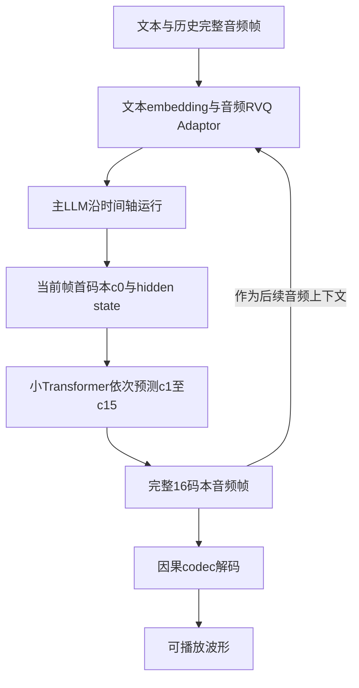
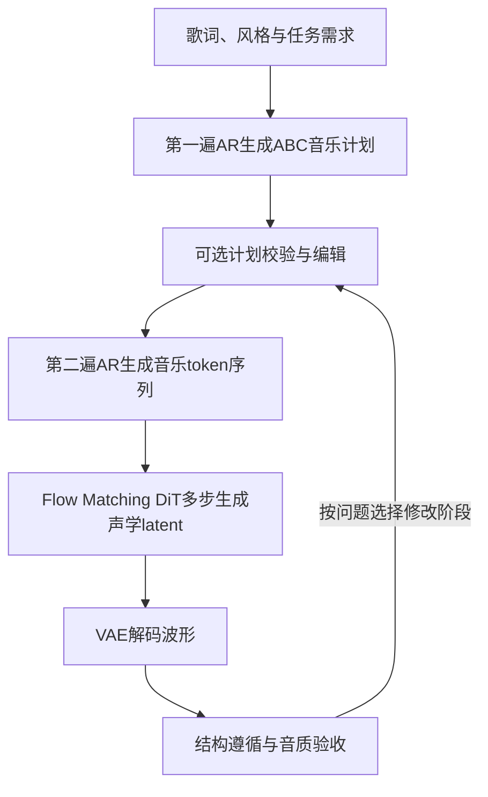

# Audio3 Gen与Music：机制优势、参考实现与昇腾工程投入

**资料时点：2026-10-12（北京时间）。** 范围为StepAudio 3 Gen和Music，解释核心总览中的“时间–码本深度分工 / 计划–AR–渲染分工”。论文机制、已有版本代码参考和工程建议分别标注；本次未进行NPU实测，也未核实到与两篇论文逐一对应的完整公开部署实现。Realtime的听说并发、Think-While-Speaking与异步工具属于另一条系统路线，不能由Gen/Music的生成架构推导已具备。

## 1. 核心判断

**Gen的优势是把跨时间的序列组织和帧内声学表示分配给不同规模的模型。** 大LLM预测各时间帧的首码本，小Transformer补齐同一帧其余码本，codec还原声音。减少的是大模型承担的串行预测位置，帧内细节生成和波形解码仍需计算。

**Music的优势是把可编辑音乐决策、离散序列生成和连续声学合成分开。** 先生成计划，再根据计划生成音乐token，最后由DiT和VAE合成波形。可编辑中间表示提供Agent介入点，各阶段独立测量提供系统优化入口；不能据此承诺更低总延迟或严格逐音符遵循。

**昇腾结论：API调用以应用集成为主；完整本地部署需要按模块确认和适配。** 是否重点投入取决于业务是否要求本地运行、模型资料是否完整，以及性能/质量差距。近期优先做开放范围核验和最小链路验证，资料齐全后再决定专项研发规模。

## 2. Gen：时间轴与码本轴如何分工

### 2.1 码本与深度是什么意思

[论文机制] 音频先表示成连续的帧，每帧由多个离散编号共同描述；码本是学习得到的特征向量字典，编号指向字典中的向量。残差向量量化（RVQ）逐级近似尚未表达的特征。“码本深度”指同一帧的量化层级，不是Transformer网络层数，也不是音频播放时间。

```text
                    同一时间帧内部的码本轴 →
时间帧t             c[t,0]  c[t,1]  ...  c[t,15]
时间帧t+1           c[t+1,0]        ...  c[t+1,15]
时间帧t+2           c[t+2,0]        ...  c[t+2,15]
   ↓
声音时间向前推进
```

图注：每一行是同一个时间位置的完整音频表示；主LLM沿行方向推进时间，小预测器在一行内推进码本层级。各码本同时承载语义与声学信息，不能硬分成“首码本只有文字，后续码本只有音色”。

### 2.2 输入与输出的接口流程

[论文机制] 输出端主LLM产生首码本及对应hidden state，小预测器以两者为条件补齐剩余码本。输入端则汇聚完整帧的多码本embedding，经RVQ Adaptor映射到主干输入空间。输入Adaptor与输出Code Predictor职责不同。[Gen论文§2](https://arxiv.org/html/2609.12945#S2)



图注：依据论文模块关系归纳，反馈表示后续帧可使用完整历史表示；图不保证跨帧流水并行已经实现。实际缓存、分块和调用接口需以部署代码核验。

### 2.3 优势从哪里来

**优势一：避免将所有码本平铺成大LLM的时间序列。** 若每帧的多个码本都成为主干独立位置，大模型需要承担更多串行步骤和更长历史。时间–深度分解保留完整音频表示，将帧内预测交给较小模块。与这种平铺基线相比，大模型的音频位置减少；整体收益还取决于小模型串行预测、数据交换及codec成本，不能直接宣称固定倍数加速。

**优势二：不同计算任务可以分别优化。** 主干关注跨帧上下文，小预测器处理短序列局部依赖，codec执行波形重建。工程上可分别定位主干带宽、预测器启动开销、声学解码和分块调度瓶颈，避免只优化LLM而遗漏出音链路。

**优势三：减少新增声学目标对预训练主干的直接干扰。** 训练先建立输入对齐，再引入生成；新预测器尚不稳定时暂时断开其到主干的梯度，并配合文本回放，最后联合训练。这是保护原语言能力的训练设计，推理移植需要正确加载相关模块，不必重复执行训练过程。[Gen训练章节](https://arxiv.org/html/2609.12945#S4)

**优势四：因果解码提供增量出音条件。** 波形解码不依赖未来帧，适合分块输出；首音仍受首帧生成、codec分块、队列与播放buffer影响。因果codec本身不提供用户打断和工具执行控制。

### 2.4 用计数理解收益与边界

[教学算例] 采用论文的12.5Hz、16码本表示，10秒音频约125帧、2000个码本编号；主干预测约125个音频位置的首码本，剩余编号由小预测器生成。主干还要处理文本和控制token。此算例说明计算分工，不是实测吞吐或最大长度。

[工程建议] 单块耗时拆为主干生成、帧内码本预测、codec解码和输出调度；只有真正实现重叠的阶段才能按流水线分析，存在依赖的步骤仍须计入串行关键路径。

## 3. Music：计划、AR与渲染如何分工

### 3.1 三个阶段各自产生什么

[论文机制] AR是自回归，即根据已有序列逐步预测后续token。计划启用时，同一MoE AR主干先生成ABC音乐计划，再生成音乐token；DiT根据离散token生成连续VAE latent，VAE还原波形。[Music论文§2](https://arxiv.org/html/2609.16034#S2)



图注：计划是可选生成模式；编辑与验收回路是可借鉴的Agent工程组织。ABC计划与音乐token是不同表示，DiT与VAE承担不同任务。

### 3.2 机制优势及其原理

**优势一：将部分音乐决策显式化。** ABC把节拍、调性、和弦及旋律等安排放到可读中间表示中。Agent可以在昂贵声学合成前发现约束冲突或修改安排，将部分试错转移到计划阶段。计划编辑后仍需重新生成，并验证实际音频遵循；计划有效不保证成品好听。

**优势二：把长程序列组织与声学合成分配给不同模块。** AR负责离散序列依赖，DiT负责条件连续生成，VAE负责波形重建。DiT推理通过多步更新连续latent，因此计算量受积分配置影响；不能将它当作一次简单token查表。可分别优化AR缓存与decode、DiT多步计算和VAE解码。

**优势三：以生成可预测性为目标设计离散表示。** 更高重建保真度并不自动带来更好的生成，因为AR必须预测这些表示，预测误差会影响后续结果。Music选择单码本路线，在信息保存和序列可预测性之间取舍；该设计与Gen的多码本路线面对不同目标，不能据此判断单码本普遍更好。

**优势四：分块渲染控制单次声学计算范围。** 论文以30秒块渲染，并将前块末尾2秒latent作为后块上下文。短历史帮助衔接局部声学状态，全局音乐结构仍依赖计划和音乐token条件；不能把2秒上下文当作整首曲子的记忆。[Music§2.4](https://arxiv.org/html/2609.16034#S2.SS4)

### 3.3 Agent与性能分析的直接价值

[工程建议] 流程设计为“需求→计划→校验/编辑→音乐token→渲染→成品检查”。保存plan revision、seed、采样/渲染配置与产物标识，让结果可以追溯到实际使用的计划。结构问题优先检查计划及AR结果，音质问题检查token信息、DiT与VAE，避免任何失败都重复整条链。

[教学算例] 论文最终表示为50Hz单码本，因此3分钟约9000个音乐token，另加歌词、提示与计划上下文。总耗时包括计划、AR、DiT多步计算、VAE和传输；不应只用LLM tokens/s估算整首音乐的生成时间。

## 4. 主要技术文档与代码仓

表注：资料时点2026-10-12（北京时间）。“机制依据”是论文；“代码参考”是已存在的其他版本或后端入口，不表示Audio3完整模型已开源或已完成昇腾部署。main入口随仓库更新，实际实验应固定commit。

| 类型 | 主要入口 | 使用方式与边界 |
|---|---|---|
| Gen机制 | [技术论文](https://arxiv.org/html/2609.12945)、[项目页](https://stepaudiollm.github.io/step-audio-3-gen/) | §2核对时间–深度结构、输入Adaptor及codec；§4核对训练；项目页用于音频示例 |
| Music机制 | [技术论文](https://arxiv.org/html/2609.16034)、[项目页](https://stepaudiollm.github.io/step-audio-3-music/) | §2核对AR/DiT/VAE；§5.4.3核对计划编辑实验；不要将样例页面视为部署源码 |
| 既有音频模型 | [Step-Audio2](https://github.com/stepfun-ai/Step-Audio2)、[stepaudio2.py](https://github.com/stepfun-ai/Step-Audio2/blob/main/stepaudio2.py) | 参考音频处理、模型调用与输出组织；不能替代Audio3 RVQ预测器或Music渲染器 |
| 音频推理服务 | [Step-Audio-R1](https://github.com/stepfun-ai/Step-Audio-R1)、[stepaudior1vllm.py](https://github.com/stepfun-ai/Step-Audio-R1/blob/main/stepaudior1vllm.py) | 参考vLLM服务交互与音频请求封装，部署仍需核对具体模型与设备路径 |
| Agent工具入口 | [StepAudio-Skills](https://github.com/stepfun-ai/StepAudio-Skills) | 参考API工具、输入输出与异常处理；API客户端不等于本地NPU模型实现 |
| 推理主框架 | [vLLM](https://github.com/vllm-project/vllm) | 核对模型注册、权重加载、多模态输入、scheduler及缓存能力 |
| 昇腾后端 | [vLLM-Ascend](https://github.com/vllm-project/vllm-ascend)、[官方文档](https://docs.vllm.ai/projects/ascend/en/latest/) | 固定与core配套的版本，核对目标硬件与具体模块支持；通用后端存在不代表整模型支持 |

### 4.1 可提供的源码证据与接口流

**音频前后处理参考：** Audio2的`stepaudio2.py`用于检查既有版本的预处理、模型调用与输出处理组织。参考流程为`音频/文本→模型输入组织→生成→输出解析`。迁移时须替换成Audio3真实processor与模块契约，不能直接照搬模型结构。

**已有昇腾attention实现：** 固定commit的[patch_step3p5.py](https://github.com/vllm-project/vllm-ascend/blob/c076a131097fdfac9db4b57c8cf55bfd45ea0ca5/vllm_ascend/patch/worker/patch_step3p5.py)中，`_patched_attention_forward`先调用`self.qkv_proj(hidden_states)`，再按条件调用`DeviceOperator.split_qkv_rmsnorm_rope(...)`。接口流为`hidden→QKV投影→融合拆分/归一化/RoPE→后续attention`。这是Step3.5/3.7的已有后端代码，只有Audio3结构、布局与数学语义一致时才可考虑复用。

**缓存组织参考：** [step3p5.py](https://github.com/vllm-project/vllm-ascend/blob/c076a131097fdfac9db4b57c8cf55bfd45ea0ca5/vllm_ascend/spec_decode/step3p5.py)的`AscendStep3p5MTPProposer`按MTP层的KV group组织metadata，`set_per_group_attn_metadata(gid, block_table, slot_mapping)`接收对应映射。可借鉴“缓存与实际模块依赖匹配”的方法。Gen的帧内RVQ预测并不是MTP推测解码，不能把MTP proposer当作RVQ预测器实现。

## 5. 昇腾是否需要适配

### 5.1 先确定交付目标

表注：以下是工程决策建议；“需要适配”指新增或补齐目标NPU执行链，实际缺口以目标版本检查为准。本报告没有Audio3 NPU实测结论。

| 目标 | 是否需要模型级NPU适配 | 参考价值与建议投入 |
|---|---|---|
| 调用远端音频API | 客户端通常无需移植模型算子 | 应用集成、计划/脚本管理、结果验收；投入由业务需求决定 |
| 借鉴分层生成机制到已有模型 | 不必部署Audio3，但改动自身模型仍需验证 | Gen提供时间/帧内计算分解思路；Music提供计划与昂贵执行分离思路 |
| 本地部署Gen | 需要核验并补齐主干、Adaptor、RVQ预测器、codec全链 | 开放资料齐全且有本地语音/音效业务时，适合专项投入 |
| 本地部署Music | 需要核验并补齐AR、DiT、VAE及分块状态 | 有长音乐创作或本地生成要求时专项评估；多阶段性能与音质工作较多 |
| 提供实时Voice Agent | 另需交互与任务运行时适配 | 不能从Gen因果codec或Music计划直接推导全双工能力 |

### 5.2 Gen模块适配清单

[工程建议] 依次检查：

1. **模型与权重接入：** tokenizer词表、音频token ID、文本/音频控制符、各码本embedding和模块权重映射。
2. **输入Adaptor：** 完整帧embedding汇聚、音频位置门控、主干输入形状与精度；不能只保留首码本embedding。
3. **时间主干：** attention/MoE若存在、位置编码、KV布局与并行配置；以实际config为准，不由产品名称推断架构。
4. **帧内预测器：** hidden state及c0输入、码本层级位置、c1～c15采样、短序列缓存生命周期。小模型计算短，需测启动/同步开销，避免只看矩阵乘速度。
5. **因果codec：** 实际attention窗口、波形重建、ISTFT相关路径与分块历史；验证NPU算子和精度。CPU回退可用于原型定位，但应单列耗时。
6. **流式封装：** 分块输出、音频边界、结束/取消时缓存清理和播放接口；分别记录首音与持续出音能力。

### 5.3 Music模块适配清单

[工程建议] 依次检查：

1. **计划与AR主干：** ABC提示模板和输出解析、音乐词表/终止条件、长序列KV、MoE与并行路径（依实际实现）。
2. **条件对齐：** 音乐token与latent的帧位置、形状和dtype，确保DiT接收到正确条件，而非仅检查张量尺寸可运行。
3. **DiT：** 多步条件计算、attention与norm等实际算子、随机噪声与solver配置。先保持参考步数/精度，正确后单独评估减步和量化。
4. **VAE：** 解码算子、声道、采样率、幅度与输出时长；用参考latent隔离VAE误差。
5. **块间状态：** 保存与传递前块latent尾部；按参考实现处理上下文与输出边界，不能自行假设直接拼接或重叠相加策略。
6. **流水与资源：** 分别采集AR/DiT/VAE耗时、内存与传输量，测得瓶颈后才决定同卡、分卡或资源池拆分。分阶段架构不保证分部署一定更快。

## 6. 是否需要重点工程投入，以及怎样推进

**建议设为有前置条件的音频专项，先形成可运行基线再做重优化。** 只有论文和展示样例时，交付机制调研、资料缺口和最小实验方案；拿到合法可用权重、配置、完整推理源码及参考产物后，再进行NPU研发。需要本地部署且质量/成本目标明确时，Gen和Music分别评估，不共用一份笼统人天估算。

表注：阶段为建议研发顺序，不是日历时间或承诺工期；进入下一阶段需满足所列产出。人员列是责任领域，不表示固定人数。

| 阶段 | 主要工作 | 交付与进入下一阶段条件 | 责任领域 |
|---|---|---|---|
| A：资料与范围核验 | checkpoint/config/processor、许可、源码、参考环境 | 完整依赖清单与可执行参考链；资料不足则继续调研/API验证 | 模型接入、业务负责人 |
| B：模块正确性 | 固定精度、eager模式、逐模块对齐 | 关键张量与内容/音质基线，错误可定位 | 音频模型、NPU后端、质量评测 |
| C：完整服务 | Gen流式状态或Music分块渲染、异常/取消 | 连续运行、产物可追溯、任务终态正确 | 推理服务、Agent/平台 |
| D：瓶颈优化 | profiling后决定算子融合、图模式、量化或并行 | 同条件质量守住且端到端性能收益成立 | 算子、性能、分布式 |
| E：业务验收 | 真实负载、并发、成本与主观听评 | 满足业务SLO；达标即可停止扩大优化范围 | 业务、质量与平台 |

**重点投入应落在音频专有模块与完整链路。** Gen关注帧内小模型和codec；Music关注DiT/VAE、长序列与块间连续性。已有后端可运行的基础算子优先复用；只有测量确认的缺口才开发融合算子或通信优化。

## 7. 验证指标与故障定位

表注：下表是建议测量定义；所有时间均用同一固定测量窗口统计，注明预热、样本数、并发、输入/输出音频时长、是否包含网络和排队，并报告分位数。阈值由参考基线和业务SLO确定。

| 指标/实验 | 测量或验收口径 | 定位作用 |
|---|---|---|
| 首音延迟 | 完整请求进入服务至首段可播放波形可用；客户端实际播放另报 | Gen首块及服务关键路径 |
| 完整生成时间 | 请求进入服务至完整音频产物可用 | 各阶段总成本；不以首音代替 |
| RTF | 声明范围内处理墙钟耗时/生成音频秒数；单请求和批量分开 | 持续生成能力；不直接推导首音 |
| 分阶段时间 | Gen主干/预测器/codec，Music计划/AR/DiT/VAE分别计时 | 避免将所有瓶颈归给LLM |
| 固定中间表示实验 | 固定RVQ码或音乐token/latent，分别运行后端模块 | 区分预测误差、渲染误差与设备移植误差 |
| 音频质量 | 语音内容、音色稳定、爆音/断音；音乐结构、节奏、音质与听评 | 数值或形状正确不等于成品正确 |
| 计划遵循 | 请求→计划约束→实际音频逐项检查 | 区分计划满足需求与成品遵循计划 |
| 资源与可靠性 | 峰值内存、队列时间、设备耗时、取消后释放和错误率 | 服务容量与运行控制 |

随机采样模型应固定种子组、采样参数和版本，并比较多样本分布；不可要求跨设备随机生成波形逐点相同。模块级确定性输入可做张量误差对齐，成品同时采用内容指标和听评。减少DiT步数、量化或图优化后须重新验证音质与连续性。

## 8. 交流时推荐的表述

“Gen把音频生成拆成跨时间的首码本预测与帧内残差码本预测，让大LLM承担序列组织，小模型补齐声学表示；Music先给出可编辑音乐计划，再自回归生成音乐token，最后通过DiT和VAE完成声学合成。对昇腾的价值是明确不同计算模块与瓶颈，便于分阶段适配和验证。完整本地部署仍需要权重、源码与音频专有链路支持，不能从文本主干可运行推导整模型已经支持。”
