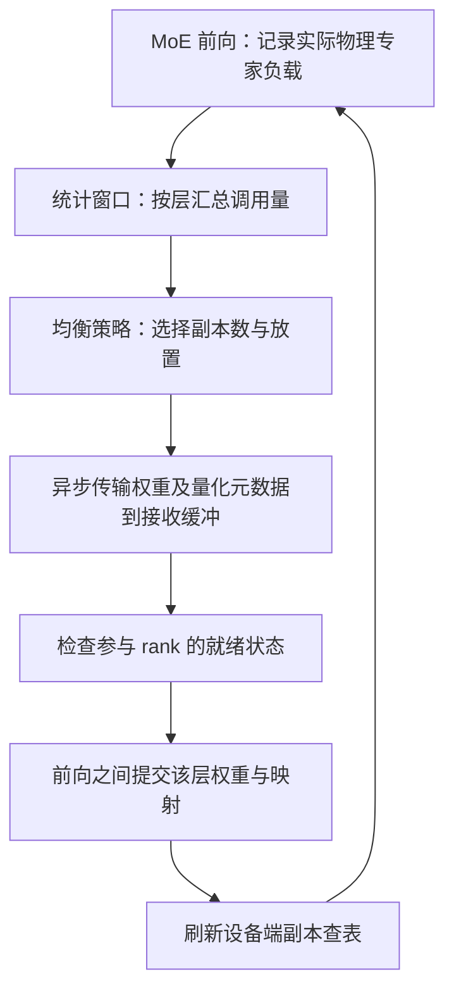

# MoE 与 EP：机制优势、拖尾治理及昇腾工程判断

**资料时点：2026-10-12（北京时间）。** 本文解释机制并给出工程建议，不代表新增性能实测。标识约定：**[公开实现/论文]**、**[工程分析/建议]**、**[未核实]**。MoE 是稀疏专家模型；EP 是将专家分布到不同设备的专家并行；EPLB 是专家并行负载均衡。rank 指并行进程，不能在所有部署中直接等同于一个 NPU die。

**核心判断：MoE 用较少的单 token 计算访问较大的模型容量；EP 用多设备分担专家权重和计算；EPLB 通过专家重排与热点副本降低最忙 rank 的负载。三者分别改善计算预算、部署容量和执行均衡，组合后才有机会获得低时延。激活参数少不能保证通信少、矩阵乘效率高或没有拖尾。**

## 1. 机制优势与原理

### 1.1 MoE：以条件计算扩大模型容量

Dense FFN 对每个 token 执行同一组参数；MoE 的 router 根据 token 的隐藏状态选择少量 FFN 专家。若有 E 个等规模 routed experts、每个 token 选 k 个，则 routed FFN 的理论参与比例约为 k/E。它只描述 routed experts，不包含 Attention、router、shared expert 等公共计算，不能把这个比例直接当成整模型加速倍数。

对 token t，输出可以表达为：

`y_t = shared(x_t) + Σ[e∈TopK(t)] w_t,e · FFN_e(x_t)`

**优势来源：** 不必为每个 token 执行所有专家，就能保留大量可供不同输入选择的参数，增加模型表达容量。shared expert 提供公共计算路径，routed experts 提供条件化计算路径；专家是否形成有效专长仍需训练与评测验证，不能由路由均衡直接推出。

**Step 路由实现证据：** [Step 3.7 的 modeling_step3p7.py](https://huggingface.co/stepfun-ai/Step-3.7-Flash/blob/main/modeling_step3p7.py#L493) 中，`router_bias_func()`（493–503 行）执行 FP32 sigmoid，用概率加 bias 选择 Top-k，再从未加 bias 的原概率中取混合权重并归一化。`forward()`（513–559 行）施加 routed scaling、按专家收集 token 并累加加权输出；`get_expert_output()`（504–512 行）执行 up/gate/down 投影及激活。bias 调整选择，不能直接加到最终混合权重中。该文件是语义参考，其逐专家循环没有展示生产 EP 通信实现。

### 1.2 EP：分担权重容量，并聚合同专家的 token

EP 将专家放到不同 rank。每个 rank 只保存和执行分配给自己的物理专家，接收来自 EP 组其他 rank 的 token。对均匀放置、没有副本的专家权重，单 rank 存储量约为专家总权重除以 EP size；公共层的存储由 TP/DP 等布局另行决定。

**优势来源：** 大量专家权重可以分布存储，模型部署容量随设备数扩展；来自多个请求或源 rank 的同专家 token 可以聚合处理，提高有效专家批量。EP 的收益取决于聚合规模和互连，增加设备同时也会增加通信与同步成本，不能认为 EP 越大越快。[vLLM EP 部署说明](https://docs.vllm.ai/en/latest/serving/expert_parallel_deployment/)

图注：单层 MoE 的概念执行链；B 为本轮 token 数、H 为隐藏维度、k 为每 token 选择的专家数。shared 分支是否与 routed 分支重叠依实现而定。Router 选择逻辑专家，部署映射决定在哪个物理副本执行；不能在 dispatch 阶段重新选择不同逻辑专家。

### 1.3 为什么激活量小仍可能高时延

**小专家批量降低算力利用率。** 路由均匀时，每个专家平均分配量约 `Bk/E`。例如 E=288、k=8、B=36，平均只有一次 token–expert assignment。矩阵乘很小，权重读取、padding 和 kernel 启动成本难以摊薄。这个例子是解释性计算，不是 Step 实测；B 是当前 MoE 层本轮参与路由的 token 总数，不是请求数或上下文长度。

**EP 有额外通信。** Dispatch 发送隐藏状态和必要元信息；combine 返回专家结果。通信包含启动、打包、访存、网络和同步成本，小数据包也不能免除固定延迟；实际发送字节受目标 rank 去重、量化和后端布局影响，不能简单按 BkH 推断。

**最忙 rank 进入关键路径。** 对没有重叠的单层执行，可近似写为：

`T_MoE ≈ T_router/map + T_dispatch + max_r(T_expert,r) + T_combine`

其中时间范围是单层、单轮 MoE，不含请求排队、Attention 和层间公共操作；shared expert 应按实际串行或重叠路径另计。流水实现要以时间线确定关键路径。模型激活参数只影响部分专家计算量，不能覆盖这些额外项。

## 2. 如何治理拖尾：均衡对象、实现流程和边界

### 2.1 训练均衡与服务均衡解决不同问题

[公开论文] Step 3.5 使用 loss-free 全局专家均衡，同时加入 EP 级均衡损失。论文指出，全局专家均衡不能保证 micro-batch 内的 rank 均衡，因此需要更直接约束 rank 利用率。预训练使用该约束；mid-training 与 SFT 冻结 router 并关闭 EP-group 均衡损失。[论文 §3 的 MoE Expert-parallel Load Balancing 及 §4 训练设置](https://arxiv.org/html/2602.10604v2)

[工程分析] 训练均衡提供有利的路由基础，但线上业务域、小 batch、部署映射与训练不同，仍会形成热点。请求调度控制请求积压和批量；EPLB 控制专家部署；通信后端控制数据搬运。请求数相同不意味着专家分配量相同。

### 2.2 重排专家与复制专家的优势

**重排解决多个热点专家挤在同一 rank。** 按近期调用量，把热点和冷门专家重新组合到不同 rank，减少最忙 rank 的总计算量。

**副本解决单个专家本身太热。** 相同逻辑专家的权重复制到多个物理位置，把调用分流到这些副本。只把一个极热专家搬到另一张卡，通常只是搬走热点。副本应保持同一版本权重和混合权重语义；相同权重下数学语义可保持，浮点归约与执行顺序变化仍需验证数值一致性。

表注：以下是同一层、同一轮、4 个 EP ranks 的解释性示例；数字为 token–expert assignments，不是原始 token 数或实测时间。假设设备相同、每次分配计算成本相近；理想均衡结果不保证总能实现。

| 状态 | rank 0 | rank 1 | rank 2 | rank 3 | 最忙 rank / 平均负载 |
|---|---:|---:|---:|---:|---:|
| 初始偏斜 | 160 | 80 | 40 | 40 | 2.0 |
| 理想均衡 | 80 | 80 | 80 | 80 | 1.0 |

这个例子说明降低最大负载的价值，不能据此宣称端到端快 2 倍：通信、router、shared expert 和重排成本没有消失。

### 2.3 EPLB 接口流程

[公开实现] [vLLM 的 EplbState](https://github.com/vllm-project/vllm/blob/main/vllm/distributed/eplb/eplb_state.py) 中，`step()` 维护统计窗口并检查重排周期；`rearrange()` 将物理专家负载转换为逻辑专家负载，跨 rank 汇总后调用 `policy.rebalance_experts()` 计算部署。异步 worker 搬移专家权重；运行线程在允许的边界消费就绪结果并提交映射。

图注：EPLB 控制闭环示意，具体同步与提交行为以所用版本为准。异步搬移旨在降低停顿，不等于零成本，也不能在目标权重就绪前公开新映射。

**实现要点：** `physical_to_logical_map` 说明物理槽位存放哪个逻辑专家；`logical_to_physical_map` 和 `logical_replica_count` 说明可用副本。分流改变执行位置，保留 router 原来的逻辑选择。窗口太长会跟不上业务变化，重排过频会增加传输与提交开销；稳定业务可以优先比较固定放置与动态均衡的净收益。

### 2.4 均衡不能替代通信和小批量优化

[工程建议] 若 rank 分配量已接近，但 dispatch/combine 占主导，应优化互连、跨节点放置和通信后端；若各 rank 都在低效执行小矩阵，应优化 grouped GEMM、融合、padding 和调度批量。增加聚合批量可能改善吞吐，却增加等待时间，必须同时观察时延约束。

[未核实] Step5 现有材料披露负载感知调度与跨机 EP，但尚无足够公开代码证据确认生产中的动态 EPLB、热点副本和迁移实现；不能把 vLLM 的参考流程写成 Step5 内部实现。相关披露见[技术报道](https://news.qq.com/rain/a/20260920A06EUP00)。

## 3. 主要参考仓库和技术文档

表注：资料核验时点为 2026-10-12（北京时间）。用途说明区分模型语义、通用控制逻辑、NPU 实现与 CUDA 通信；main/latest 会变化，目标部署应固定 vLLM、vLLM-Ascend、torch_npu 和 CANN 的版本组合。

| 参考对象 | 主要入口 | 可复用价值与边界 |
|---|---|---|
| Step 3.5 论文 | [论文](https://arxiv.org/html/2602.10604v2) | 解释全局专家均衡为何不足，以及 EP-group 训练约束；不能替代线上 EPLB |
| Step 3.7 模型仓 | [模型仓](https://huggingface.co/stepfun-ai/Step-3.7-Flash)、[路由代码](https://huggingface.co/stepfun-ai/Step-3.7-Flash/blob/main/modeling_step3p7.py#L493) | sigmoid、bias、Top-k、混合权重与专家 FFN 的语义基准 |
| vLLM | [仓库](https://github.com/vllm-project/vllm)、[EPLB 状态](https://github.com/vllm-project/vllm/blob/main/vllm/distributed/eplb/eplb_state.py)、[EP/EPLB 文档](https://docs.vllm.ai/en/latest/serving/expert_parallel_deployment/) | 统计窗口、放置策略、映射及异步重排生命周期；设备通信需适配 |
| vLLM-Ascend | [仓库](https://github.com/vllm-project/vllm-ascend)、[EPLB 使用指南](https://docs.vllm.ai/projects/ascend/en/latest/user_guide/feature_guide/expert_parallelism_load_balancer.html)、[MRv2 架构](https://docs.vllm.ai/projects/ascend/en/latest/developer_guide/Design_Documents/model_runner_v2_eplb.html) | 已有 NPU MoE 通信、查表分流、负载记录与迁移适配，是昇腾首选起点 |
| DeepEP | [仓库与接口](https://github.com/deepseek-ai/DeepEP) | 参考吞吐型/低延迟型 dispatch/combine、异步与通信计算重叠设计；CUDA 实现不能直接在昇腾运行 |

## 4. 昇腾是否需要适配，以及现有代码证据

**结论：机制可复用，硬件数据路径需要适配；vLLM-Ascend 已完成一部分基础设施，近期工作应优先复用与目标组合验收。** 不应把“需要 Ascend 数据路径”理解为“需要从零写 EPLB”，也不能把“模型基础推理支持”理解为“该模型所有 EPLB/量化/图模式组合都已验证”。

本节代码证据固定到 vLLM-Ascend 提交 **`c2fa1a926b0aa416d8d088b4a976aedfa7bf7b5c`**，便于复查。

### 4.1 已有接口和调用流程

1. **设备端副本分流与计数。** [ops/fused_moe/eplb.py](https://github.com/vllm-project/vllm-ascend/blob/c2fa1a926b0aa416d8d088b4a976aedfa7bf7b5c/vllm_ascend/ops/fused_moe/eplb.py) 的 `build_expert_replica_routing_table()` 构建带 rank 偏移的周期副本表，`map_to_physical_for_ascend()` 将逻辑 ID 转成物理 ID，NPU 分支调用 Triton 实现；`record_expert_tokens()` 记录物理专家实际分配量，并区分计数与前缀和格式。它不是逐 token 查询实时最闲卡，而是基于已提交副本表分流。
2. **NPU token 通信。** [token_dispatcher.py](https://github.com/vllm-project/vllm-ascend/blob/c2fa1a926b0aa416d8d088b4a976aedfa7bf7b5c/vllm_ascend/ops/fused_moe/token_dispatcher.py) 提供 `token_dispatch()` / `token_combine()` 接口；MC2 路径通过 HCCL 通信组调用 `torch_npu.npu_moe_distribute_dispatch_v2()` / `npu_moe_distribute_combine_v2()`，输出专家分组量及 combine 元数据。这里搬的是 token 激活与结果。
3. **控制与稳定映射。** [worker/v2/eplb.py](https://github.com/vllm-project/vllm-ascend/blob/c2fa1a926b0aa416d8d088b4a976aedfa7bf7b5c/vllm_ascend/worker/v2/eplb.py) 的 `AscendEPLBController` 处理 batch 阶段；[distributed/eplb/eplb_state.py](https://github.com/vllm-project/vllm-ascend/blob/c2fa1a926b0aa416d8d088b4a976aedfa7bf7b5c/vllm_ascend/distributed/eplb/eplb_state.py) 的 `AscendEplbLayerState.refresh_expert_replica_routing_table()` 刷新设备表，`AscendEplbState` 对接上游状态与异步生命周期。
4. **权重迁移。** [distributed/eplb/eplb_communicator.py](https://github.com/vllm-project/vllm-ascend/blob/c2fa1a926b0aa416d8d088b4a976aedfa7bf7b5c/vllm_ascend/distributed/eplb/eplb_communicator.py) 提供 `AscendHixlEplbCommunicator`，通过注册 NPU 内存和接收端发起 READ 传输专家权重；`AscendGlooEplbCommunicator` 提供 CPU staging 回退。这里搬的是部署权重，不能与每轮 token dispatch 的 HCCL/MC2 路径混同。

综合接口链为：`router 逻辑 IDs/weights → 设备副本查表 → token_dispatch → NPU 专家计算 → token_combine → 负载窗口 → 放置策略 → HIXL/Gloo 权重迁移 → 前向之间提交 → 原位刷新查表`。新表只能对应已安装的权重；固定形状、原位更新的设备查表用于保持长期 router 引用和图执行有效。[固定版本架构说明](https://github.com/vllm-project/vllm-ascend/blob/c2fa1a926b0aa416d8d088b4a976aedfa7bf7b5c/docs/source/developer_guide/Design_Documents/model_runner_v2_eplb.md)

### 4.2 版本和支持范围必须单独验收

[公开文档] 当前 latest 区分 MRv1 旧路径与 MRv2 上游控制路径：前者保留动态/记录/静态模式，后者使用异步重排和 Ascend 迁移适配，两者开关与配置不能混用。早期 [v0.23.0 文档](https://docs.vllm.ai/projects/ascend/en/v0.23.0/user_guide/feature_guide/expert_parallelism_load_balancer.html) 与 latest 的 MRv2 支持说明不同，不能把最新能力套到旧容器。

当前指南明确列出硬件与量化约束，例如 A2 不支持 redundant experts；MRv2 已有 Qwen3 W8A8 模型级回归，但其他组合仍需目标验证。这并非 Step 3.5/3.7 的 EPLB 全组合验收证明。具体开关与支持矩阵以[使用指南](https://docs.vllm.ai/projects/ascend/en/latest/user_guide/feature_guide/expert_parallelism_load_balancer.html)及目标安装提交为准。

### 4.3 需要检查或补齐的适配边界

表注：下表是工程检查范围，不表示现有实现缺失；只有目标硬件、模型、量化、runner 组合未覆盖或验收失败时才需要新增代码。

| 边界 | 检查内容 | 参考价值 |
|---|---|---|
| 路由语义 | FP32 sigmoid、bias 仅参与选择、Top-k、归一/缩放、shared 分支 | 以 Step 公开代码作语义基准，避免通过修改模型行为制造均衡 |
| token 数据路径 | HCCL/MC2、变长分配、空专家、padding、恢复顺序与权重 | 复用 Ascend dispatcher，评估跨机与小包成本 |
| 专家计算 | grouped GEMM、量化融合、每专家批量与 padding | 找到小批量下效率不足的真实算子 |
| 权重及量化元数据 | 搬移 kernel 实际读取的存储、scale、打包布局和相关 bias | 不能只复制原始参数而遗漏计算路径使用的量化存储 |
| 图与异步一致性 | 查表地址稳定、提交顺序、接收缓冲复用、所有 rank 协议一致 | 防止旧权重新映射、错误结果和集合通信挂起 |
| 显存和拓扑 | 副本、迁移缓冲、KV cache 竞争，节点内外放置 | 评估“少等待”是否被显存损失或跨机流量抵消 |

## 5. 后续是否需要重点工程投入

**建议优先做 P0 复用与测量；动态 EPLB 作为有条件的 P1 投入。** 跨机大 MoE、持续专家热点、严格尾时延要求使它值得重点研究；若当前瓶颈是 Attention、通信或低效小矩阵，直接增加专家副本未必有净收益。

表注：P0 为先决验收与基线工作，P1 为瓶颈证实后的重点优化，P2 为需新增证据的研究项；不是人天估算或已经完成的开发清单。

| 优先级 | 工作 | 升级或继续投入的条件 |
|---|---|---|
| P0 | 固定环境版本；验证 Step 路由语义和已有 EP 路径；建立分层时间线 | 先确认结果正确，排除版本或配置问题 |
| P0 | 比较 EPLB 关闭与已有支持路径；记录每层每 rank 的分配量、耗时和通信 | 判断拖尾是否主要来自热点，不能只看设备利用率 |
| P1 | 调整统计窗口、重排周期、副本与迁移约束，区分 prefill/decode 目标 | 热点持续时间足以覆盖统计和迁移周期，端到端收益超过额外成本 |
| P1 | 补齐目标量化权重视图、HIXL 环境与图模式；优化跨节点迁移 | 当前目标组合缺少验证或权重搬移成为停顿来源 |
| P1 | grouped GEMM、融合和通信计算重叠；拓扑感知专家放置 | 小矩阵或 dispatch/combine 已进入关键路径 |
| P2 | 基于实际执行时间而非仅 token 数的放置策略 | 分配数均衡但 rank 耗时仍不均，且能够复现 |

**最低验收口径：** 固定模型/精度、硬件拓扑、请求到达方式、输入输出长度分布和并发，分别记录 prefill/decode。每层每轮记录 rank 分配量、专家计算时间、dispatch/combine 时间；服务侧记录 TTFT、TPOT 的 p50/p95/p99、吞吐、峰值显存和 KV 容量，并注明 TPOT 是逐请求平均还是逐 token 间隔。计时使用设备事件或 profiler，避免把异步 CPU enqueue 时间当作算子耗时。

验证数据应覆盖稳定热点、热点切换、小 batch 和跨机情形，以及重排发生时的尾时延；比较关闭 EPLB、已有放置与动态路径，静态模式仅在目标版本支持时纳入。检查多次迁移后的路由、输出/logprob 与精度基准。负载均衡指标只是诊断量，最终按端到端收益和数值正确性验收；RL rollout 还需保持策略版本与概率语义一致。

**对昇腾的参考价值是复用完整控制闭环和接口边界，建立可测的拖尾治理路径。重点工程投入应由瓶颈证据触发，而非因 MoE 激活量小或存在 EP 就默认投入动态副本研发。**
