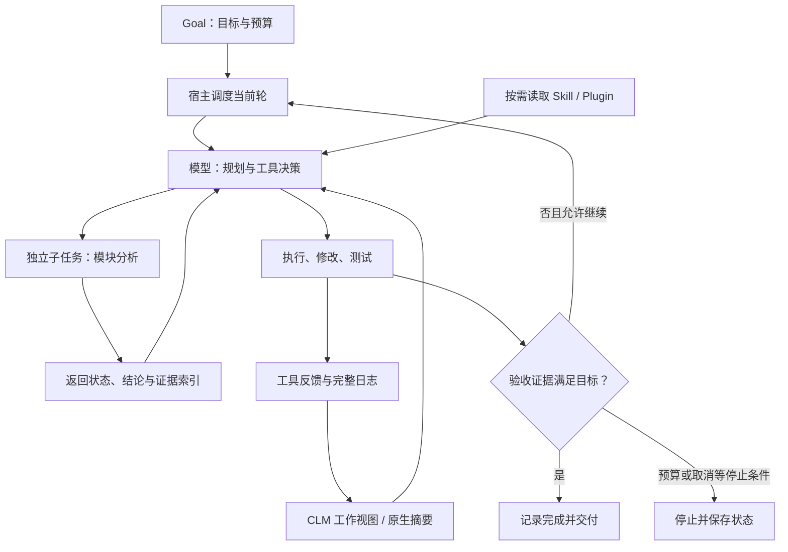
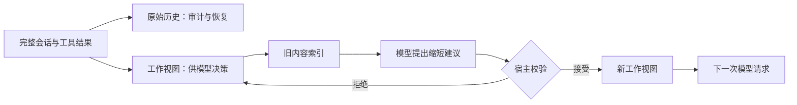
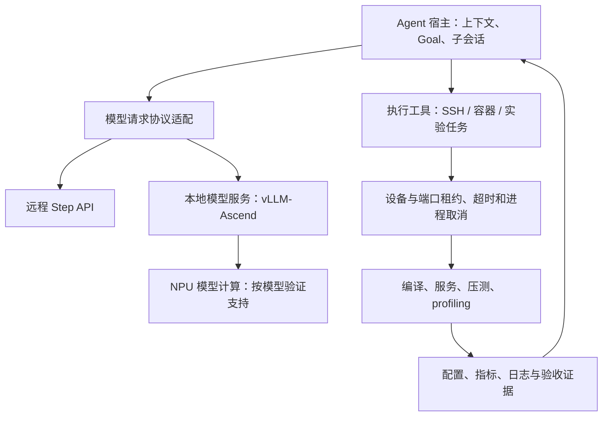

# Step-Code 长任务机制、参考实现与昇腾工程价值

**资料时点：2026-10-12（北京时间）。** 本文基于 Step-Code 官方文档与源码、已有 MindSpeed-Agent 调研整理；未开展 NPU 真机验证或组件收益消融。公开实现、机制解释和建议改造分别标注。main 分支会变化，实际接入前应固定 commit。

## 1. 核心判断：长任务优势来自模型与运行框架共同作用

**长任务的核心价值是：多轮执行后仍能保留目标和约束，利用有效结果，根据反馈修正方案，并推进到可验证的交付。** 上下文容量为读取材料提供空间；推理和工具决策决定下一步；框架管理历史、子任务、预算及恢复。不能把 CLM、Goal、子会话等框架实现全部归为 Step 5 模型参数或训练收益。

模型负责“理解—计划—工具选择—根据反馈调整”；Step-Code 负责让这一循环持续运行。五项机制分别处理：旧材料过多、压缩状态丢失、子任务结果膨胀、单轮结束后停止、重复操作不一致。机制提供可解释的收益路径，不证明在所有长任务中领先。

图注：概念组合流程，不是每个任务都必须使用子 Agent。验收节点表示建议的证据检查；Step-Code Goal 本身没有独立完成 evaluator。预算控制、上下文维护和工具取消依赖宿主。

## 2. 机制原理、优势与应用场景

### 2.1 CLM：原始历史与模型工作视图分离

**[公开实现] CLM 对应 Context Language Models 思路。** Step-Code 将其实现为模型管理工作上下文，官方文档注明借鉴 pi-clm。完整会话记录继续用于历史和用量追踪；模型后续调用使用经过校验的工作视图。可编辑旧正文被索引化，模型选择压缩哪些材料，而非每次重写全部历史。

自动路径的接口流程为：`检查请求大小 → 生成可编辑正文索引 → 模型返回 replacements[{id,text}] → 校验来源/版本/保护规则/收益 → 接受并归档旧视图 → 后续请求使用新视图`。无匹配请求前缀时使用隔离维护请求及私有 `apply_context_edit` 路径。手动维护涉及 `CONTEXT_INDEX.md`、`LIVE_CONTEXT.md` 和 `/clm-compact`。

宿主保护用户消息、应用控制消息、原生摘要及最新助手/工具组。非法 ID、过期版本或对保护内容的修改会导致草稿拒绝，保留上一有效视图。失败可退回原生压缩；取消、新用户输入或来源上下文变化有专门中止语义，不能一律继续 fallback。

**[机制解释] 优势来自减少旧内容在后续多轮中的重复输入。** 昇腾编译日志可整理为“失败原因、修复位置、最新验证状态、完整日志路径”，重复警告仍保存在原始记录中。模型更容易围绕当前问题决策，也降低后续请求的上下文压力。

边界：历史保存不代表每轮都读取全部历史；摘要仍可能遗漏关键事实。CLM 增加维护调用，改写早期前缀可能降低缓存复用；它不会把旧文本的 KV 状态直接移植到新文本。应比较包含维护调用的任务总成本和完成质量。

图注：CLM 工作视图与原始历史分离示意；原生摘要另有重建上下文流程。结构校验不能代替语义完整性验证。

参考：[上下文管理与实现来源](https://github.com/stepfun-ai/Step-Code/blob/main/packages/coding-agent/docs/context-management.md)、[pi-clm 固定版本](https://github.com/lolipopshock/pi-clm/tree/b84a9d7cbb625cd39539db3bcef72ea9cc89aa89)、[Context Language Models 论文入口](https://arxiv.org/abs/2609.37725)。本文对 Step-Code 行为的判断依据其实现文档，不将论文机制直接视为模型内部实现。

### 2.2 原生压缩完整性：保护上下文切换的有效状态

**[公开实现]** 接口链为 `shouldCompact → prepareCompaction → compact / generateSummaryWithUsage → CompactionEntry → 重建上下文`。压缩处理旧历史与保留消息之间的交接；必须生成却为空的摘要应被拒绝，已有有效摘要和上下文不能因本次失败被错误覆盖。

**[机制解释]** 价值是减少压缩时的状态断裂。调优任务中“精度约束、基线配置、最佳已验证配置、当前未完成检查”比重复输出更重要，应进入摘要及外部实验记录。压缩失败后保留有效状态，有助于继续任务而非重新排查。

适用于接近上下文上限的长任务，是可靠性保障。空摘要检查仅解决一类故障；非空摘要仍需检查事实和约束。完整日志、结构化结果和配置文件应独立保存，不能只存在于模型记忆。

参考：[压缩实现 compaction.ts](https://github.com/stepfun-ai/Step-Code/blob/main/packages/coding-agent/src/core/compaction/compaction.ts)、[压缩完整性文档](https://github.com/stepfun-ai/Step-Code/blob/main/docs/compaction-integrity.md)。

### 2.3 子会话与结果裁剪：隔离工作上下文，控制返回量

**[公开实现]** `executeSubagent` 支持 single、parallel、chain；子任务使用独立 child session，可选 worktree，并有并发限制。结果聚合保留步骤状态和关键输出，chain 的早期正文可保存在 details，主会话无需携带所有中间过程。

接口链为 `主任务定义边界 → 创建子会话/可选独立工作区 → 子任务执行 → 聚合状态和结果 → 主任务汇总决策`。独立会话隔离上下文；独立 worktree 隔离文件修改；两者不能代替硬件资源隔离。

**[机制解释]** 算子、通信、内存分析可各自读取相关材料，主会话只接收结论与证据，减少上下文交叉污染。相互独立的只读任务可以并行；复杂实现与审查也可分开，以不同视角检查结果。

**[工程建议]** 子任务交付统一包含 `task_id、状态、结论、代码位置、命令与退出码、指标、完整日志位置、未验证项、下一步`。失败状态必须进入汇总，不能裁剪成只有成功结论。同一组 NPU 上的压测、profiling、服务重启需协调；并发并不必然加速。

参考：[execute.ts](https://github.com/stepfun-ai/Step-Code/blob/main/packages/coding-agent/src/features/subagent/execute.ts)、[子会话 runner](https://github.com/stepfun-ai/Step-Code/blob/main/packages/coding-agent/src/features/step-subagent.ts)。

### 2.4 Goal：让持续执行有状态、有预算、可停止

**[公开实现]** `create_goal` 登记目标，`get_goal` 查询，工作 Agent 用 `update_goal` 记录完成或阻塞；宿主在当前轮结束后调度活动目标的下一轮。用户通过 `/goal pause/resume/clear/budget` 管理暂停、恢复、清除与 token 预算，状态持久化及取消流程防止已经清除的目标被后续回调重新启动。

接口链为 `创建目标 → 保存状态 → 当前轮执行 → 更新状态及消耗 → 宿主判断续跑 → 达成/阻塞/用户控制/预算条件下停止`。具体工具参数应以固定版本为准；不能把用户命令和工具可更新状态混为一个接口。

**[机制解释]** 多小时调优无需每轮人工输入“继续”，中断后能追踪目标与消耗。目标可以是“完成部署、真实请求、精度与性能验收并保存配置”，而非仅“服务能启动”。

边界：Step-Code 当前依靠工作 Agent 自报完成，没有独立完成 evaluator；需要测试及产物证据。预算约束后续续跑，进行中的请求可能超出余额，并非硬实时限额。文档中的 token 预算也不能直接替代墙钟时间或 NPU 小时限制。远程进程停止、设备释放和实验恢复需要额外工具实现。

参考：[Goal 生命周期](https://github.com/stepfun-ai/Step-Code/blob/main/docs/goal-lifecycle.md)、[编排生命周期](https://github.com/stepfun-ai/Step-Code/blob/main/docs/orchestration-lifecycle.md)。

### 2.5 Skill / Plugin / MCP：流程复用与工具接入

**[公开实现]** Skill 保存适用条件、步骤及资源；`loadSkillsFromDir → loadSkillFromFile → formatSkillsForPrompt` 提供发现与提示信息，任务再按需读取详细内容。Plugin 通过 `readStepPluginManifest → parseStepPluginManifest` 组织资源及 MCP 配置；MCP 连接外部工具服务。

**[机制解释]** 把安装、精度验证、性能采集和报告要求固化，降低每次重新描述流程及漏做步骤的概率。按需加载避免无关说明长期占据上下文；Plugin 便于按组件组织能力。可用昇腾验证 Skill 统一记录软件版本、设备、并行策略、输入长度、并发、指标及原始日志。

边界：方法说明不能替代运行时保障。Skill 写“设备独占、超时取消”不代表工具已经实现；插件兼容也需要实测角色派发、hook、事件和工具协议。上述组织方式可复用，但不能作为 Step-Code 独有能力的证明。

参考：[skills.ts](https://github.com/stepfun-ai/Step-Code/blob/main/packages/coding-agent/src/core/skills.ts)、[plugins.ts](https://github.com/stepfun-ai/Step-Code/blob/main/packages/coding-agent/src/step/plugins.ts)、[中文 README](https://github.com/stepfun-ai/Step-Code/blob/main/README.zh-CN.md)。

## 3. 主要参考仓与技术文档

表注：资料时点为 2026-10-12（北京时间）。Step-Code main 为动态入口；MindSpeed-Agent 引用既有调研固定 commit。参考价值不代表已完成兼容、复现或 NPU 移植。

| 参考对象 | 主要入口 | 用途与证据边界 |
|---|---|---|
| Step-Code 官方仓 | [stepfun-ai/Step-Code](https://github.com/stepfun-ai/Step-Code) | 上述五项运行机制的直接实现与接口入口 |
| 上下文与压缩文档 | [context-management](https://github.com/stepfun-ai/Step-Code/blob/main/packages/coding-agent/docs/context-management.md)、[compaction-integrity](https://github.com/stepfun-ai/Step-Code/blob/main/docs/compaction-integrity.md) | 保护规则、回退、恢复及成本边界 |
| 任务生命周期文档 | [goal-lifecycle](https://github.com/stepfun-ai/Step-Code/blob/main/docs/goal-lifecycle.md) | 续跑、预算、持久化与取消；不提供独立完成判定 |
| CLM 思路来源 | [pi-clm](https://github.com/lolipopshock/pi-clm/tree/b84a9d7cbb625cd39539db3bcef72ea9cc89aa89)、[论文入口](https://arxiv.org/abs/2609.37725) | 用于追踪设计来源；Step-Code 实际行为以其实现为准 |
| MindSpeed-Agent 官方仓 | [仓库](https://gitcode.com/Ascend/MindSpeed-Agent)、[优化 workflow](https://gitcode.com/Ascend/MindSpeed-Agent/blob/f56bb671309ee1bd9f9fdf6c6c7b17b488f4a448/plugins/inference-model-optimize/workflows/optimize-pipeline.yaml)、[门禁](https://gitcode.com/Ascend/MindSpeed-Agent/blob/f56bb671309ee1bd9f9fdf6c6c7b17b488f4a448/plugins/inference-model-optimize/workflows/gates.js) | 已有领域角色、工作流和证据检查，作为增量接入位置 |
| 昇腾模型服务 | [vLLM](https://github.com/vllm-project/vllm)、[vLLM-Ascend](https://github.com/vllm-project/vllm-ascend) | 模型加载与推理后端；Agent 接入成功不证明目标模型已支持 |

## 4. 昇腾是否需要适配：按三层判断

**CLM、Goal、子会话和插件属于控制端机制，通常不需要直接编写 NPU 算子。** 是否需要模型后端研发，取决于实际部署的模型及功能。框架通过 SSH 操作 NPU 环境，并不等于 Step 5 模型运行在 NPU。

图注：建议的适配分层。远程 API 与本地服务是可选模型路径；NPU 工具执行与模型请求是两类接口。租约及远程取消表示需要落实的运行能力，不是 Step-Code 已提供的昇腾实现。

表注：以下为工程建议，未进行兼容实测。“需要适配”按选定路径判断；模型、平台与软件版本须在实验记录中固定。

| 层次与场景 | 是否需要适配 | 主要验证或开发项 | 投入性质 |
|---|---|---|---|
| 远程 Step API 控制昇腾任务 | 需要执行工具与环境集成；无需为该 API 开发本地模型内核 | SSH/容器执行、日志保存、异常返回、资源与取消 | 应用及平台集成 |
| 本地 vLLM-Ascend 提供模型服务 | 需要协议验证；缺失功能再做后端适配 | chat template、工具调用解析、reasoning、流式事件、token 统计、上下文限制及取消 | 服务兼容与模型支持分别验收 |
| 五项机制接入 MindSpeed-Agent 宿主 | 需要运行时集成 | 工作视图来源绑定、结果契约、Goal 续跑与状态持久化、插件/hook 兼容 | Agent 运行时研发 |
| NPU 实验执行 | 需要设备相关执行保障 | 设备/端口租约、单写入者、远程进程取消、日志与配置恢复 | 平台工程重点 |
| Step 5 本地 NPU 部署 | 不能由框架可用推导支持 | 完整模型资料、后端实现、精度与性能证据；详见报告 04 | 有前置依赖的独立模型专项 |

MindSpeed-Agent 已有角色、技能和优化状态机，增量价值是补运行契约，避免重复建设目录。优化流程可沿 `catalog → 角色 → 工具/产物 → handoff → next_state → verify_log → finalize/abort` 检查；另一套 prompt-first migration 插件不应被强制改成同一状态机。[状态机实现](https://gitcode.com/Ascend/MindSpeed-Agent/blob/f56bb671309ee1bd9f9fdf6c6c7b17b488f4a448/plugins/inference-model-optimize/engine/state_machine.py)、[migration 说明](https://gitcode.com/Ascend/MindSpeed-Agent/blob/f56bb671309ee1bd9f9fdf6c6c7b17b488f4a448/plugins/ecosystem-code-repository-npu-migration/README.md)。

## 5. 后续工程投入：先可靠执行，再验证上下文收益

**建议重点投入 Agent 运行时与 NPU 平台集成；CLM 应作为可消融的试验项。** Skill 可先落地，设备租约、取消、证据保存是持续自动调优的基础。只有发现模型后端缺口或明确性能瓶颈，才追加模型/算子研发。

表注：P0/P1 是本报告建议优先级，不是上游计划或工期承诺。验收范围针对昇腾部署与调优；预算中的时间指墙钟耗时，NPU 小时指设备占用累计时间，需要自行实现统计与控制。

| 优先级 | 交付内容 | 工程价值 | 验收与继续投入条件 |
|---|---|---|---|
| P0 | 安装/精度/性能 Skill，统一实验与子任务结果契约 | 减少漏项，建立可追溯基线 | 报告能由配置、命令和原始日志复核；失败/未验证状态不丢失 |
| P0 | 设备与端口租约、远程进程取消、单写入者 | 避免并发争用和任务停了进程仍占设备 | 取消后确认进程停止与设备释放；资源冲突可检测 |
| P0 | 压缩失败保护、关键状态持久化、证据门禁 | 防止目标漂移和错误完成声明 | 空摘要/中断后保留有效状态；恢复后知道已验证配置及待办 |
| P1 | Goal 与 token/墙钟/NPU 预算的宿主联动 | 支持长期实验并控制成本 | 重启恢复、预算耗尽与取消行为有证据；明确软限额或硬限制 |
| P1 | CLM 单项接入与同条件对照 | 检查是否降低上下文压力及成功任务成本 | 计入维护和缓存成本；关键约束遗漏不增加，质量达到要求 |
| 按需 | 本地模型协议/后端与算子补齐 | 满足实际本地部署需求 | 在固定模型和硬件组合上完成精度/功能/性能验收 |

建议由 Agent 运行时工程师和 NPU 平台工程师合作。模型服务兼容由推理服务工程师参与；仅有明确后端缺口时引入算子或分布式工程师。现有资料不足以承诺固定人数或人天。

**验证方法：** 固定模型版本、任务、环境与预算，先记录现有框架基线，再分别启用子任务结果裁剪、CLM 和 Goal 控制，最后做组合。观察完成率、错误完成声明、关键约束遗漏、人工返工、总 token/缓存费用、墙钟耗时、NPU 小时和中断恢复结果。CLM 成本应含维护调用；缓存、思考 token 与 Goal 预算口径须分开记录。

验证模型能力时固定框架，验证框架机制时固定模型；不可用两边同时变化的结果作单项归因。短任务中维护与协作开销可能超过收益，不需要默认开启全部机制。

关联阅读：[04-重点对象代码参考与工程投入](./04-重点对象代码参考与工程投入.md)、[02-Agent技术核心分析](./02-Agent技术核心分析.md)、[03-昇腾适配与验证规范](./03-昇腾适配与验证规范.md)。
