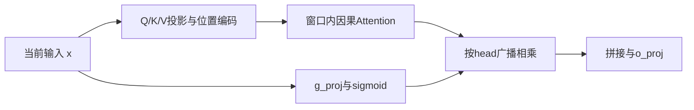

# 推理特性详解与竞争力：EP、Gated SWA、AFD、MTP、PaCoRe与Step5 Attention

资料时点：2026-10-12（北京时间）。公开机制、厂商实验与工程推断分别说明；未新增真机实测。本文讨论模型计算、解码、服务部署及推理时计算扩展；Agent运行机制另见07报告。PaCoRe虽由编排实现，本质仍是推理时计算扩展，因此归入本文。

## 1. 特性与承载总览

表注：承载列区分模型、服务库与调用编排；“参考”提供证据入口，不表示完整生产链已开源。竞争力针对适用场景，不表示全球领先；时点为2026-10-12。

| 特性 | 机制说明 | 承载仓库/组件 | 竞争力判断 | 参考 |
|---|---|---|---|---|
| EP均衡 | 控制rank路由负载与同步拖尾 | Step-3.5模型训练；服务期另有vLLM/Ascend EPLB | 负载偏斜时有效，单项领先未证实 | [训练论文](https://arxiv.org/html/2602.10604v2#S2.SS2) |
| Gated SWA | 窗口访问加head输出门控 | Step-3.5/3.7注意力层与推理后端 | 有受控质量消融，成本收益需整体归因 | [模型代码](https://huggingface.co/stepfun-ai/Step-3.7-Flash/blob/main/modeling_step3p7.py) |
| AFD | Attention/KV与FFN分池 | StepMesh通信；afd-plugin运行时 | 高并发及资源失配时有潜力 | [StepMesh](https://github.com/stepfun-ai/StepMesh) |
| MTP-3 | 提出未来候选并批量验证 | 模型MTP模块；vLLM-Ascend proposer | 接受率与验证效率决定净加速 | [proposer](https://github.com/vllm-project/vllm-ascend/blob/c076a131097fdfac9db4b57c8cf55bfd45ea0ca5/vllm_ascend/spec_decode/step3p5.py) |
| PaCoRe | 并行探索、消息压缩及多轮综合 | PaCoRe调用编排与综合模型 | 难题质量有竞争力，成本优势另验 | [推理代码](https://github.com/stepfun-ai/PaCoRe/blob/main/pacore/batch_inference/base_exp.py) |
| Step5 Sparse GQA | 共享KV并选择历史位置；块合并细节待核实 | Step5模型/后端；本次未核验到完整官方代码 | 长上下文有潜力，缺单项可复现证据 | [官方接口](https://platform.stepfun.ai/docs/en/guides/models/step-5-preview) |

## 2. EP均衡：降低专家并行拖尾

**说明。** EP是Expert Parallelism，专家分布在不同rank上。全局专家平均接收token相近，不代表每个micro-batch里各rank的工作量相近。Step 3.5在全局loss-free均衡之外加入EP-group级训练损失，使router关注rank利用率。这里讨论训练塑造的路由倾向；服务期EPLB通过专家副本/映射调整应对实时热点，是另一层机制。

**接口流程：** `hidden states → router分数/Top-k → 按专家所在rank分发token → 各rank计算 → combine返回`；训练时从路由概率及分配统计计算group级均衡损失，反馈到router。简化关键路径为`T_MoE ≈ T_dispatch + max_r(T_compute,r) + T_combine`，最忙rank决定计算等待。

**竞争力评价：有条件的系统价值，独立领先证据不足。** 在偏斜明显的MoE服务中值得关注；热点不明显时收益有限。过强均衡可能限制专业化，训练时group与实际部署映射也可能不同。不能由训练损失推出线上吞吐固定提升；预训练约束的使用阶段亦须和mid-training/SFT区分。

**参考：** [Step 3.5 §2.2 EP均衡公式及§4训练设置](https://arxiv.org/html/2602.10604v2#S2.SS2)；[vLLM专家并行/EPLB指南](https://docs.vllm.ai/en/latest/serving/expert_parallel_deployment/)；[Ascend EPLB指南](https://docs.vllm.ai/projects/ascend/en/latest/user_guide/feature_guide/expert_parallelism_load_balancer.html)。公开模型router可解释推理路由，不能作为训练损失完整实现证据。

**验证重点：** 每rank token/专家计算负载、最忙rank与平均rank之比、dispatch/combine耗时、P99每token延迟和同条件吞吐；EPLB另计专家复制与迁移成本。

### 展开：为什么专家均衡还不够

设一批有100个token，每token选2个专家，总计200次专家分配。4个rank分别收到100、40、30、30次分配：平均是50，最忙rank是平均的2倍。即使其他rank先完成，同步combine仍须等待最忙rank。下一批热点换到其他rank，长期累计可能看起来均衡，但每批仍拖尾。这是示意，真实时长还受专家大小、分片、通信与batch效率影响。

训练EP约束按专家部署分组汇总实际分配比例f_g和路由概率p_g，使用类似G·Σ(f_g·p_g)的损失推动group均衡。这里group对应专家所在rank的训练组织，不等于每token必须平均访问所有rank。硬分配统计与可微路由概率配合；不能简单将该约束理解成“强制所有卡同时满载”。公式依据前述论文。

服务期EPLB则观察热点并重新放置或复制专家。它能缓解训练分布与线上请求分布不一致，却增加副本显存、迁移和路由成本。请求调度是第三层：改变哪些请求一起执行，不能替代专家映射。竞争力应通过最忙rank拖尾降低且整体质量、吞吐不退化确认。

## 3. Gated SWA：控制局部注意力的信息注入

**说明。** SWA只访问滑动窗口，降低历史访问成本；head-wise gate根据当前输入缩放各head输出。窗口没有有用证据时，softmax仍分配权重，gate可抑制该head的信息注入。Step 3.5结合窗口512、3:1的SWA/Full混合布局及增加SWA query heads；门控不是扩大窗口或稀疏位置选择器。

**接口流程：** `输入x → Q/K/V → 窗口内因果attention得到y → g=sigmoid(W_gate·x) → 按head执行g×y → 输出投影/残差`。Full层补充远程连接；SWA保留attention语义，可用KV masking支持投机候选并行验证。实际KV容量收益仍取决于缓存后端是否回收窗口外状态。

**竞争力评价：较强的成本—质量设计，有局部消融支撑。** 论文在100B-A10B、相同S3F1布局的预训练对照中，head-wise gate相对固定sink token使平均分由62.46到64.43，增加1.97分。这支持该条件下的门控质量收益；混合布局的计算节省不能全部归因于gate，也不证明胜过所有注意力架构。

**参考：** [Step 3.5 §2.3表2及附录A.1/A.2](https://arxiv.org/html/2602.10604v2#S2.SS3)；[公开模型实现](https://huggingface.co/stepfun-ai/Step-3.7-Flash/blob/main/modeling_step3p7.py)。阅读代码应区分attention输出门控、FFN门控和MoE router，三者职责不同。

**验证重点：** 同质量要求下的长上下文任务表现、Prefill时间、Decode延迟和实际KV占用；消融时分别控制窗口、head数、门控和MTP。

### 展开：gate改善质量，window减少访问

因果attention可写成y_i=Σ softmax(q_i·k_j/√d)v_j；SWA将j限制在当前位置之前的窗口内。若窗口都是无关信息，softmax权重总和仍为1，模型仍会混入局部信息。门控再做o_i=g_i·y_i，让该head整体输出接近零。这改变信息注入强度，不会把被窗口排除的远端token找回来；远端关系仍依靠Full层及层间传播。

固定窗口W时，窗口层的attention配对数量从全注意力约L²降为约L·W；Decode访问位置从历史长度L降为W。但混合模型仍有Full层，投影、MoE、通信也在运行，完整模型不能写成只需O(LW)。长上下文成本优势来自布局；gate主要弥补质量损失，query head增加补充表达能力，三项不可混为一个收益。

例：当前在分析编译报错，局部窗口是大量无关警告。gate可以抑制部分head输出；早期用户的精度要求是否仍能被利用，取决于Full层、表示传播和模型能力。不得仅凭gate推断长程信息绝不会丢失。部署需要窗口mask、head形状、门控广播和混合KV管理都正确，再讨论融合算子收益。

### 论文补充：增加 Gate 是否有明显优势

**有质量收益的消融证据，但不能直接认定是 Step 的同幅提升。** 除上述 Step 3.5 的固定 sink 对照外，Gated Attention 专门比较了无 Gate、head-wise 与 elementwise 输出门控。其 Table 1 的 head-wise 形式与 Step 公开实现最接近：每个 token、每个 query head 一个 sigmoid 标量，在 attention 之后、输出投影之前相乘。

表注：来源为 NeurIPS 2025《Gated Attention for Large Language Models》正文第5页 Table 1，第1、10、5行；15B总参数、约2.54B激活的MoE，训练400B tokens，训练序列长度4096。PPL越低越好，任务分数越高越好；新增参数单位为百万。差值为相对无Gate基线的绝对差，不是相对百分比。该实验采用GQA，不是普通SWA与Gated SWA的直接对照，也不是Step或昇腾实测。

| 配置 | 平均PPL | MMLU | GSM8K | 新增参数（百万） |
|---|---:|---:|---:|---:|
| 无Gate基线 | 6.026 | 58.79 | 52.92 | 0 |
| SDPA后head-wise sigmoid Gate | 5.792（−0.234） | 60.05（+1.26） | 54.44（+1.52） | 1.6 |
| SDPA后elementwise sigmoid Gate | 5.761（−0.265） | 60.82（+2.03） | 55.27（+2.35） | 201 |

来源：[论文正文 Table 1、§2.2、§3](https://papers.neurips.cc/paper_files/paper/2025/file/904e89bb4e632e75fb47f093b620b257-Paper-Conference.pdf)。elementwise为每个head的每个通道生成门控，不能把它的最好成绩归给Step的head-wise版本。

**优势原理。** 普通SWA计算 `y_h = Σ_j softmax(q_h·k_j/√d) v_j`，其中j仅覆盖因果窗口。加Gate后计算 `g_h = sigmoid(W_g x)_h`、`y'_h = g_h y_h`。softmax会分配总和为1的权重；Gate允许整个head的输出接近零。输出投影也可学习抑制信息，但其权重在推理时固定；Gate随当前token输入变化，提供动态抑制能力。它控制聚合后的信息贡献，不能逐个删除无关token或恢复窗口外信息。

论文§4将收益解释为低秩映射中的新增非线性与输入相关的稀疏门控；Figure 1及训练实验报告loss spikes减少、较大学习率下稳定性改善。这里的“稀疏”指门控值接近零，并不表示执行时跳过head。训练与长上下文收益应按对应实验配置引用，不作为Step专属结论。



图注：展示Step head-wise输出门控的概念接口流程；普通SWA省去门控分支和相乘节点。Gate先生成与后生成不影响这里的依赖关系，实际执行可由后端安排。

**代码证据。** [Step 3.7 modeling_step3p7.py](https://huggingface.co/stepfun-ai/Step-3.7-Flash/blob/main/modeling_step3p7.py#L686) 的 `Step3p7Attention.__init__` 用 `g_proj: hidden_size → num_attention_heads` 定义门控；`forward` 将窗口参数传入attention接口，随后按head乘sigmoid结果，再调用 `o_proj`。核心语义为：

```python
# Step3p7Attention.forward：attention完成后的输出门控
output = attn_output.view(
    *attn_output.shape[:-1], self.num_attention_heads, self.head_dim
) * gate_states.unsqueeze(-1).sigmoid()
attn_output = self.o_proj(output.view(*attn_output.shape))
```

**参考仓与文档。** [Step 3.5官方仓](https://github.com/stepfun-ai/Step-3.5-Flash)及[技术报告§2.3](https://arxiv.org/html/2602.10604v2#S2.SS3)用于混合SWA设计与Step消融；[Gated Attention作者实现](https://github.com/qiuzh20/gated_attention)用于门控变体与复现；上述Step 3.7模型文件用于实际接口和权重语义。注意区分attention Gate、FFN Gate与MoE router。

**昇腾是否需适配、是否重点投入。** 模型使用Gate时必须保持该语义，不能为提速直接删掉；但已有[Ascend Step patch固定版本](https://github.com/vllm-project/vllm-ascend/blob/c076a131097fdfac9db4b57c8cf55bfd45ea0ca5/vllm_ascend/patch/worker/patch_step3p5.py)的 `_patched_attention_forward` 已包含 `self.attn(q,k,v) → g_proj → sigmoid/广播乘法 → o_proj`，应先复用支持路径，不重复从零适配。新精度或并行路径重点验证head分片、广播形状、dtype与输出误差。

Gate不缩小KV、不省去已完成的attention；SWA的访存收益与Gate的质量收益应分别计量。其参考价值是以小规模head-wise投影增加信息控制能力，并用消融证明收益。后续先测门控投影、逐元素操作及访存占比；只有成为实际瓶颈时才研究sigmoid/乘法融合、减少中间写回，并验证数值与业务质量。Gate支持与验收属于必要工作；单独内核专项不是默认高优先级，长上下文窗口KV管理、attention及MoE/通信瓶颈应由profiling决定投入次序。本文未新增NPU实测。

## 4. AFD：Attention与FFN分池执行

**说明。** AFD是Attention-FFN Disaggregation。Attention池持有请求/KV，FFN池执行dense FFN或MoE；跨多个Attention实例汇聚兼容的FFN工作，可提高专家有效batch，并分别配置两侧设备与并行拓扑。它与Prefill/Decode分离、DBO计算通信重叠解决的问题不同，可以按后端条件组合。

**接口流程：** `Attention计算 → PushPull发送激活/元数据 → FFN GetBatch → 应用执行FFN → Respond → Attention Wait后进入后续层`。传输主要是中间激活，不是每层搬迁整份KV。同一微批次的层间依赖不消失；重叠来自其他独立微批次。StepMesh负责交接通信，不负责执行模型FFN。

**竞争力评价：高并发和资源失配场景有潜力，部署复杂度较高。** Step-3系统论文报告Hopper、4K上下文、FP8、无MTP、50ms TPOT约束下4039 tok/s/GPU，对照DeepSeek-V3为2324；这是不同模型及系统的整体对照，不能当作纯AFD收益。低并发、单请求延迟优先时，额外往返和聚批等待可能得不偿失。

**参考：** [Step-3 §3与§7](https://arxiv.org/html/2507.19427#S7)；[StepMesh接口](https://github.com/stepfun-ai/StepMesh)及[运行示例](https://github.com/stepfun-ai/StepMesh/blob/main/tests/fserver/test_fserver.py)；[AFD Attention运行时设计](https://github.com/vllm-project/afd-plugin/blob/bf5bd280b7481358fc0df4a8ec5897b12be73802/docs/design/module/attention_runtime.md)。StepMesh的xPU占位不证明完整NPU后端已实现。

**验证重点：** 相同总设备数、精度、上下文与延迟约束下的吞吐/成本；记录A/F资源比例、专家batch、队列等待、通信及KV容量。昇腾优先核对已有afd-plugin路径，再判断Step模型接入缺口。

### 展开：聚批与往返如何决定收益

示意：若一批64个token，每token选8个专家，共288个专家，均匀路由下每专家平均只有64×8/288≈1.78个token。汇聚4个兼容Attention实例的工作后约为7.11。更大矩阵有机会摊薄权重读取与kernel启动；这不是实测，也不表示性能线性提升。热点、shared expert和TP切分会改变结果。

同步单层的简化时间为T_A+T_send+T_queue+T_F+T_return。AFD只有在FFN效率、资源布局或跨批重叠的收益超过新增等待时才有净收益。多个请求提供流水线机会，但当前请求仍须等自己的FFN输出。长上下文可能需要更多Attention显存，专家计算可能需要更多FFN算力，两侧资源比例应按瓶颈调整。

不能只比较“每卡吞吐”：应固定总设备、模型精度与TPOT约束，计入两池全部设备以及网络成本。也不能把KV释放量写成全部FFN权重大小，因为通信缓冲、激活、图缓存与工作区会占空间。昇腾接入重点是模型切分、Connector、stream/event同步与返回匹配，先复用已有运行时再定位缺口。

## 5. MTP-3：以三个预测模块辅助投机解码

**说明。** MTP是Multi-Token Prediction；“-3”指三个附加预测模块，不是固定3倍加速。Step 3.5的轻量模块采用SWA+Dense FFN，训练主要先优化第一个，后期复制并联合训练其余模块。主LM预测下一token，MTP模块提供更远位置候选；候选仍须由目标模型验证。

**接口流程：** `主模型状态 → MTP提出候选 → 主模型批量验证 → 按验证规则接受连续候选/处理拒绝 → 提交有效KV → 下一轮`。平均接受长度、候选成本与验证成本共同决定收益；严格分布保持还要求正确的接受/校正规则，不能只因使用MTP就声称无损。

**竞争力评价：较强的解码优化，但收益依赖后端与负载。** 长生成、带宽受限Decode且接受率高时更有利。Audio3论文表6在自身计时条件下报告MTP3严格验证1.76倍、Medusa式接受2.05倍；后者允许生成分布变化，且不是Step 3.5或昇腾速度。更多预测头也未必更快。模型结构支持与后端完整MTP-3支持应分别核实。

**参考：** [Step 3.5 MTP架构](https://arxiv.org/html/2602.10604v2#S2.SS2)；[Ascend proposer固定源码](https://github.com/vllm-project/vllm-ascend/blob/c076a131097fdfac9db4b57c8cf55bfd45ea0ca5/vllm_ascend/spec_decode/step3p5.py)；[Audio3 §6.3.2表6](https://arxiv.org/html/2609.14005#S6.SS3.SSS2)。

**验证重点：** 平均接受候选数、拒绝率、每有效输出token的时间、吞吐与质量；区分严格验证/宽松接受、并发、采样参数、生成长度和KV提交成本。

### 展开：为什么三个候选不是三倍速度

设普通解码每轮成本为C，投机一轮成本为C_verify+C_draft+C_manage，平均产生m个有效输出token，简化加速比为m·C/(C_verify+C_draft+C_manage)。m包括正常目标输出与按算法接受的候选；不同实现对接受长度口径不同，需注明。候选被拒绝、验证batch变大或KV回滚昂贵，都会抵消收益。

示意：普通每token 10ms；投机轮总成本16ms，平均提交2个有效token，则约8ms/token、1.25倍；若只提交1个，则反而慢。所有数字仅用于解释，不代表Step或NPU实测。高并发时主模型本已算力饱和，额外候选和验证可能降低总吞吐，不能把低并发单流加速推广到服务吞吐。

严格投机采样需按目标分布及提案分布实施接受/校正，贪心验证则比较目标选择；宽松阈值接受不是同一质量保证。KV状态只能提交有效分支，拒绝后的候选状态须回滚或屏蔽。验收应同时覆盖工具调用格式、停止token、采样与不同长度输入。

## 6. PaCoRe：并行探索与多轮推理综合

**说明。** PaCoRe是Parallel Coordinated Reasoning，通过多条探索轨迹和综合模型跨轮协调，扩展推理时计算；压缩消息让后续轮次在有限上下文内利用前轮成果。价值来自探索和综合能力，不只是多次采样投票。

**接口流程：** `问题/前轮消息 → 并行调用K条轨迹 → 压缩/综合 → 综合消息反馈下一轮 → 最终答案`。代码`_run_parallel_calls()`创建异步任务，`_get_semaphore()`限制并发，`process_single()`组织处理。框架能接任意兼容模型，不保证模型具有专门训练的综合能力。

**竞争力评价：高预算难题具有竞争力，低成本优势不能直接成立。** 官方报告PaCoRe-8B在HMMT 2025达到94.5%，其有效推理时计算约为两百万token。它证明特定预算下可提高质量，不是与单轨迹模型等预算的全面胜出。适合数学、代码等可验证任务；外部工具有副作用时还需去重、取消和结果协调，不能直接套用纯文本并行流程。

**参考：** [官方说明与报告入口](https://github.com/stepfun-ai/PaCoRe)；[base_exp.py](https://github.com/stepfun-ai/PaCoRe/blob/main/pacore/batch_inference/base_exp.py)。

**验证重点：** 固定任务和总预算，对照单轨迹、best-of-N/投票与多轮综合；统计成功率、总token、完成时间、失败轨迹及综合丢失的信息。

### 展开：与投票、多Agent、MTP的区别

best-of-N先生成N个答案再选择一个；投票统计一致答案；PaCoRe将不同轨迹的证据与中间结论压缩，再指导下一轮。综合模型需要识别正确推导、矛盾和失败路线；若只是压缩表面相似的文本，可能放大同源错误。并行轨迹应有有效差异，数量本身不保证覆盖面。

多Agent框架可分配角色、工具与资源，PaCoRe公开流程主要聚焦推理轨迹协调，不能据此推断具备完整设备任务生命周期。MTP减少生成串行轮次；PaCoRe增加总探索量。二者可组合，但一个降低单位生成成本，一个提高总生成预算，最终费用不一定下降。

以难代码题为例，轨迹分别探索算法、边界反例和复杂度，再综合候选。外部执行测试可增加可靠反馈，但需要专门接入；不能将生成模型自述“验证通过”作为测试证据。推荐同时画准确率—总token、准确率—墙钟时间、准确率—费用曲线，确定它在哪个预算区间优于单链和投票。

## 7. Step 5 Preview Attention：稀疏访问、Indexer与KV组织

### 7.1 已知事实与证据边界

官方API文档确认1M上下文、文本/图像/视频输入以及文本输出，但没有公开精确attention heads、Indexer结构、选择粒度与缓存布局。[官方模型文档](https://platform.stepfun.ai/docs/en/guides/models/step-5-preview)。Sparse GQA、Block-wise Token Merging和局部Indexer/Top-k成本降至1/8来自既有架构报道；本轮该媒体页读取失败，不能视为新增官方核验。[既有报道入口](https://news.qq.com/rain/a/20260920A06EUP00)。本地名为step5_config.json的文件含step3p5v/Step4标识，未建立官方来源和模型版本对应，因此不据此填精确字段。社区镜像和量化转换亦不能替代官方配置证据。

后文公式解释这一类稀疏GQA机制，不声称是Step5逐算子实现。对照代码采用DeepSeek官方稀疏attention实现，仅用于说明“索引—选择—attention”的可执行流程，不证明Step5使用MLA或相同参数。[DeepSeek官方model.py](https://huggingface.co/deepseek-ai/DeepSeek-V3.2/blob/main/inference/model.py)。

### 7.2 GQA与稀疏选择作用于不同维度

GQA让H_q个query heads共享H_kv组K/V，减少KV表示量。常规未压缩KV的简化存储约为2·B·L·H_kv·d·s字节/层：B是请求数，L是缓存长度，d是head维度，s是每元素字节数，2表示K和V；公式忽略页碎片、量化scale与其他缓存。

稀疏选择则减少每query实际读取的位置：先从L个历史位置选择k个，再做主attention。它减少访问范围，不自动减少必须保存的全部历史KV；下一query可能选中此前没用的位置。Paged KV解决逻辑位置到物理页的映射和空间分配，属于缓存管理层，不等于稀疏选取。

### 7.3 接口与张量流程

`输入hidden states → 主Q/K/V投影并保存K/V → 轻量Indexer评分 → 因果范围内Top-k → 逻辑位置映射到KV页/偏移 → 读取候选K/V → 各query/head执行softmax与加权求和 → 输出投影 → 后续MoE`。

Indexer回答“哪些位置可能相关”；主attention决定这些候选如何加权。二者可采用不同维度、精度与缓存，但Step5具体设计待确认。示意公式为I_i=TopK(score_index(q_i, history))，o_i=Σ_{j∈I_i}softmax(q_i·k_j/√d)v_j。Top-k选择必须满足j≤i；共享加载不等于共享softmax分母。

### 7.4 Prefill与Decode：哪里可复用

Prefill一批输入包含多个query，各自访问不同因果前缀；可能批量评分、Top-k与主attention。K/V投影通常按输入位置生成一次，不是为每query重复计算一次；复用优化主要针对索引工作、加载和调度，而非省掉本来不存在的投影重复。

示意：两个相邻query各选4个历史位置，候选分别为{1,2,5,8}与{1,2,5,9}。朴素独立加载涉及8次位置访问，联合tile可加载并集5个位置；每query仍只对自己的候选计算权重，因果mask亦独立。这里token位置仅用于说明，不能据此断定Step5实际按token还是块选择。若直接将并集当作两者的新候选集合，则改变了attention语义。

普通Decode同请求每轮通常只有1个新query；相邻query复用更直接存在于Prefill、分块Prefill或投机批量验证。不同请求通常拥有不同KV，即使索引数字相同也不能复用内容；公共前缀能否共享须依缓存和请求契约判断。不能用Prefill的多query收益直接证明普通Decode同等加速。

### 7.5 块合并可能省什么，不能省什么

报道提到的块合并涉及Indexer/Top-k及相邻query候选重叠；但具体压缩评分、复用选择或联合调度的边界未获得代码确认。需要区分：评分对象压缩可减少评分量；共享Top-k结果可减少选择开销但可能改变候选；相同K/V加载复用降低搬运；只是重新排布访问则不能追溯省掉已完成的评分。

即使局部成本变为原来的1/8，整轮加速也受该部分占比限制。设该部分占总时间p、其余不变，理想加速为1/[(1-p)+p/8]。若p=20%，约1.21倍；p=50%，约1.78倍。数字是Amdahl定律示意，未计新增调度成本，更不是Step5实测。

### 7.6 相对Gated SWA/DSA的竞争力

SWA使用固定局部窗口，规则且易调度；稀疏检索可选择远处证据，更适合长文跨材料访问，但付出Indexer、Top-k、不规则gather与选择遗漏代价。Gated SWA控制head输出，稀疏选择控制访问位置，可以组合；是否在Step5组合及如何组合须官方证据。

DSA提供了已公开的学习型索引路线；不能因为Step5名称为Sparse GQA，就断定它在质量、KV容量或速度上优于DSA/MLA。GQA、MLA和位置稀疏化是不同维度的选择。当前评价是长上下文效率有合理潜力，缺Step5完整同条件消融，无法确认单项领先。[DSA论文](https://arxiv.org/abs/2512.02556)、[官方实现](https://huggingface.co/deepseek-ai/DeepSeek-V3.2/blob/main/inference/model.py)。

### 7.7 昇腾落地与验收

优先确认官方权重/配置/参考输出，再检查Indexer投影与缓存、Top-k kernel、Paged KV gather、稀疏attention、因果mask和KV提交；多query调度还需保持独立归一化与可重复输出。稀疏索引规则与图捕获兼容性、动态长度和通信亦可能影响端到端效率。

分开测Prefill、普通Decode与投机验证；分别记录投影、索引、Top-k、KV访问、attention、MoE/通信耗时。长文检索质量不能只测单针定位，还需多证据、跨段推理与位置覆盖。固定硬件、长度、并发、量化与质量约束之后，再比较吞吐、首token延迟、每token延迟和显存。

## 8. 推理侧投入顺序

先复用已支持的3.5/3.7基础推理，测MTP接受率与EP拖尾；按长上下文任务核对SWA成本和质量。AFD在资源失配确实存在时专项验证；PaCoRe按质量与总预算曲线决策。Step5先补官方证据及正确参考链，再规划稀疏后端，不能仅凭报道先承诺算子收益。
