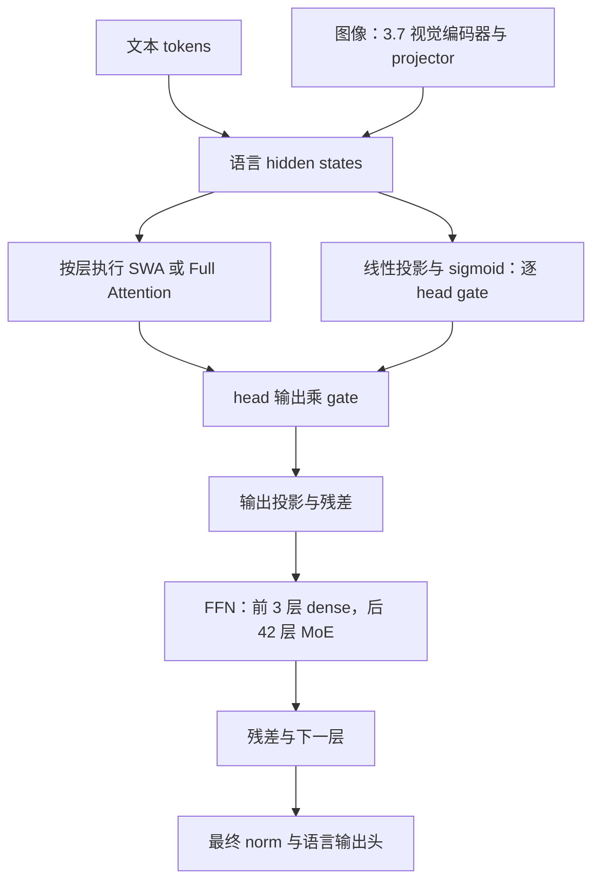
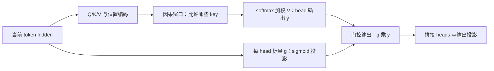
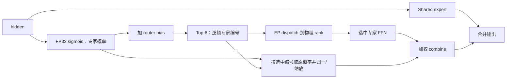
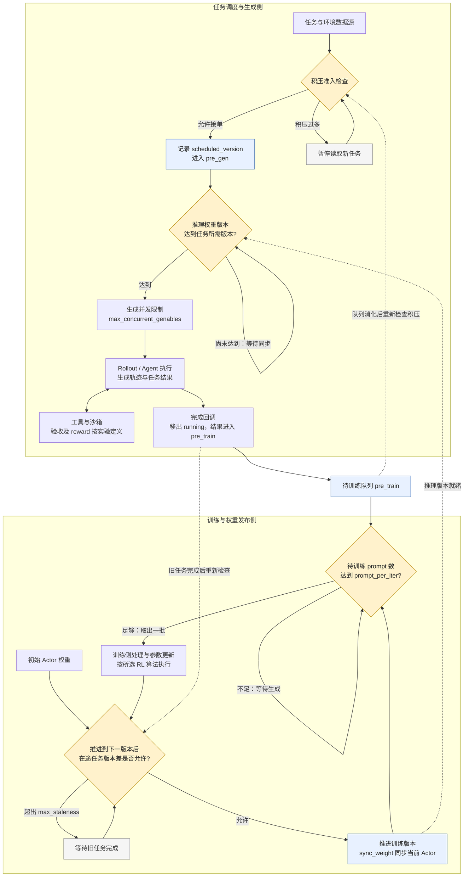
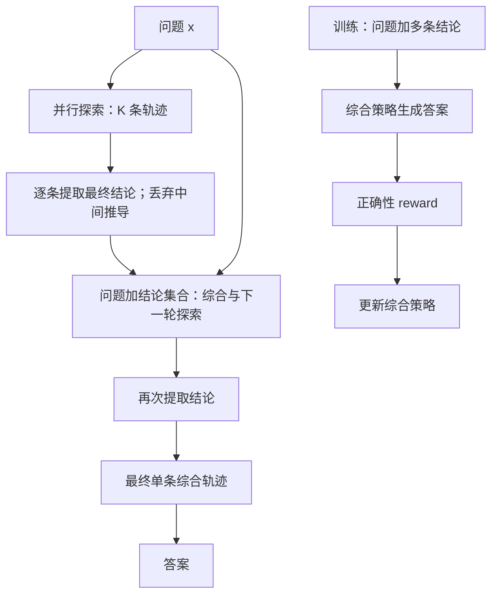

# Step 3.5 / 3.7 Flash：推理架构、后训练与 Agent 技术报告

**整理日期：2026-10-12，北京时间。**本文件单独整理此前 Step 3.5/3.7 内容；Step 5 重点报告、总览、图示及旧版原稿均保留。架构依据论文、官方模型配置和代码；服务端点规格为此前注明日期的公开快照。本次未运行模型或复现训练。

证据范围：3.5 的后训练机制来自其技术报告；3.7 的模型结构、视觉与 MTP 来自其官方配置/仓库；StepTronOSS、StepMesh、Step-Code、PaCoRe 是相关开源项目，不因同属 StepFun 就认定为两个模型的默认生产内部实现。参考链接全部为网络地址，表格均注明统计条件。

## 1. 主要优势与值得借鉴的点

- **可核查的高效模型结构：**大总容量、较小激活路径，混合局部/全局注意力与 MTP；推理适配可直接检查官方配置和算子语义。
- **SWA + 输出 Gate：**窗口减少直接读取范围，门控调节各 head 的信息注入，Full 层保留全局交互路径。门控不自动跳过 attention 计算。
- **稀疏 MoE 与负载约束：**288 routed experts、top-8、1 shared expert；3.5 论文区分全局专家均衡与 micro-batch EP rank 均衡。
- **后训练与 rollout 一致性：**3.5 MIS-PO、截断感知价值估计及路由稳定性分析，为大规模异步采样提供具体技术抓手。
- **3.7 的视觉与可部署实现：**在语言主干上增加视觉编码器；官方提供多个精度版本和 MTP 服务实验，但收益必须按硬件和负载说明。

来源：[3.5 论文](https://arxiv.org/html/2602.10604v2)、[3.5 官方仓库](https://github.com/stepfun-ai/Step-3.5-Flash)、[3.7 官方仓库](https://github.com/stepfun-ai/Step-3.7-Flash)、[3.7 配置](https://huggingface.co/stepfun-ai/Step-3.7-Flash/blob/main/config.json)。

## 2. 参数、结构与代际差异

表注：B 为十亿参数；主干层数与 MTP 分开。3.5 的 196B/11B 为论文语言主干口径，含 MTP 另列 198B/13B；3.7 标称约 198B 由 196B 语言主干加约 1.8B 视觉构成，不能混同两个 198B 口径。API 独立上限受服务端点约束，详见附录 A。

| 项目 | Step 3.5 Flash | Step 3.7 Flash |
| --- | --- | --- |
| 总参数 / 激活参数 | 主干 196B / 11B | 标称约 198B / 约 11B；196B 语言主干 + 1.8B 视觉编码器 |
| 主干层数 / hidden size | 45 / 4096 | 45 / 4096 |
| 主干 FFN 布局 | 3 dense + 42 MoE | 3 dense + 42 MoE |
| 注意力布局 | 33 SWA + 12 Full，S3F1 混合 | 同左 |
| SWA window | 512 | 512 |
| Query heads / KV heads | Full 64、SWA 96；KV 8；head dim 128 | 同左 |
| 门控 | head-wise attention output gate | 同左，代码可核实 |
| 每层 routed / shared experts | 288 / 1；每 token routed top-8 | 同左 |
| Expert intermediate size | 1280 | 1280 |
| MTP | 3 个预测层 | 3 个预测层 |
| 上下文窗口 | 开源配置与官方 API 模型页均为 256K | 开源配置与官方 API 模型页均为 256K |
| API 最大输入 | Step 直连未给独立数值；受 256K 总上下文约束，见附录 A | 百炼列 262,144；OpenRouter 端点未给独立值，见附录 A |
| API 最大输出 | OpenRouter/SiliconFlow：65,536；Step 直连未给独立硬上限 | 百炼：262,144；OpenRouter/StepFun：230,400；Novita：256,000 |
| 模态 | 文本 | 文本与视觉；47 层视觉编码器 + projector |
| 可用形态 | 开放权重与技术报告 | 开放权重、量化版本与部署说明 |

来源：[3.5 论文架构与附录](https://arxiv.org/html/2602.10604v2)、[3.7 配置](https://huggingface.co/stepfun-ai/Step-3.7-Flash/blob/main/config.json)、[3.7 官方说明](https://github.com/stepfun-ai/Step-3.7-Flash)。3.5→3.7 可复用语言主干分析，但视觉编码、图像 token 与任务差异会改变计算和上下文开销；参数接近不意味着端到端耗时相同。

### 2.1 公开能力结果：分别说明，不拼成统一排名

表注：以下为 3.5 技术报告/官方仓库及 3.7 官方仓库公开结果，2026-10-12 查阅；未经本次独立复现。数字为百分比，不同模型的基准、工具、版本和设置不同，不能横向直接排名；官方宣传的榜首/次席不作为当前全球名次。3.7 工具增强评测也不代表纯模型输入输出能力。

| 模型 / 基准 | 公开分数 | 可关注方向 | 统计或应用边界 |
|---|---:|---|---|
| 3.5 SWE-bench Verified | 74.4 | 软件工程问题定位与修补 | 官方任务/harness 条件，不是任何仓库成功率 |
| 3.5 Terminal-Bench 2.0 | 51.0 | 终端工具执行 | 不与 3.7 的 2.1 或 Step 5 的 v4 直接比较 |
| 3.5 BrowseComp + Context Manage | 69.0 | 搜索与上下文管理 | 含上下文管理组件，不归因于模型单项变化 |
| 3.5 τ²-Bench | 88.2 | 多轮工具与业务任务 | 指定环境评分，非生产 SLA |
| 3.7 ClawEval-1.1 | 67.1 | 多轮工作流完整性 | 官方公布任务集结果，当前排名需另查 |
| 3.7 SimpleVQA（Search） | 79.2 | 视觉问题与检索验证 | 带搜索工具 |
| 3.7 V*（Python） | 95.3 | 视觉定位与工具推理 | 带 Python 工具 |
| 3.7 SWE-Bench PRO | 56.3 | 工程任务 | 不与 SWE-bench Verified 74.4 直接比较 |

来源：[3.5 结果与设置](https://github.com/stepfun-ai/Step-3.5-Flash)、[3.7 结果与设置](https://github.com/stepfun-ai/Step-3.7-Flash)。不同部署平台的速度、价格和限额会变动；本报告不把宣传峰值当作固定端点能力。

## 3. 推理架构与技术原理

### 3.1 模型内部计算：Attention 与 MoE 分工



图注：Step 3.5/3.7 主干的概念流程；省略部分 norm、位置编码和缓存细节；视觉分支仅对应 3.7。不是 Step 5 已公开系统图。[模型实现](https://huggingface.co/stepfun-ai/Step-3.7-Flash/blob/main/modeling_step3p7.py)

### 3.2 SWA 与 Gated SWA

SWA（滑动窗口注意力）限制每个 query 的直接可见范围。以窗口含当前 token 的教学约定为例，第 12 个 token、窗口 4，只看 9–12；Full causal attention 看 1–12。SWA 的 attention 主计算由 prefill 约 O(N²) 降至 O(Nw)，decode 每个 query 读取约 w 个 KV，而不是 N 个。该复杂度不包括整个模型的 FFN、投影与通信。

Step 3.5/3.7 用局部与全局层混合：**33 SWA + 12 Full，window=512**。Full 层保留直接全局路径，多层 hidden 也传递上下文信息，因此不能说“整个模型只记住 512 tokens”。只有窗口内核和缓存管理真正生效，SWA 层才可获得相应内存收益；Full 层 KV 仍随序列增长。[论文 §2.2](https://arxiv.org/html/2602.10604v2)



图注：Gated SWA 的门控在 attention 输出侧。**窗口控制看哪里，gate 控制每个 head 的结果注入多少**；gate 不扩大窗口，也不自动跳过已完成的 attention 计算。Step 的逐 head 输出门控也用于混合布局中的 Full attention。

代码证据是 `g_proj(hidden_states)` 产生 head 数量的 gate，再以 `gate_states.unsqueeze(-1).sigmoid()` 乘 head 输出，最后 `o_proj`。一个 head 的所有 head_dim 分量共享该标量。门控有助于抑制当前窗口无用信息，但不能由此宣称全模型任意任务提分或推理自动加速。[官方 attention 代码](https://huggingface.co/stepfun-ai/Step-3.7-Flash/blob/main/modeling_step3p7.py#L686)

### 3.3 稀疏 MoE 与 EP 负载平衡

MoE 专家是 FFN 子网络。Step 3.5/3.7 每个 MoE 层从 **288 个 routed experts 选 8 个，另加 1 个 shared expert**；每 token、每层重新路由。8/288 只是专家数量比例，不是整个模型的激活参数比例。



图注：路由语义依据官方模型代码；跨 rank dispatch/combine 是 EP 的分布式执行流程，不表示该 Transformers 参考实现本身完成了高性能分布式通信。

官方关键代码节选：

```python
gate_prob = torch.sigmoid(gating_output.float())
gate_prob_with_bias = gate_prob + self.router_bias.unsqueeze(0)
_, indices = torch.topk(gate_prob_with_bias, k=topk, dim=1)
topk_prob = torch.gather(gate_prob, 1, indices)
```

接口含义：bias 影响专家选择；混合系数来自未加 bias 的概率，后续还会归一/缩放。推理后端应保持这一语义，不能直接用普通 softmax top-k 替换。[路由实现](https://huggingface.co/stepfun-ai/Step-3.7-Flash/blob/main/modeling_step3p7.py#L537)

**EP 不均的两级训练方案：**Step 3.5 用 loss-free bias 调整平衡全局专家调用；再加 EP-group 辅助损失，约束 micro-batch 的 rank 负载。全局专家均衡不保证当前 batch 各卡均衡。论文给出 `L_EP = G × Σ_g f_g p_g`，其中 f_g 为实际 token–expert 分配份额，p_g 为该 rank 上专家平均路由概率之和，G 为 rank/group 数；预训练系数 0.001。这是软约束，非每步强制平均，也不是可直接照搬到 rollout 的运行参数。[论文 §2.2、§4.2](https://arxiv.org/html/2602.10604v2)

服务侧可另用 EPLB 重排专家、复制热点专家并将请求分到等价副本，改变物理映射而保持逻辑专家选择。代价是显存、迁移与调度开销；支持情况需按模型/后端确认。RL 中若临时改路由 bias 或 top-k，会改变策略概率；专家副本还必须同步权重版本。[vLLM EPLB](https://docs.vllm.ai/en/latest/serving/expert_parallel_deployment/)、[vLLM-Ascend EPLB](https://github.com/vllm-project/vllm-ascend/blob/main/docs/source/user_guide/feature_guide/expert_parallelism_load_balancer.md)

### 3.4 MTP：减少串行解码，收益依赖负载

MTP 的执行流程为 **生成候选 tokens → target 模型验证 → 接受前缀进入 cache → 拒绝处按后端规则处理**。接受率、并发与额外计算决定净收益；用于 RL 时，不能把 draft 概率冒充 target 策略概率。

表注：Step 3.7 官方实验；GB200、TP4、NVFP4，约 250 输入 tokens/1.6K 输出 tokens，decode-heavy 负载；单位为总输出 tok/s，非单请求速度，也非完整 RL 吞吐。

| 并发 | 开 MTP | 关 MTP | 相对吞吐 |
|---:|---:|---:|---:|
| 8 | 1309 | 1155 | 1.13 倍 |
| 32 | 4391 | 3480 | 1.26 倍 |
| 64 | 8229 | 5667 | 1.45 倍 |

来源：[官方 MTP 部署与实验](https://github.com/stepfun-ai/Step-3.7-Flash)。同页 GPQA avg@16 点估计为开 MTP 77.81、关闭 78.41；缺少不确定性时不宣称严格无损，也不外推到昇腾、长 prefill 或 Step 5。

## 4. 后训练 RL 与推理设施

### 4.1 可借鉴的训练机制

Step 3.5 的关键问题定义是：训练策略与 rollout 策略可能因权重过时、数值精度、内核或路由而产生概率偏差；长链会放大偏差。**MIS-PO 使用 token 与轨迹层面的概率比构造过滤 mask**，控制失配样本进入更新。工程上应同时看原始吞吐、过滤保留率和学习效果，否则生成更快可能只带来更多无效样本。[论文 §5.2](https://arxiv.org/html/2602.10604v2)

其他值得保留的机制是：区分上下文截断与真实失败，用 value estimate 处理截断的后续价值；可验证任务使用程序 checker，非可验证任务使用校准过的奖励模型/rubric；监控 MoE 路由信心和训练/推理一致性。带 value 的处理不能直接等同于无 critic 算法。上述是 3.5 证据，未确认 Step 5 沿用。

### 4.2 Rollout 与训练的接口流程

**异步 RL 总览：任务流、权重流与四个控制点。** 实线表示主流程，虚线表示跨侧通知或条件影响；生成侧与训练侧可以并行，不要求每批生成结束后才启动训练。



图注（2026-10-12）：以 StepTronOSS `FullyAsyncFlowController` 的接口顺序为骨架：`start()` 启动控制/生成线程；`_control_worker()` 调度任务；`_generation_worker()` 等待版本并提交生成；完成回调进入 `pre_train`；`get_train_samples()` 先调用 `_wait_for_next_weight()`，推进版本并同步当前 Actor，再等待/取出训练批次；外层 trainer 更新参数，下一轮重复。工具、reward 和具体 RL 算法是实验定义的扩展环节，非该流控文件独立实现；此图不表示 Step 5 官方生产架构。[控制器与接口代码](https://github.com/stepfun-ai/SteptronOss/blob/dev/steptronoss/core/generators/flow_controller.py)、[生成控制器](https://github.com/stepfun-ai/SteptronOss/blob/dev/steptronoss/generation/async_generation.py)

表注：以下单位来自代码语义；版本差按训练版本计，不是秒。prompt/生成任务的数量不等于 tokens 数，不能将配置直接当作 GPU 容量。

| 控制点 | 判断或配置 | 等待发生在哪里 | 目的 |
|---|---|---|---|
| 积压背压 | `len(pre_train) + len(running_genables) <= max_untrained_prompts`，同时检查 `pre_gen` 是否为空 | 任务数据源暂停接单 | 控制尚未训练的任务积压 |
| 生成并发 | `max_concurrent_genables` | 生成控制器的请求执行入口 | 控制同时执行的生成任务 |
| 训练批次 | `len(pre_train) >= prompt_per_iter` | 训练侧等待结果凑批 | 决定每次交接的 prompt 数 |
| 版本流控 | 在途任务最大 `next_version - scheduled_version <= max_staleness` | 训练侧推进版本之前等待旧任务 | 限制长任务落后训练策略的版本距离 |

两个容易混淆的边界：积压检查使用 `<=`，是提交前准入阈值，不是任何时刻严格不超过配置值的硬容量；`scheduled_version` 是任务调度标签，生成侧只等待 `infer_weight_version >= scheduled_version`，不能因此认定每个采样 token 都来自该标签所指的同一权重。版本流控也不替代训练/rollout 的 logprob 对齐与概率失配处理。[相关条件与回调实现](https://github.com/stepfun-ai/SteptronOss/blob/dev/steptronoss/core/generators/flow_controller.py)

StepTronOSS 提供可检查的实现入口：`VLLMDeployConfig` 生成服务配置，controller 启动并注册 endpoint，client 生成/重载权重；`SimpleFlowController` 与 `FullyAsyncFlowController` 管理版本、在途请求与队列。`max_staleness` 按策略版本步数计，`max_untrained_prompts` 控制背压，`max_concurrent_genables` 控制并发。热加载接口存在，不等于已证明零停顿或任意 KV 可复用。[部署配置](https://github.com/stepfun-ai/SteptronOss/blob/dev/steptronoss/exp/inference.py)、[流控](https://github.com/stepfun-ai/SteptronOss/blob/dev/steptronoss/core/generators/flow_controller.py)、[RL 配置](https://github.com/stepfun-ai/SteptronOss/blob/dev/steptronoss/exp/rl.py)、[vLLM client](https://github.com/stepfun-ai/SteptronOss/blob/dev/steptronoss/generation/vllm/vllm_client.py)

### 4.3 StepMesh 与其他设施的职责

StepMesh 实现 Attention–FFN（A/F）分离通信：**attention worker PushPull/ZBatchPushPull → FFN server GetBatch → 计算 → Respond → worker Wait**。它关注低延迟通信和 RDMA；P/D 分离划分 prefill/decode，训练/rollout 分离划分工作负载，三者不可混称。[StepMesh 接口](https://github.com/stepfun-ai/StepMesh)

StepTronOSS 便于学习训练配置与版本流控，verl/slime 可作为通用 RL 系统参考，vLLM/SGLang 负责模型服务与调度。未发现足够同条件证据证明 StepTronOSS/StepMesh 性能胜过这些系统。选择应基于真实瓶颈和支持的算子，而不是将所有框架叠加。[verl](https://github.com/verl-project/verl)、[slime](https://github.com/THUDM/slime)、[vLLM](https://github.com/vllm-project/vllm)、[SGLang](https://github.com/sgl-project/sglang)

## 5. Agent、Skills 与 Plugin：接口与业务借鉴

Model 决定下一步和工具参数；harness 管理执行循环、上下文、预算与恢复；plugin/MCP 接入工具；skill 提供领域指令、脚本和资源；bench 定义任务环境与验收。模型支持 tool calling，并不意味着它自带企业系统访问能力。


图注：建议的业务流程。Step-Code 已实现技能/插件及执行框架接口；各领域 checker 需按业务补齐，不由 loader 自动保证。

**代码证据：**Step-Code `loadSkillsFromDir` 扫描技能目录，`loadSkillFromFile` 解析 frontmatter、校验名称/描述，`formatSkillsForPrompt` 生成可发现的技能信息。插件侧 `readStepPluginManifest` / `parseStepPluginManifest` 读取并解析 `step.plugin.json`，代码也包含兼容 manifest 路径；再由框架装载对应能力。调用链可追溯，不等于任意插件全部兼容。[skills.ts](https://github.com/stepfun-ai/Step-Code/blob/main/packages/coding-agent/src/core/skills.ts)、[plugins.ts](https://github.com/stepfun-ai/Step-Code/blob/main/packages/coding-agent/src/step/plugins.ts)、[goal 生命周期](https://github.com/stepfun-ai/Step-Code/blob/main/docs/goal-lifecycle.md)


### 5.1 哪些项目值得单独看

表注：本表为相关项目职责和工程借鉴，不是 3.5/3.7 训练配方证明，也不是对全部框架的性能排名；建议依任务和后端支持进行验证。

| 项目 | 技术入口 | 借鉴点 | 边界 |
|---|---|---|---|
| StepTronOSS | 生成控制器、权重同步、版本/积压流控 | 异步 rollout 与样本生命周期 | 不等于已证明其接口就是两个模型的完整生产 RL 栈 |
| StepMesh | Attention/FFN worker-server 与 RDMA | 分开资源池与专家计算通信 | A/F 分离不同于 prefill/decode 分离 |
| Step-Code | Skills loader、Plugin manifest、子会话、Goal | 工具工作流、执行与验收、上下文管理 | harness 组件不是模型架构，后来的 Step 5 框架分数不移植到 3.5/3.7 |
| StepDeepResearch | 搜索、计算、证据组织与研究验收 | 专业研究工作流 | 不认定为 3.5/3.7 金融能力的完整训练来源 |
| PaCoRe | 多轮并行结论提取与综合 | 高价值可验证推理 | 独立方法；不是每个模型请求默认采用，也不是低成本机制 |

来源：[StepTronOSS](https://github.com/stepfun-ai/SteptronOss)、[StepMesh](https://github.com/stepfun-ai/StepMesh)、[Step-Code](https://github.com/stepfun-ai/Step-Code)、[StepDeepResearch](https://github.com/stepfun-ai/StepDeepResearch)、[PaCoRe](https://github.com/stepfun-ai/PaCoRe)。

## 6. 全量图示与原版资料保留

本次单独整理原有六页完整 PPT、单页总览、六张逐页高清图、原机制图与流程源文件，并保留旧版各 PPT/PNG。PaCoRe 是独立方法；EP/EPLB 是训练或服务机制；Agent 图展示可组合的框架能力，不能当作 3.5/3.7 模型内部层。

图示清单：模型结构；SWA 与 Gated SWA；稀疏 MoE；EP 负载均衡；PaCoRe；Agent 组件；单页总览；RL 异步流控与模型/路由等 Mermaid 流程。PNG 适合粘贴，PPT 保留原版图形与说明，SVG/Mermaid 便于后续编辑。原单页中 MTP 箭头为简化分支示意，不应理解为普通串行主干层。

文件名和本地目录仅用于交付索引；本文所有技术参考仍为网络链接。原 Step 5 文件、旧版原稿及已有图文件均未覆盖或删除。

## 附录 A：输入输出与服务端点规格

输入输出与服务端点补注（2026-10-12，北京时间）：复核了 Step 官方中英文模型页、Chat Completions 参数说明、OpenRouter 实时端点 API 和百炼模型页。Step 直连文档的 `max_tokens` 默认 INF，表示不额外设置请求级生成限制；同一文档明确输入与生成 tokens 总和受模型上下文限制，不能解释为无限输出。3.5/3.7 官方模型页只明确 256K 上下文；能够进一步确认的独立上限如下。

表注：单位均为 tokens，保留端点原始整数，避免将十进制 256,000 和二进制 262,144 混写成同一个 256K。以下是服务端点公开规格，不是本次实测，也不代表所有部署共享相同限制。`max_prompt_tokens=null` 表示该 API 未提供独立输入字段值，不表示无限输入；输入需计入系统提示、历史、工具定义/结果及多模态 token，并为生成保留上下文预算。

| 模型 / 服务端点 | 上下文窗口 | 独立最大输入 | 独立最大输出 | 证据与适用范围 |
|---|---:|---:|---:|---|
| Step 3.5 / OpenRouter → SiliconFlow | 262,144 | `max_prompt_tokens=null`；受上下文预算约束 | 65,536（64 × 1024） | [实时端点 API](https://openrouter.ai/api/v1/models/stepfun/step-3.5-flash/endpoints)、[模型页 FAQ](https://openrouter.ai/stepfun/step-3.5-flash)；不能直接作为 Step 直连上限 |
| Step 3.7 / 百炼，页面声明推理服务供应商为 StepFun | 262,144 | 262,144 | 262,144 | [百炼官方模型页](https://docs.bailian.console.aliyun.com/zh/model-studio/step-3-7-flash)；思考模式也列相同数值，仍需遵守总上下文预算 |
| Step 3.7 / OpenRouter → StepFun | 256,000 | `max_prompt_tokens=null`；受上下文预算约束 | 230,400 | [实时端点 API](https://openrouter.ai/api/v1/models/stepfun/step-3.7-flash/endpoints) 中 `provider_name=StepFun`；不是 Novita 的规格 |
| Step 3.7 / OpenRouter → Novita | 262,144 | `max_prompt_tokens=null`；受上下文预算约束 | 256,000 | [同一实时端点 API](https://openrouter.ai/api/v1/models/stepfun/step-3.7-flash/endpoints) 中 `provider_name=Novita`；模型页 FAQ 的最大输出汇总值不应覆盖所有 provider |

预算关系：按 [Step 官方 Chat Completions 文档](https://platform.stepfun.com/docs/zh/api-reference/chat/chat-completion-create)，输入 tokens + 生成 tokens ≤ 模型上下文窗口。例如仅用于说明预算：若上下文为 262,144、输入为 200,000，则剩余生成预算最多为 62,144，此外还要遵守该端点自身的输出上限。Step Plan 的 `step-router-v1` 另列 `max_tokens` 上限 250K，是自动路由通道的约束，不能归到 Step 3.5 或 Step 3.7 的固定上限。价格页的“1M tokens”是计费单位，原表据此将 Step 3.7 上下文写成 1M，已纠正。

## 附录 B：PaCoRe 独立技术背景

**证据范围：**以下 HMMT 对照来自论文的 RLVR-8B 与 PaCoRe，不是 Step 3.5/3.7 的同条件测量；保留作此前讨论的独立推理方法。



图注：PaCoRe 论文流程。Low/Medium/High 探索配置为 `[4]`、`[16]`、`[32,4]`，最终收敛到一条轨迹；论文实现轮间使用同一模型权重。压缩是提取每条最终结论，不是额外摘要模型必然介入。总 TTC 可跨轨迹累计，单次上下文仍受限制。[论文 §2](https://arxiv.org/html/2601.05593v1)

训练通过 outcome reward 鼓励模型综合、交叉检查和纠错，而非简单多数投票。HMMT 2025 中基础 RLVR-8B 为 **75.4% / 48K TTC**，PaCoRe High 为 **94.5% / 1796K TTC**，总 token 约 37.4 倍。基础模型与训练/配置同时改变，不能把这个差值视为仅增加并发的消融收益，也不能外推所有业务。[官方结果与实现入口](https://github.com/stepfun-ai/PaCoRe)

