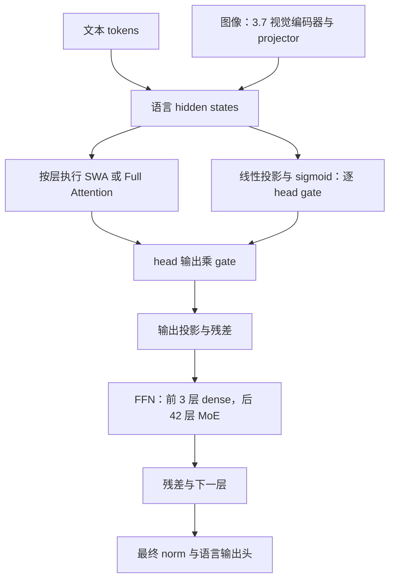
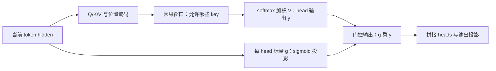
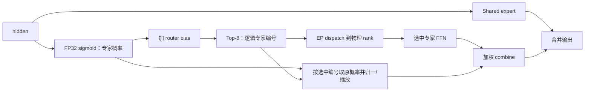
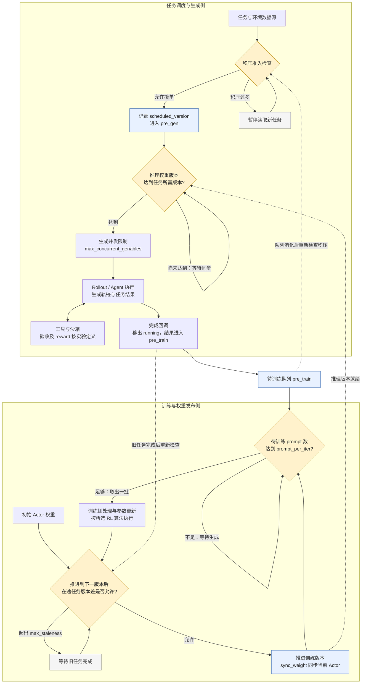
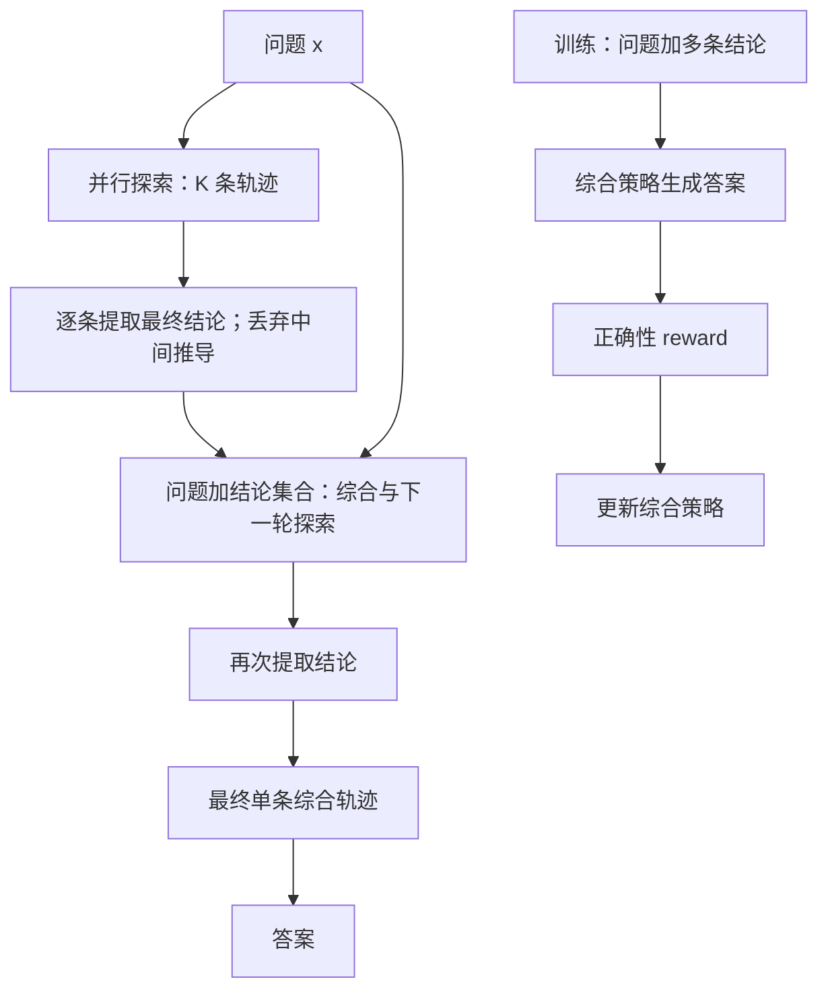

# Step 系列推理与 Agent 技术总结

**资料复核日期：2026-10-12（北京时间）｜用途：推理与 Agent 技术交流、方案评估｜范围：Step 5 Preview、Step 3.5/3.7 Flash 及相关开源项目**

本文依据官方发布页、技术报告、模型配置、仓库代码和独立评测整理。分数为公开结果，未在本次运行模型或复现训练；技术方案和试点优先级属于工程建议。所有参考链接均为网络地址，流程图使用可编辑 Mermaid。当前公开信息不足以建立统一硬件、统一预算下的跨模型总排名。

## 1. 结论摘要

**Step 5 Preview 最值得关注的是部分软件工程任务、金融研究与长资料分析能力；Step 系列最值得复用的技术，则集中在混合注意力、稀疏 MoE 的稳定训练、训练与推理概率一致性，以及可验收的 Agent 工作流。** 能力优势和技术实现证据应分别判断。

- **业务能力：** Step 5 在 ProgramBench、代码库问答和 FrontierFinance 等项目中相对 GLM-5.3/Kimi K3 有优势信号；DeepSWE 接近两者，通用业务自动化和部分长程任务不领先。
- **推理架构：** Step 3.5/3.7 的 SWA + Full Attention、逐 head 输出门控、288 专家 top-8 MoE、MTP 有论文或配置/代码支持，适合研究推理效率与数值一致性。Step 5 目前只能确认 600B/27B 稀疏 MoE、1M API 上下文等公开规格。
- **后训练：** Step 3.5 的 MIS-PO、截断处理和路由稳定性分析，以及 StepTronOSS 的版本流控，适合解决高吞吐 rollout 带来的概率偏差和样本过时问题。
- **Agent：** Step-Code 的技能发现、插件接入和目标生命周期可直接参考；业务收益取决于模型、工具、环境和验收共同作用，不能由存在 SKILL.md 推导固定增益。
- **计算扩展：** PaCoRe 学习综合多条推理结论，用更多测试时计算改善困难任务；它适合高价值可验证任务，不应按低成本方案推广。

主要依据：[Step 5 发布页](https://www.stepfun.com/step-5-preview)、[Step 3.5 技术报告](https://arxiv.org/html/2602.10604v2)、[Step 3.7 仓库](https://github.com/stepfun-ai/Step-3.7-Flash)、[Step-Code](https://github.com/stepfun-ai/Step-Code)、[PaCoRe](https://github.com/stepfun-ai/PaCoRe)。

## 2. 模型代际与参数变化

### 2.1 已核实的规格

表注：B 表示十亿参数；层数仅计主干，MTP 单列。3.5 使用论文主干口径，3.7 使用官方 README 和开源配置，Step 5 使用发布页/API 规格。不同模型是否计入视觉、MTP、embedding/output 的口径不完全相同，不能直接据此推导 FLOPs。“未核实”表示没有可靠公开依据，不表示沿用上一代。

| 项目 | Step 3.5 Flash | Step 3.7 Flash | Step 5 Preview |
|---|---|---|---|
| 总参数 / 激活参数 | 主干 196B / 11B | 标称约 198B / 约 11B；196B 语言主干 + 1.8B 视觉编码器 | 官方披露 600B / 27B，详细组成未核实 |
| 主干层数 / hidden size | 45 / 4096 | 45 / 4096 | 未核实 |
| 主干 FFN 布局 | 3 dense + 42 MoE | 3 dense + 42 MoE | 稀疏 MoE；布局未核实 |
| 注意力布局 | 33 SWA + 12 Full，S3F1 混合 | 同左 | 具体类型未核实 |
| SWA window | 512 | 512 | 未核实 |
| Query heads / KV heads | Full 64、SWA 96；KV 8；head dim 128 | 同左 | 未核实 |
| 门控 | head-wise attention output gate | 同左，代码可核实 | 未核实 |
| 每层 routed / shared experts | 288 / 1；每 token routed top-8 | 同左 | 专家数量、top-k 未核实 |
| Expert intermediate size | 1280 | 1280 | 未核实 |
| MTP | 3 个预测层 | 3 个预测层 | 未核实 |
| 上下文窗口 | 开源配置与官方 API 模型页均为 256K | 开源配置与官方 API 模型页均为 256K | 官方 API：1M |
| API 最大输入 | Step 直连未给独立数值；受 256K 总上下文约束，见附录 A | 百炼列 262,144；OpenRouter 端点未给独立值，见附录 A | 官方明确列出 1M tokens |
| API 最大输出 | OpenRouter/SiliconFlow：65,536；Step 直连未给独立硬上限 | 百炼：262,144；OpenRouter/StepFun：230,400；Novita：256,000 | 官方明确列出 64K tokens |
| 模态 | 文本 | 文本与视觉；47 层视觉编码器 + projector | API 支持文本、图像、视频输入 |
| 可用形态 | 开放权重与技术报告 | 开放权重、量化版本与部署说明 | API 预览；发布页计划 10 月 15 日开放权重 |

来源：[3.5 论文架构表与附录](https://arxiv.org/html/2602.10604v2)、[3.7 README](https://github.com/stepfun-ai/Step-3.7-Flash)、[3.7 config](https://huggingface.co/stepfun-ai/Step-3.7-Flash/blob/main/config.json)、[Step 5 文档](https://platform.stepfun.ai/docs/en/guides/models/step-5-preview)、[当前 API 规格](https://platform.stepfun.ai/docs/en/guides/pricing/details)。3.5 论文另列含 MTP 的 198B/13B；不要把这个 198B 与 3.7 加视觉后的标称 198B 视为相同统计口径。

输入、输出限制因服务端点而异，具体规格与上下文预算说明见文末附录 A。

### 2.2 参数变化对推理的含义

**3.5 → 3.7：语言主干基本同源，增加视觉接入。** 可复用文本 attention/MoE 的结构分析，但视觉编码和图像 token 会增加计算与上下文开销。总参数接近并不意味着所有请求耗时相同。

**3.5 → Step 5：按披露值，总参数约 3.06 倍，激活参数约 2.45 倍。** 这说明容量与激活计算预算扩大，不能解释成吞吐、质量或费用同比变化。Step 5 的层数与注意力实现未知，无法可靠估计其 KV 成本，也不能确认它采用 3.5/3.7 的 SWA、MTP 或 MIS-PO。

**容量估算只作下限参考：** 600B 参数全用 BF16 存储约 1.2 TB（十进制），不含 KV、激活、通信 buffer 和运行时。稀疏激活减少本 token 的专家计算，不免除其他专家权重的存储需求；本报告不据此给出未经验证的 Step 5 本地部署配方。

## 3. Step 5 的业务与推理优势：成绩、意义和限制

表注：来自 2026-10-12 复核的 Step 官方发布页；Step 使用 High，GLM/Kimi 使用 Max，未统一计算预算，缺少置信区间。数字为百分比，† 为内部基准，Partial Score 不是完整任务通过率。DeepSWE 使用 SWE-agent，temperature=1.0、top_p=0.95；其他项目须分别核对 harness。小差值仅称优势信号。

| 方向 / 基准 | Step 5 | GLM-5.3 | Kimi K3 | 结论与业务意义 |
|---|---:|---:|---:|---|
| 程序开发：ProgramBench | 80.5 | 72.0 | 77.8 | 较值得复验的优势：需求实现、修改和运行验证 |
| 代码库理解：SWE-Atlas-QnA | 63.6 | 59.6 | 59.5 | 代码库问答有优势信号，可试仓库分析与定位 |
| 软件工程：DeepSWE v1.1 | 67.7 | 66.9 | 67.5 | 接近，不能称显著领先 |
| 多类型编码：StepCodeBench† avg@4 | 49.0 | 40.2 | 43.9 | 内部多任务集有优势；avg@4 不等于 best-of-4 |
| 金融研究：FrontierFinance | 66.4 | 64.1 | 62.6 | 特定金融工作有局部优势，适合证据与计算驱动的研究 |
| 长材料：AA-LCR v1.1 | 88.3 | 79.7 | 88.7 | 对 GLM 较强，与 K3 接近 |
| 学科推理：GPQA Diamond | 93.5 | 91.7 | 93.5 | 学科问答较强，与 K3 持平 |
| 多工具：Toolathlon-Verified | 74.1 | 73.0 | 76.5 | 有竞争力，未全面领先 |
| 业务自动化：AutomationBench public | 44.0 | 48.2 | 46.7 | 不认定为 Step 优势 |
| 终端：Terminal-Bench v4 | 33.3 | 41.9 | 12.6 | 高于 K3、低于 GLM，绝对通过率仍偏低 |
| 长程开发：SWE-Marathon v1.1 Partial Score | 72.7 | 67.4 | 84.4 | 低于 K3，长程能力不能笼统称领先 |
| 视觉文档：GDP.pdf | 14.8 | 11.2 | 22.0 | 低于 K3，复杂文档须单独评估 |

来源：[官方评测](https://www.stepfun.com/step-5-preview)。同页 Opus 5 的 ProgramBench 82.3、DeepSWE 74.0、FrontierFinance 69.7 高于 Step 5；上述优势都是针对明确对照和任务，不是总体第一。HLE with tools 含 text-only 与全数据集的口径差异，未纳入此表。

与 DeepSeek V4.1 Flash 的金融比较也有正反结果：FrontierFinance 为 **66.4 vs 63.0**，内部金融研究为 **55.8 vs 50.2**，但内部 LiveSearch 为 **74.5 vs 76.7**。没有可靠同条件 Step 5–Hy4 Preview 对照，不推导两者总体胜负。[官方金融图](https://www.stepfun.com/step-5-preview)

独立交叉检查限制了泛化结论：Vals 的 Finance Agent v2 为 **50.67±0.32，38/76**，TB v4 为 **31.82±2.62**；± 按页面展示保留，排名为读取时样本集合。这支持“金融研究部分任务有优势”，不支持“全部金融 Agent 领先”。[Vals 评测](https://www.vals.ai/models/stepfun_step-5-preview)

**高分的技术原因能说到哪一步？** 目前结果支持相应环境下的理解、执行与验证能力；Step 5 未公开完整训练消融，不能将高分直接归因于某种 attention、RL loss 或 skill。下文技术说明来自明确列出的模型/仓库，作为实现与迁移证据。

## 4. 推理架构与技术原理

### 4.1 模型内部计算：Attention 与 MoE 分工



图注：Step 3.5/3.7 主干的概念流程；省略部分 norm、位置编码和缓存细节；视觉分支仅对应 3.7。不是 Step 5 已公开系统图。[模型实现](https://huggingface.co/stepfun-ai/Step-3.7-Flash/blob/main/modeling_step3p7.py)

### 4.2 SWA 与 Gated SWA

SWA（滑动窗口注意力）限制每个 query 的直接可见范围。以窗口含当前 token 的教学约定为例，第 12 个 token、窗口 4，只看 9–12；Full causal attention 看 1–12。SWA 的 attention 主计算由 prefill 约 O(N²) 降至 O(Nw)，decode 每个 query 读取约 w 个 KV，而不是 N 个。该复杂度不包括整个模型的 FFN、投影与通信。

Step 3.5/3.7 用局部与全局层混合：**33 SWA + 12 Full，window=512**。Full 层保留直接全局路径，多层 hidden 也传递上下文信息，因此不能说“整个模型只记住 512 tokens”。只有窗口内核和缓存管理真正生效，SWA 层才可获得相应内存收益；Full 层 KV 仍随序列增长。[论文 §2.2](https://arxiv.org/html/2602.10604v2)



图注：Gated SWA 的门控在 attention 输出侧。**窗口控制看哪里，gate 控制每个 head 的结果注入多少**；gate 不扩大窗口，也不自动跳过已完成的 attention 计算。Step 的逐 head 输出门控也用于混合布局中的 Full attention。

代码证据是 `g_proj(hidden_states)` 产生 head 数量的 gate，再以 `gate_states.unsqueeze(-1).sigmoid()` 乘 head 输出，最后 `o_proj`。一个 head 的所有 head_dim 分量共享该标量。门控有助于抑制当前窗口无用信息，但不能由此宣称全模型任意任务提分或推理自动加速。[官方 attention 代码](https://huggingface.co/stepfun-ai/Step-3.7-Flash/blob/main/modeling_step3p7.py#L686)

### 4.3 稀疏 MoE 与 EP 负载平衡

MoE 专家是 FFN 子网络。Step 3.5/3.7 每个 MoE 层从 **288 个 routed experts 选 8 个，另加 1 个 shared expert**；每 token、每层重新路由。8/288 只是专家数量比例，不是整个模型的激活参数比例。



图注：路由语义依据官方模型代码；跨 rank dispatch/combine 是 EP 的分布式执行流程，不表示该 Transformers 参考实现本身完成了高性能分布式通信。

官方关键代码节选：

```python
gate_prob = torch.sigmoid(gating_output.float())
gate_prob_with_bias = gate_prob + self.router_bias.unsqueeze(0)
_, indices = torch.topk(gate_prob_with_bias, k=topk, dim=1)
topk_prob = torch.gather(gate_prob, 1, indices)
```

接口含义：bias 影响专家选择；混合系数来自未加 bias 的概率，后续还会归一/缩放。推理后端应保持这一语义，不能直接用普通 softmax top-k 替换。[路由实现](https://huggingface.co/stepfun-ai/Step-3.7-Flash/blob/main/modeling_step3p7.py#L537)

**EP 不均的两级训练方案：** Step 3.5 用 loss-free bias 调整平衡全局专家调用；再加 EP-group 辅助损失，约束 micro-batch 的 rank 负载。全局专家均衡不保证当前 batch 各卡均衡。论文给出 `L_EP = G × Σ_g f_g p_g`，其中 f_g 为实际 token–expert 分配份额，p_g 为该 rank 上专家平均路由概率之和，G 为 rank/group 数；预训练系数 0.001。这是软约束，非每步强制平均，也不是可直接照搬到 rollout 的运行参数。[论文 §2.2、§4.2](https://arxiv.org/html/2602.10604v2)

服务侧可另用 EPLB 重排专家、复制热点专家并将请求分到等价副本，改变物理映射而保持逻辑专家选择。代价是显存、迁移与调度开销；支持情况需按模型/后端确认。RL 中若临时改路由 bias 或 top-k，会改变策略概率；专家副本还必须同步权重版本。[vLLM EPLB](https://docs.vllm.ai/en/latest/serving/expert_parallel_deployment/)、[vLLM-Ascend EPLB](https://github.com/vllm-project/vllm-ascend/blob/main/docs/source/user_guide/feature_guide/expert_parallelism_load_balancer.md)

### 4.4 MTP：减少串行解码，收益依赖负载

MTP 的执行流程为 **生成候选 tokens → target 模型验证 → 接受前缀进入 cache → 拒绝处按后端规则处理**。接受率、并发与额外计算决定净收益；用于 RL 时，不能把 draft 概率冒充 target 策略概率。

表注：Step 3.7 官方实验；GB200、TP4、NVFP4，约 250 输入 tokens/1.6K 输出 tokens，decode-heavy 负载；单位为总输出 tok/s，非单请求速度，也非完整 RL 吞吐。

| 并发 | 开 MTP | 关 MTP | 相对吞吐 |
|---:|---:|---:|---:|
| 8 | 1309 | 1155 | 1.13 倍 |
| 32 | 4391 | 3480 | 1.26 倍 |
| 64 | 8229 | 5667 | 1.45 倍 |

来源：[官方 MTP 部署与实验](https://github.com/stepfun-ai/Step-3.7-Flash)。同页 GPQA avg@16 点估计为开 MTP 77.81、关闭 78.41；缺少不确定性时不宣称严格无损，也不外推到昇腾、长 prefill 或 Step 5。

## 5. 后训练 RL 与推理设施

### 5.1 可借鉴的训练机制

Step 3.5 的关键问题定义是：训练策略与 rollout 策略可能因权重过时、数值精度、内核或路由而产生概率偏差；长链会放大偏差。**MIS-PO 使用 token 与轨迹层面的概率比构造过滤 mask**，控制失配样本进入更新。工程上应同时看原始吞吐、过滤保留率和学习效果，否则生成更快可能只带来更多无效样本。[论文 §5.2](https://arxiv.org/html/2602.10604v2)

其他值得保留的机制是：区分上下文截断与真实失败，用 value estimate 处理截断的后续价值；可验证任务使用程序 checker，非可验证任务使用校准过的奖励模型/rubric；监控 MoE 路由信心和训练/推理一致性。带 value 的处理不能直接等同于无 critic 算法。上述是 3.5 证据，未确认 Step 5 沿用。

### 5.2 Rollout 与训练的接口流程

**异步 RL 总览：任务流、权重流与四个控制点。** 实线表示主流程，虚线表示跨侧通知或条件影响；生成侧与训练侧可以并行，不要求每批生成结束后才启动训练。



图注（2026-10-12）：以 StepTronOSS `FullyAsyncFlowController` 的接口顺序为骨架：`start()` 启动控制/生成线程；`_control_worker()` 调度任务；`_generation_worker()` 等待版本并提交生成；完成回调进入 `pre_train`；`get_train_samples()` 先调用 `_wait_for_next_weight()`，推进版本并同步当前 Actor，再等待/取出训练批次；外层 trainer 更新参数，下一轮重复。工具、reward 和具体 RL 算法是实验定义的扩展环节，非该流控文件独立实现；此图不表示 Step 5 官方生产架构。[控制器与接口代码](https://github.com/stepfun-ai/SteptronOss/blob/dev/steptronoss/core/generators/flow_controller.py)、[生成控制器](https://github.com/stepfun-ai/SteptronOss/blob/dev/steptronoss/generation/async_generation.py)

表注：以下单位来自代码语义；版本差按训练版本计，不是秒。prompt/生成任务的数量不等于 tokens 数，不能将配置直接当作 GPU 容量。

| 控制点 | 判断或配置 | 等待发生在哪里 | 目的 |
|---|---|---|---|
| 积压背压 | `len(pre_train) + len(running_genables) <= max_untrained_prompts`，同时检查 `pre_gen` 是否为空 | 任务数据源暂停接单 | 控制尚未训练的任务积压 |
| 生成并发 | `max_concurrent_genables` | 生成控制器的请求执行入口 | 控制同时执行的生成任务 |
| 训练批次 | `len(pre_train) >= prompt_per_iter` | 训练侧等待结果凑批 | 决定每次交接的 prompt 数 |
| 版本流控 | 在途任务最大 `next_version - scheduled_version <= max_staleness` | 训练侧推进版本之前等待旧任务 | 限制长任务落后训练策略的版本距离 |

两个容易混淆的边界：积压检查使用 `<=`，是提交前准入阈值，不是任何时刻严格不超过配置值的硬容量；`scheduled_version` 是任务调度标签，生成侧只等待 `infer_weight_version >= scheduled_version`，不能因此认定每个采样 token 都来自该标签所指的同一权重。版本流控也不替代训练/rollout 的 logprob 对齐与概率失配处理。[相关条件与回调实现](https://github.com/stepfun-ai/SteptronOss/blob/dev/steptronoss/core/generators/flow_controller.py)

StepTronOSS 提供可检查的实现入口：`VLLMDeployConfig` 生成服务配置，controller 启动并注册 endpoint，client 生成/重载权重；`SimpleFlowController` 与 `FullyAsyncFlowController` 管理版本、在途请求与队列。`max_staleness` 按策略版本步数计，`max_untrained_prompts` 控制背压，`max_concurrent_genables` 控制并发。热加载接口存在，不等于已证明零停顿或任意 KV 可复用。[部署配置](https://github.com/stepfun-ai/SteptronOss/blob/dev/steptronoss/exp/inference.py)、[流控](https://github.com/stepfun-ai/SteptronOss/blob/dev/steptronoss/core/generators/flow_controller.py)、[RL 配置](https://github.com/stepfun-ai/SteptronOss/blob/dev/steptronoss/exp/rl.py)、[vLLM client](https://github.com/stepfun-ai/SteptronOss/blob/dev/steptronoss/generation/vllm/vllm_client.py)

### 5.3 StepMesh 与其他设施的职责

StepMesh 实现 Attention–FFN（A/F）分离通信：**attention worker PushPull/ZBatchPushPull → FFN server GetBatch → 计算 → Respond → worker Wait**。它关注低延迟通信和 RDMA；P/D 分离划分 prefill/decode，训练/rollout 分离划分工作负载，三者不可混称。[StepMesh 接口](https://github.com/stepfun-ai/StepMesh)

StepTronOSS 便于学习训练配置与版本流控，verl/slime 可作为通用 RL 系统参考，vLLM/SGLang 负责模型服务与调度。未发现足够同条件证据证明 StepTronOSS/StepMesh 性能胜过这些系统。选择应基于真实瓶颈和支持的算子，而不是将所有框架叠加。[verl](https://github.com/verl-project/verl)、[slime](https://github.com/THUDM/slime)、[vLLM](https://github.com/vllm-project/vllm)、[SGLang](https://github.com/sgl-project/sglang)

## 6. Agent、Skills、Plugin 与业务评测

### 6.1 架构分工与接口

Model 决定下一步和工具参数；harness 管理执行循环、上下文、预算与恢复；plugin/MCP 接入工具；skill 提供领域指令、脚本和资源；bench 定义任务环境与验收。模型支持 tool calling，并不意味着它自带企业系统访问能力。


图注：建议的业务流程。Step-Code 已实现技能/插件及执行框架接口；各领域 checker 需按业务补齐，不由 loader 自动保证。

**代码证据：** Step-Code `loadSkillsFromDir` 扫描技能目录，`loadSkillFromFile` 解析 frontmatter、校验名称/描述，`formatSkillsForPrompt` 生成可发现的技能信息。插件侧 `readStepPluginManifest` / `parseStepPluginManifest` 读取并解析 `step.plugin.json`，代码也包含兼容 manifest 路径；再由框架装载对应能力。调用链可追溯，不等于任意插件全部兼容。[skills.ts](https://github.com/stepfun-ai/Step-Code/blob/main/packages/coding-agent/src/core/skills.ts)、[plugins.ts](https://github.com/stepfun-ai/Step-Code/blob/main/packages/coding-agent/src/step/plugins.ts)、[goal 生命周期](https://github.com/stepfun-ai/Step-Code/blob/main/docs/goal-lifecycle.md)

### 6.2 优势或借鉴点，对应哪些仓库技术

表注：这是“证据→技术内容→可复用范围”的对应关系，不是对 Step 5 高分的因果证明。P0/P1 是本报告建议，按任务价值与迁移条件划分；仓库 stars 不代表生产质量。

| 优势 / 借鉴点 | 对应仓库技术内容 | 可直接用于什么 | 优先级与边界 |
|---|---|---|---|
| 软件工程执行与交付 | [Step-Code](https://github.com/stepfun-ai/Step-Code)：读代码、修改、测试、独立任务上下文、goal、StepPage | 代码 skill、回归测试、预算与终止、产物交付 | P0；不能证明该框架造成 ProgramBench 的全部增益 |
| 训练/生成一致性 | [StepTronOSS 流控](https://github.com/stepfun-ai/SteptronOss/blob/dev/steptronoss/core/generators/flow_controller.py)：版本、队列、背压 | 异步 rollout、样本过时控制、可重放实验 | P0；不等于开源了 Step 5 完整 RL 栈 |
| 注意力与路由语义 | [3.7 模型代码](https://huggingface.co/stepfun-ai/Step-3.7-Flash/blob/main/modeling_step3p7.py)：滑窗参数、输出门控、FP32 sigmoid/bias top-k | 推理适配、算子核验、概率一致性测试 | P0；仅证明该模型实现 |
| 研究报告的证据组织 | [StepDeepResearch](https://github.com/stepfun-ai/StepDeepResearch)：检索、任务管理、计算工具与研究评测资料 | 搜索→证据→分析→引用与 rubric 验收 | P0；不能作为 Step 5 金融能力的训练来源证明 |
| 大 MoE 资源分离 | [StepMesh](https://github.com/stepfun-ai/StepMesh)：A/F worker/server 与 RDMA 通信接口 | 研究集中 FFN 专家与独立资源池 | P1；先评估通信与 EP 拖尾 |
| 并行推理综合 | [PaCoRe](https://github.com/stepfun-ai/PaCoRe)：多轮配置、结论提取、综合训练、服务接口 | 困难可验证任务、实验方案探索 | P1；更多 token，不是通用省成本方法 |
| 无 API 的移动业务 | [gelab-zero](https://github.com/stepfun-ai/gelab-zero)：GUI、ADB、多设备与 MCP | 手机工作流、回放和状态核查 | P1；UI 成功不等于业务状态正确 |
| 语音能力业务封装 | [StepAudio-Skills](https://github.com/stepfun-ai/StepAudio-Skills)：ASR、TTS、音频推理指令/脚本 | 会议、客服和音频处理 | P1；独立工具能力，不是 Step 5 原生音频证明 |

高星通用生态的借鉴方向是：Agent Skills 标准的按需加载、成熟 RL 框架的权重同步/资源管理、AutomationBench 的最终状态校验。GEBench 评测生成 GUI 环境，不能替代真实 GUI Agent 执行成功率。[Agent Skills](https://github.com/agentskills/agentskills)、[AutomationBench](https://github.com/zapier/AutomationBench)、[GEBench](https://github.com/stepfun-ai/GEBench)

### 6.3 PaCoRe：训练综合能力，扩展测试时计算



图注：PaCoRe 论文流程。Low/Medium/High 探索配置为 `[4]`、`[16]`、`[32,4]`，最终收敛到一条轨迹；论文实现轮间使用同一模型权重。压缩是提取每条最终结论，不是额外摘要模型必然介入。总 TTC 可跨轨迹累计，单次上下文仍受限制。[论文 §2](https://arxiv.org/html/2601.05593v1)

训练通过 outcome reward 鼓励模型综合、交叉检查和纠错，而非简单多数投票。HMMT 2025 中基础 RLVR-8B 为 **75.4% / 48K TTC**，PaCoRe High 为 **94.5% / 1796K TTC**，总 token 约 37.4 倍。基础模型与训练/配置同时改变，不能把这个差值视为仅增加并发的消融收益，也不能外推所有业务。[官方结果与实现入口](https://github.com/stepfun-ai/PaCoRe)

## 7. 与竞品相比，值得借鉴的技术方向

表注：依据各模型官方资料，复核日期 2026-10-12；这是机制与工程启发，不是统一成本排名。涉及厂家自述的改进不视为独立复现。

| 对象 | 官方技术核心点 | 对推理 / Agent 的启发 | 对 Step 的判断 |
|---|---|---|---|
| DeepSeek V4 | CSA/HCA、长上下文设计、领域专家训练后统一蒸馏 | 分别评估长轨迹成本、领域 reward 与统一策略 | 无同条件全面优劣结论，版本升级需单列 |
| DeepSeek V4.1 Flash | CED 区分 prefill/decode 激活计算，CSA2 跨层缓存/索引复用，任务环境合成 | 输入密集型 Agent 分拆 prefill、decode、KV 与恢复开销；加强训练环境生产 | Step 5 架构细节不足，不能声称 KV 或推理成本领先 |
| GLM-5.3 | 与 5.2 同 base，强化后训练与长任务环境 | 借鉴业务任务、verifier 和长程训练数据 | 当前通用自动化成绩高于 Step 5 |
| Kimi K3 | 混合注意力、SFT 起低精度训练、完整推理/工具历史协议 | 训练/部署量化一致性与多轮上下文适配 | 长程、视觉部分任务更强；不能机械删除历史省 token |
| Hy4 Preview | 770B/49B 主干，Gated DSA + IndexCache、iHC，专家真实任务与产品共建 | 稀疏索引复用、真实业务样本、停止与验收策略 | 开放架构和权重证据较充分；内部盲评没有 Step 5 对照 |

来源：[V4](https://huggingface.co/deepseek-ai/DeepSeek-V4-Pro)、[V4.1](https://huggingface.co/deepseek-ai/DeepSeek-V4.1-Flash)、[GLM-5.3](https://huggingface.co/zai-org/GLM-5.3)、[Kimi K3](https://github.com/MoonshotAI/Kimi-K3)、[Hy4 Preview](https://github.com/Tencent-Hunyuan/Hy4-preview)。Hy4 主干参数不含另外的 MTP 层；不要混用含/不含 MTP 的容量数字。

## 8. 落地建议与验证指标

优先选 **真实仓库修改与测试、金融研究的证据/计算链、长资料分析与引用定位**，用固定任务、工具版本和预算验证 Step 5。Skills 应包含输入输出契约、脚本/模板、错误处理、验收与停止条件，失败日志可进入 Agent RL 数据建设。

对推理平台，先打通权重版本、logprob 对齐、结束原因、KV 失效、工具环境和 reward，再分别验证 SWA/MTP、EP/EPLB、异步 rollout。昇腾适配要固定 CANN、torch-npu、vLLM/vLLM-Ascend、模型与 parser 版本；存在框架入口不代表目标模型算子已适配。

表注：以下是建议验收口径，不是实测结果；成本统计应包含推理、工具、失败重试及人工返工，设备小时注明硬件型号。

| 维度 | 应记录指标 | 回答的问题 |
|---|---|---|
| 模型 / Agent 效果 | 固定预算成功率、最终状态正确率、引用支持率、产物检查通过率 | 高分能否迁移到业务 |
| 训练一致性 | training/rollout logprob 差、路由一致率、过滤保留率 | 加速是否改变学习信号 |
| RL 有效吞吐 | 实际用于更新的有效轨迹/设备小时，验证集收益曲线 | 生成更快是否带来更多有效训练 |
| 服务与 EP | prefill/decode/工具等待、每 rank 分配量与计算耗时、通信 p95/p99 | 瓶颈是计算、负载、通信还是环境 |
| 总成本与恢复 | 每成功任务成本、重试/重放成功率、人工返工、重复副作用 | 是否具备生产使用价值 |

**技术说明的最终落点：** Step 5 用任务评测证明局部能力；Step 3.5/3.7 与开源仓库提供可核查的技术抓手。优先复用可验收、可观测、可重放的环节，再用业务和训练结果决定是否扩大模型、并发与系统复杂度。

---

### 资料范围与复核说明

本轮复核了 StepFun 组织 33 个公开仓库的目录信息、主要技术仓库与官方模型资料；Step-Code stars 已由前次 803 变为 804，说明关注度是动态快照，因此正文不以 stars 排序代替技术判断。Step 5 官方页面的 40 个表格项目与前次读取值一致，开放权重仍为计划说明。此前失效镜像不作为任何架构依据。

本文图示是基于公开资料的技术示意，不表示 Step 5 生产内部实现；部分代码链接指向动态分支，应优先按符号名定位。需要严谨复现时，进一步固定 commit、模型版本、数据集、harness、工具与预算。本轮没有运行模型或宣称业务实测增益。

---

## 附录 A：输入输出与服务端点规格

输入输出与服务端点补注（2026-10-12，北京时间）：复核了 Step 官方中英文模型页、Chat Completions 参数说明、OpenRouter 实时端点 API 和百炼模型页。Step 直连文档的 `max_tokens` 默认 INF，表示不额外设置请求级生成限制；同一文档明确输入与生成 tokens 总和受模型上下文限制，不能解释为无限输出。3.5/3.7 官方模型页只明确 256K 上下文；能够进一步确认的独立上限如下。

表注：单位均为 tokens，保留端点原始整数，避免将十进制 256,000 和二进制 262,144 混写成同一个 256K。以下是服务端点公开规格，不是本次实测，也不代表所有部署共享相同限制。`max_prompt_tokens=null` 表示该 API 未提供独立输入字段值，不表示无限输入；输入需计入系统提示、历史、工具定义/结果及多模态 token，并为生成保留上下文预算。

| 模型 / 服务端点 | 上下文窗口 | 独立最大输入 | 独立最大输出 | 证据与适用范围 |
|---|---:|---:|---:|---|
| Step 3.5 / OpenRouter → SiliconFlow | 262,144 | `max_prompt_tokens=null`；受上下文预算约束 | 65,536（64 × 1024） | [实时端点 API](https://openrouter.ai/api/v1/models/stepfun/step-3.5-flash/endpoints)、[模型页 FAQ](https://openrouter.ai/stepfun/step-3.5-flash)；不能直接作为 Step 直连上限 |
| Step 3.7 / 百炼，页面声明推理服务供应商为 StepFun | 262,144 | 262,144 | 262,144 | [百炼官方模型页](https://docs.bailian.console.aliyun.com/zh/model-studio/step-3-7-flash)；思考模式也列相同数值，仍需遵守总上下文预算 |
| Step 3.7 / OpenRouter → StepFun | 256,000 | `max_prompt_tokens=null`；受上下文预算约束 | 230,400 | [实时端点 API](https://openrouter.ai/api/v1/models/stepfun/step-3.7-flash/endpoints) 中 `provider_name=StepFun`；不是 Novita 的规格 |
| Step 3.7 / OpenRouter → Novita | 262,144 | `max_prompt_tokens=null`；受上下文预算约束 | 256,000 | [同一实时端点 API](https://openrouter.ai/api/v1/models/stepfun/step-3.7-flash/endpoints) 中 `provider_name=Novita`；模型页 FAQ 的最大输出汇总值不应覆盖所有 provider |
| Step 5 Preview / Step 官方 API | 官方标记 1M | 官方标记 1M | 官方标记 64K | [官方模型页](https://platform.stepfun.ai/docs/en/guides/models/step-5-preview)；两个独立上限不能同时取满 |

预算关系：按 [Step 官方 Chat Completions 文档](https://platform.stepfun.com/docs/zh/api-reference/chat/chat-completion-create)，输入 tokens + 生成 tokens ≤ 模型上下文窗口。例如仅用于说明预算：若上下文为 262,144、输入为 200,000，则剩余生成预算最多为 62,144，此外还要遵守该端点自身的输出上限。Step Plan 的 `step-router-v1` 另列 `max_tokens` 上限 250K，是自动路由通道的约束，不能归到 Step 3.5 或 Step 3.7 的固定上限。价格页的“1M tokens”是计费单位，原表据此将 Step 3.7 上下文写成 1M，已纠正。
