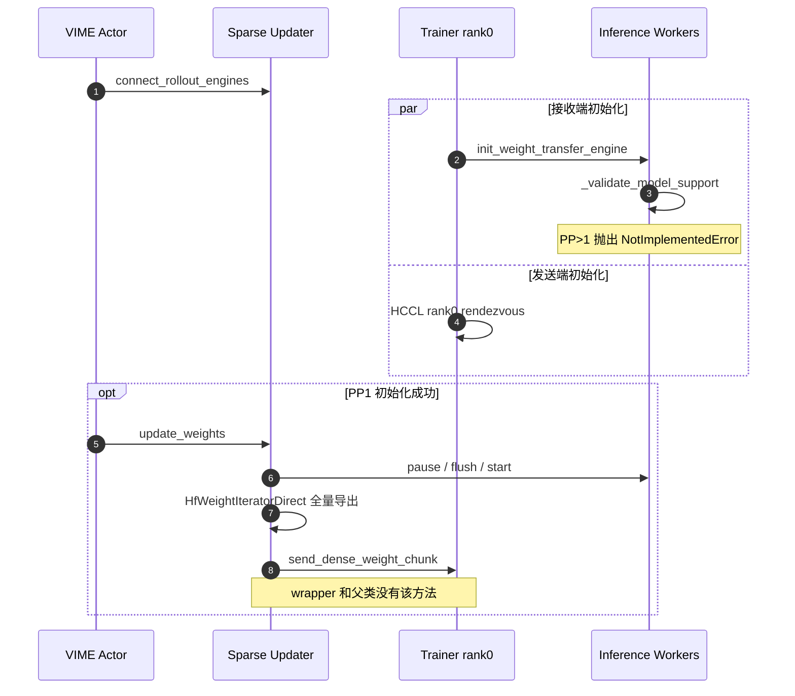

# #492 原始时序与断点

代码版本：[VIME #492 b7a462f5](https://github.com/vllm-project/vime/tree/b7a462f5d7351627109ace757e88a9b01fe854a7)。这是修改前快照，不代表本文候选代码。

## 评估

VIME updater 与 #480 内容相同，但底层已换成 160 行上游 wrapper，接口契约没有同步保持。

| 项目 | 固定版本代码事实 | 影响 |
| --- | --- | --- |
| dense seed | updater 调用 `send_dense_weight_chunk`；wrapper 及固定版本父类都没有该方法 | PP1 初始化成功后，首次同步仍会遇到方法缺失 |
| PP | wrapper 在 `_validate_model_support` 明确拒绝 PP>1 | TP2/PP2/EP2 无法正常完成初始化 |
| 接收顺序 | 上游接收后直接进入公共 loader，没有 #480 的 PP 过滤 | 不能只删 PP guard 就宣称支持 PP |
| 发送校验 | 固定版本父类仅检查 shape 是否存在、int32、1D、长度匹配 | #480 的发送前批量 bounds/duplicate/NaN 校验没有接上；接收端仍有数值校验 |
| MoE 直写 | wrapper 没有调用 sparse_apply/direct helper | #480 直写收益不可外推 |

表注：表内描述修改前 #492，不是优化候选。PP 初始化拒绝和 dense 方法缺失是两条独立阻断；多线程握手时，某端提前失败还可能令另一端等待。

## 实际时序

## 代码证据

- [VIME updater](https://github.com/vllm-project/vime/blob/b7a462f5d7351627109ace757e88a9b01fe854a7/vime/backends/megatron_utils/update_weight/update_weight_from_sparse_hccl.py#L338)：首轮 dense 调用。
- [Ascend dependency patch](https://github.com/vllm-project/vime/blob/b7a462f5d7351627109ace757e88a9b01fe854a7/docker/npu_patch/vllm-ascend.patch#L1070)：PP guard；同文件包含完整 160 行 wrapper。
- [固定 vLLM 父类](https://github.com/vllm-project/vllm/blob/e6bfe03ad73a3330cb427885aa90d97a12e1c704/vllm/distributed/weight_transfer/sparse_nccl_engine.py)：`send_weights`、`send_weight_chunk`、`_validate_patch`；没有 dense chunk 方法。

静态检查已执行 PP guard 并确认两个类的方法定义；它不是 NPU 测试。#492 原始提交的 NPU 性能不用于推算本候选的延迟。
