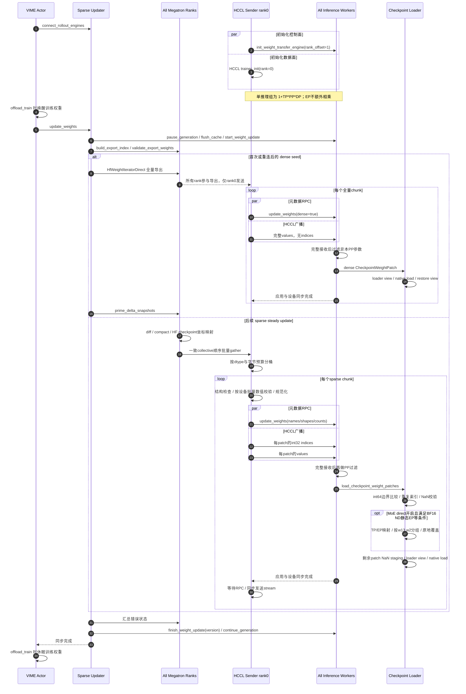
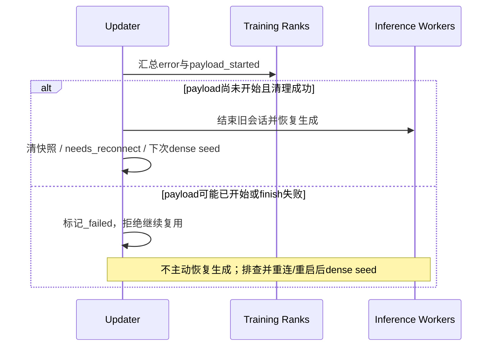

# 优化候选：接口、时序与可行性

候选基于 #492 `b7a462f5`，复用 #480 `1e46fc61` 的 sparse 相关依赖段。下图是候选代码对应的逻辑顺序；没有绘制时间比例，也不表示候选已完成多卡实测。

## 整体时序

## 核心修改与代码证据

| 修改位置 | 修改逻辑 | 解决的问题 |
| --- | --- | --- |
| Ascend `sparse_hccl_engine.py::send_dense_weight_chunk` | 同一HCCL组发送dense元数据和完整values，等待应用完成 | 补齐VIME首轮调用；不发送全量indices，不做NaN staging |
| `SparseHCCLWeightTransferUpdateInfo` / `_receive_patches` | dense模式的indices为None；sparse模式为int32 | 让元数据、发送和接收广播次数一致 |
| `receive_weights` | 先收完整wire，再按PP参数存在性过滤 | 保持所有worker collective顺序一致 |
| `_prepare_patches` / `sparse_weight_patch.py` | 结构检查后按设备汇总数值标志，通信前拒绝错误 | 减少逐patch主机同步，保留bounds/duplicate/NaN检查 |
| `sparse_moe_direct.py` | 校验后按runtime参数分组写入，未处理patch保序回退 | 避免支持的MoE patch完整形状staging及重复loader调用 |
| 公共 `checkpoint_weight_patch.py` | 边界比较显式使用int64；wire不变 | 避免不同后端对大Python整数与int32比较的差异 |

表注：位置均在 VIME 提交的 dependency patch 内；可读源码见下面链接。最后一项是本候选相对复用 #480 流程的新增逻辑，其他为恢复已有协议能力。

- [完整Ascend引擎](core-source/sparse_hccl_engine.py)：`receive_weights`、`_prepare_patches`、`send_dense_weight_chunk`、`_broadcast_chunk`。
- [发送校验](core-source/sparse_weight_patch.py)、[MoE映射](core-source/sparse_moe_direct.py)。
- [公共loader](core-source/checkpoint_weight_patch.py)、[边界回归用例](core-source/test_checkpoint_weight_patch.py)。
- [VIME updater](core-source/update_weight_from_sparse_hccl.py)：沿用原有调度、diff/gather和失败状态机。

MoE direct在推理runtime视图下执行，临时checkpoint视图仅包围回退loader，退出时恢复。HF flat index不能直接当作runtime flat index。patch values是目标值覆盖，0值也必须写入。

## 失败处理

更新原地执行，不能回滚已写参数。RPC与broadcast并发是必要的，不能先等待接收RPC结束再开始broadcast。通信链路故障可能令collective等待；当前没有宣称事务恢复或所有故障下的有限时退出保证。

## 可行性与延迟预估边界

接口/补丁层面可行：两份patch均能在固定原始源码上直接 `git apply --check` 和应用，生成源码与被测候选一致；96项CPU回归通过；真实单NPU的BF16 dense→sparse加载及大张量边界校验通过。新候选的多卡HCCL、TP2/PP2/EP2 oracle、30B完整同步仍需实测。

首轮成本包括全量导出、dense HCCL、原生加载及建立快照，不能保证与full耗时相同。稳态关键路径包含diff/export、gather、发送校验、广播和接收应用；部分阶段包含等待或互相重叠，不能简单把profile数值相加。

BF16 payload模型：full约 `2*N` 字节；sparse约 `(4+2)*K=6*K` 字节。仅在变化位置比例 `K/N<1/3` 时，sparse tensor payload小于full。这个阈值只比较payload，忽略元数据、fan-out、分桶、loader和diff/gather，不能当作端到端加速阈值。

#480历史参考：直写关闭的稳态均值78.73秒；直写开启51.20秒；full为59.73秒。它们不是本候选的预估秒数或SLA。需要同配置、同payload复测后才能给出新候选实际性能判断。
