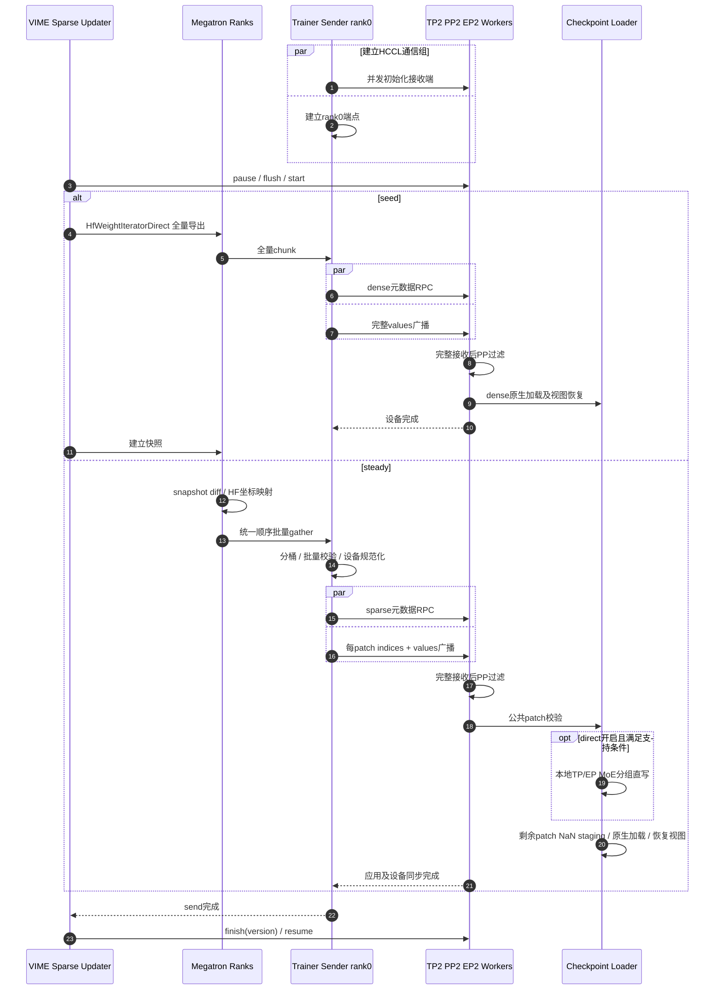

# #480 已验证版本：时序与结果

固定版本：[VIME #480 1e46fc61](https://github.com/vllm-project/vime/pull/480)。实测为2026-10-21的既有结果，本次重新核查记录；不是2026-10-24优化候选的新性能结果。

## 已验证调用流程

这里的EP2与TP2共享已有worker维度，不增加一次worker乘数。测试配置ETP1；不能据此扩展到ETP>1。

## 正确性范围

- Qwen3-30B-A3B、BF16 ND、TP2/PP2/EP2/ETP1；4张训练卡和4张推理卡。
- Ascend sparse/direct回归83项；隔离公共loader/profiler8项；既有expert/layout14项。
- 独立tiny checkpoint恢复direct OFF/ON通过；所有worker参数hash和token匹配正常dense加载。
- 真实30B replay：四rank参数hash跨direct和sender-validation模式一致；恢复原始模型全部runtime参数hash，token为`[2796,315,279,17097]`，finish reason为`length`。
- 既有容器/native CANN与打补丁Python源码；不是重新构建的固定镜像验证。
- direct默认关闭，仅支持guard内的Qwen3-MoE BF16/连续ND/静态EP。量化、NZ、EPLB不支持；ETP>1及Qwen3.5/GLM5 direct未验证。

## 完整权重同步

| 模式 | 首次seed（秒） | 后续三轮完整同步（秒） | 稳态均值（秒） | seed加三轮（秒） |
| --- | ---: | --- | ---: | ---: |
| Full HCCL | 98.7 | 59.7 / 62.3 / 57.2 | 59.73 | 277.9 |
| 旧校验，direct OFF | 133.7 | 102.3 / 110.8 / 115.2 | 109.43 | 462.0 |
| 旧校验，direct ON | 132.9 | 71.0 / 95.1 / 95.7 | 87.27 | 394.7 |
| 批量校验，direct OFF | 134.5 | 77.0 / 77.6 / 81.6 | 78.73 | 370.7 |
| 批量校验，direct ON | 122.4 | 49.7 / 51.3 / 52.6 | 51.20 | 276.0 |

表注：2026-10-21，188，Qwen3-30B-A3B BF16 ND，TP2/PP2/EP2/ETP1，四训练卡与四推理卡。秒数为完整`update_weights`墙钟耗时，含生命周期、export/diff、gather、传输和apply，排除启动、训练、生成；seed不进入稳态均值。各模式为独立rollout/training运行，payload略有差异；不是严格相同输入因果实验。所有五个Ray作业成功，客户端退出0，profiling关闭。batch/direct-OFF seed包含一次非阻塞栈观测，不用于严格seed比较。旧校验/full控制使用`e66cb752`，批量校验使用`1e46fc61`。

组合优化的稳态观测比full低14.29%，但seed加三轮只低1.9秒；不能把稳态收益当成短任务总收益。

## 同payload对照

| 实验 | 控制均值（秒） | 优化均值（秒） | 降幅 |
| --- | ---: | ---: | ---: |
| direct OFF→ON，旧发送校验 | 170.524 | 135.160 | 20.74% |
| 旧→批量发送校验，direct始终ON | 134.324 | 34.110 | 74.61% |

表注：两个独立实验，每个模式仅2个正式样本，先分别预热，再按ABBA顺序。均使用18,867 patches、59,633,124 positions、341.22347 MiB，计时含发送校验、广播和接收应用完成；排除训练export/diff/gather、finish、hash审计和推理。不能合并为一个因子实验，也不能当作完整同步耗时。

独立同步诊断中sender_validate从116.671降至18.323秒；receiver_apply最大rank从10.893到10.622秒。这些诊断不混入吞吐样本，发送接收等待重叠，不能相加。

证据：[原PR说明](https://github.com/vllm-project/vime/pull/480)、[本次保留的历史报告](validation/pr480-history-report.md)、[同payload审计摘要](validation/pr480-replay-audited-summary.json)、[完整同步最终指标](validation/pr480-final-metrics.json)。2026-10-16评论中的10031.2秒seed是更早的全量索引实现，不代表本版本dense bootstrap。
