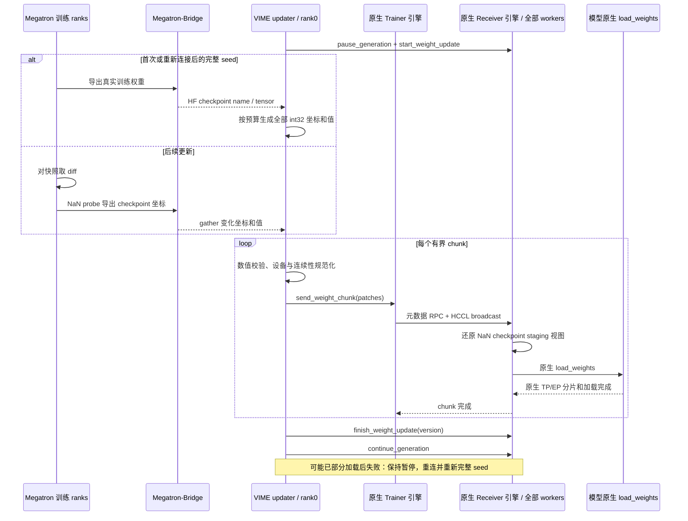

# #492 原生引擎验证补充：不使用直接映射或 MoE 直写

日期：2026-10-24，北京时间。此页记录本次独立验证，补充同目录的设计阅读快照；不把历史 #480 或旧扩展候选的性能归入本方案。

## 实现约束和接口流程

VIME sparse updater 不导入或使用 `HfWeightIteratorDirect`。首次完整 seed 和后续 NaN probe 都经过 `HfWeightIteratorSparseBridge` / Megatron-Bridge；Ascend 不增加 `sparse_moe_direct`，不直接寻址 MoE runtime 参数。

依赖引擎固定为 [#18915 f6ad8bd5](https://github.com/vllm-project/vllm-ascend/pull/18915)。`SparseHCCLTrainerWeightTransferEngine` 与 `SparseHCCLWeightTransferEngine` 的源码、引擎单测、checkpoint e2e、示例四个文件与该提交逐字节一致。旧 pinned Ascend 的 checkpoint-view 兼容补丁保留，未整体覆盖新版 routed_experts.py。

这是接口顺序预估图，没有给箭头虚构毫秒数。当前原生接收器要求推理 PP=1、PCP=1；训练端可经过 Bridge 使用 TP2/PP2/EP2。旁边 PP1 教学脚本的训练 PP1 是该脚本配置，不代表 updater 一律拒绝训练 PP2。

首次 seed 仍使用稀疏协议发送全部坐标，没有 dense API。BF16 每个元素需 4 字节坐标和 2 字节数值；这会增加首次同步通信量，不能沿用旧 dense-seed 候选或 #480 的耗时。

## 已取得的验证

| 检查范围 | 结果 | 测试总墙钟时间 |
|---|---|---|
| VIME sparse adapter 非 integration 测试 | 33 passed，1 deselected | 19.41 秒 |
| 原生引擎与 pinned routed checkpoint 兼容测试 | 24 passed | 0.15 秒 |
| updater 工厂选择 | 8 passed | 24.67 秒 |
| 原生 HCCL checkpoint e2e，TP4/DP1/EP4 与 TP2/DP2/EP4 | 2 passed，无 skip；全部 worker 参数 hash 与 greedy token 对齐原生完整加载 | 245.06 秒 |
| 真实 NPU 训练侧 gather 和 Bridge 差分重建，训练 TP2/PP2/EP2 | 1 passed；20 种空/不等长/非连续/分割/复用 FP32/BF16 情况，Bridge 完整与差分重建逐位一致 | 83.08 秒 |
| launcher 设备选择等单测 | 75 passed，含 5 项离散物理设备用例 | 9.85 秒 |

表注：时间是相应 pytest 进程总墙钟时间，包含启动和等待，**不是单次权重同步延迟**。不同测试范围不可合并为吞吐或精度指标。另有 20 项本地提取适配层契约检查，与上表用例重叠，不累加。

真实 NPU 检查位于 192.168.13.188 的 `cjy-vllm-acend-1019` 容器，独立工作目录 `/home/w00899129/pr492-native18915-1024.2J8cpo`。使用 pinned Python 源码与容器已有原生库/CANN，不代表重新构建完整镜像验证。

30B 三轮完整训练验证仍在准备/运行中，目前不能宣布其通过，也不能给出本方案的 30B 同步延迟或相对 #480 加速比。

## 修改位置与逻辑

- `vime/backends/megatron_utils/update_weight/update_weight_from_sparse_hccl.py`：Bridge 完整 seed；同一原生发送接口；发送前校验和设备规范化；推理 PP/PCP 前置检查。
- `docker/npu_patch/vllm-ascend.patch`：原生 #18915 引擎和用例，不引入 MoE 直写。
- `scripts/run-qwen3-30B-A3B-sparse-hccl.sh` 与对应测试：推理 PP1、TP4/EP4，训练保留 TP2/PP2/EP2。
- `vime/backends/vllm_utils/vllm_engine.py`：正确选择 `ASCEND_RT_VISIBLE_DEVICES` 中已分配的离散物理设备，避免连续编号假设；此处是设备启动配置。
- 中英文文档与相应测试同步上述约束。

当前结论：原生传输、checkpoint loader 和 Bridge 差分链路已有真实 NPU 通过证据；本方案在以上支持边界内具备可行性。30B 完整训练与性能结论仍待实际完成。
