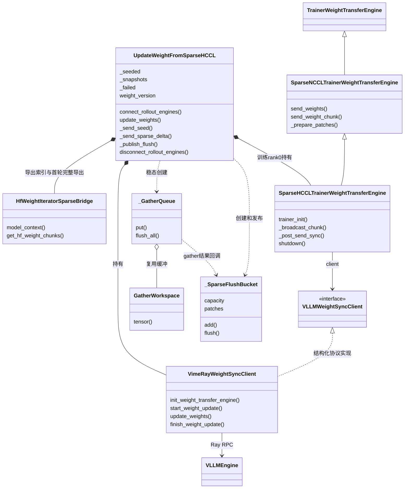
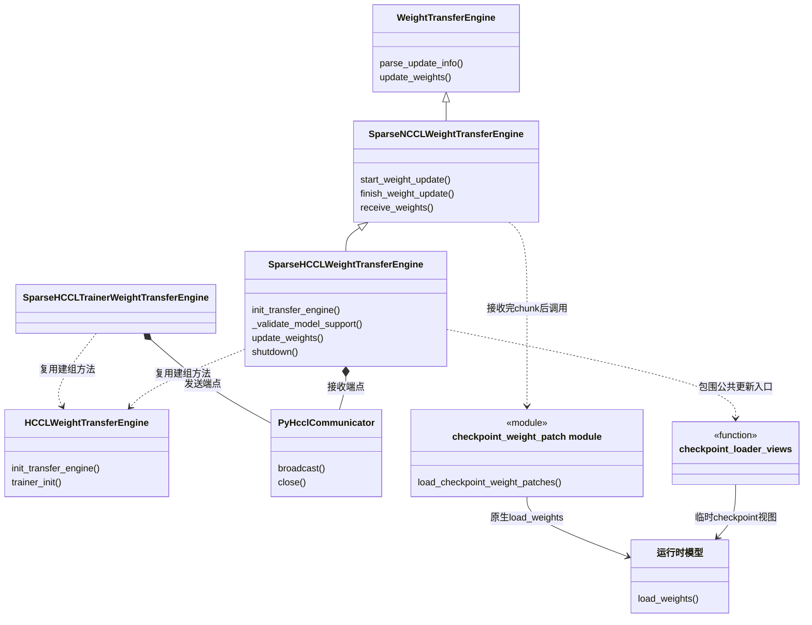
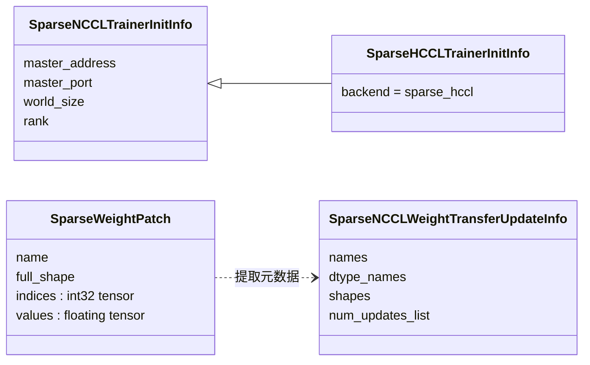

# #492 原生 Sparse HCCL 方案：类设计与使用说明

整理日期：2026-10-24（北京时间）。本文按“不使用 MoE 直写、不使用 PP”的要求整理，训练侧和推理侧均设置 PP=1。

本方案采用 #18915 原生收发引擎。VIME 调用方负责首轮完整坐标 seed、后续 diff/gather、批量数值校验和暂停/恢复生成；接收端统一使用公共 checkpoint loader。MoE 模型仍可使用原生 TP/EP loader，不包含专用直写路径。

**版本边界：这是相对 #492 `b7a462f5` 的原生兼容调用方候选说明，不代表该提交原本已可用。** 本目录附调用方和引擎的阅读快照；没有把未提交的 VIME 代码推送到 #492，也没有修改运行环境。本目录与旁边 [PP/直写扩展候选](../vime-sparse-hccl-492-480/README.md) 是不同方案，不要混用其 patch、测试数量或性能结果。

## 1. 设计边界

- VIME：选择 updater、建立快照、导出完整或变化坐标、按全局一致顺序 gather、按字节预算分桶、通信前校验和设备规范化、版本与失败状态管理。
- Ascend：原生 #18915 trainer/receiver wrapper，负责 HCCL 建组、NPU stream 适配、正常 checkpoint loader 视图和通信资源释放。
- vLLM：公共 patch 类型、trainer 发送入口、元数据、接收与 checkpoint loader。
- 不包含：PP 参数筛选、MoE direct、dense 专用发送方法、dense wire 标志、packed sparse transport。
- 单推理组的 HCCL 成员数是 `1 + TP × DP`；一个 trainer 加全部推理 worker，EP 不额外乘设备数。多个 rollout engine 时，发送端使用 `1 + sum(engine_gpu_counts)`，客户端分配不同 rank offset。

## 2. 类设计图：VIME 调度和发送侧



图注：实线空心三角表示继承，虚线空心三角表示协议实现，实心菱形表示持有对象，虚线箭头表示依赖或回调。`VimeRayWeightSyncClient` 没有显式继承该 Protocol，是通过相同方法签名满足结构化接口。队列和桶在更新过程中创建，不是所有都常驻为 updater 成员。图省略泛型和不影响主链路的基类。

`send_weights()` / `send_weight_chunk()` 继承自公共 trainer；VIME 已管理 start/finish，所以使用 `send_weight_chunk()`。发送引擎不会承担训练侧 diff/gather。[VIME 调用方](source/update_weight_from_sparse_hccl.py)、[Ray 客户端](source/common.py)、[Ascend trainer](source/sparse_hccl_engine.py)。

## 3. 类设计图：接收、加载与通信



图注：发送和接收各自持有自己的 communicator 实例，不是在同一进程共享同一 Python 对象。`HCCLWeightTransferEngine` 是方法复用依赖，不是 sparse receiver 的父类。`checkpoint_loader_views` 是上下文函数，公共 loader 是模块函数，图中没有将其伪装成新增生产类。

正常专家 loader 需要的视图变换不等于 MoE 直写：更新期间暂时暴露 checkpoint 布局，仍调用 `model.load_weights()`；结束时恢复推理视图。所有 sparse 参数都走公共校验、完整形状 NaN staging 和原生加载。

## 4. 数据类型和消息契约



图注：`SparseWeightPatch` 直接复用 vLLM 公共类型；`SparseHCCLWeightTransferUpdateInfo` 是 `SparseNCCLWeightTransferUpdateInfo` 的别名，不是新增子类，也不增加 `dense` 字段。`rank` 等基础信息可能继承自公共 dataclass；图按使用时可见字段展示。

indices 是完整 checkpoint 参数的扁平坐标，不是本地 TP 分片或融合权重的直接地址。values 是更新后的目标值，包括需要写入的零值；不是加法 delta。

## 5. 接口流程：首轮与后续更新

```text
create_weight_updater(delta, sparse_hccl)
  → UpdateWeightFromSparseHCCL
  → connect_rollout_engines：Ray客户端与HCCL端点并发初始化
  → update_weights
      → pause_generation / flush_cache / start_weight_update
      → 首轮：HfWeightIteratorSparseBridge全量导出
              → 全部坐标的int32 indices + 完整目标values
      → 后续：iter_delta_entries + snapshots
              → checkpoint坐标映射 → 一致顺序批量gather
      → _SparseFlushBucket按字节预算切分
      → prepare_native_sparse_patches校验和连续化
      → trainer.send_weight_chunk
          → 元数据RPC与HCCL广播并发
          → 每个非空patch先indices、后values
          → 公共接收和checkpoint loader
          → NaN staging → 原生load_weights → 设备同步
      → 等待RPC完成和发送stream同步
      → finish_weight_update(version) / continue_generation
```

**首轮不调用 `send_dense_weight_chunk()`。** 原生 #18915 没有该接口。`_send_seed()` 把完整权重编码成覆盖所有位置的普通 sparse patch，依然走 `send_weight_chunk()`。重连时重新 seed，不假定 worker 仍等于最初磁盘 checkpoint。

`prepare_native_sparse_patches()` 位于 VIME 调用方，检查名称、形状、int32 索引、浮点 values、长度、边界、重复索引和 NaN，将 tensor 放到 communicator device 并连续化；按 chunk 汇总数值标志后，才启动原生引擎 RPC。不是修改 #18915 的公共发送协议。

当前调用方保守要求每个完整 checkpoint 参数的元素数小于 `2**31`，以避开原生接收 loader 的大张量 int32 比较限制。拆小传输 chunk 不会改变完整参数的 `full_shape`，不能绕过该限制。[代码证据](source/update_weight_from_sparse_hccl.py)

## 6. 使用前提

1. 训练 PP=1、推理 PP=1，推理 prefill context parallel size=1；不使用 PP 扩展。
2. 训练和推理使用独立设备，不使用 `--colocate`；未量化浮点 ND 权重，关闭 NZ 和 EPLB。
3. 使用配套的 VIME native updater 和 #18915 接收引擎，不能把旧 `_send_dense()` 调用方与原生引擎混装。
4. 保留既有 exporter、delta 导出和 gather 模块；不要只复制本目录阅读快照就当作完整安装包。
5. native/CANN、torch-npu、vLLM、Ascend、Ray、Megatron 及模型依赖已按项目安装指南安装。固定安装基线仍见 #492 的配套 dependency patch 与 README；本页不把上游 main 当作固定镜像的替代。

## 7. VIME 启动参数

先确保你已有一套 PP=1 的 full 训练/推理命令能运行，再将权重同步部分切换为：

```bash
--update-weight-mode delta \
--update-weight-transport sparse_hccl \
--update-weight-delta-verify-every 0 \
--update-weight-delta-batch-diff 32 \
--update-weight-delta-batch-gather 32 \
--pipeline-model-parallel-size 1 \
--vllm-pipeline-parallel-size 1 \
--vllm-prefill-context-parallel-size 1 \
--vllm-additional-config '{"weight_nz_mode":0}'
```

这是追加到完整训练命令中的参数片段，不是单独可执行命令。`verify-every=0` 关闭的是该后端不提供的周期 rank-local verify，不会关闭 payload 输入校验。

示例配置：4 张训练卡与 4 张推理卡，训练 TP2/PP1/EP2/ETP1，推理 TP4/PP1/DP1；MoE 模型可正常启用 EP。训练 PP 从 2 改为 1 会改变分片与显存需求，不能套用之前 PP2 的显存/性能结果。

| 配置项 | 设置 | 含义 |
| --- | --- | --- |
| 训练 PP | 1 | 训练不做流水线分层 |
| 推理 PP、PCP | 1、1 | 接收端使用原生支持范围 |
| 传输模式 | delta + sparse_hccl | 首轮完整坐标seed，后续变化坐标 |
| batch diff / gather | 32 / 32 | 按已有模块进行批量提取和gather |
| periodic verify | 0 | 不调用该后端不提供的周期校验 |
| 接收应用 | 公共checkpoint loader | 无专用MoE直写路径 |

表注：以上是本文示例配置，不是已测最优值或新性能结论；4+4表示训练与推理共8张独立NPU，不是HCCL组含8个成员。单推理组的HCCL成员为1+4=5，其他训练rank只参加训练侧导出/gather。

## 8. PP1 示例启动脚本

[run-qwen3-30b-pp1-native-example.sh](run-qwen3-30b-pp1-native-example.sh) 根据现有 VIME Qwen3-30B 脚本生成，显式使用训练/推理 PP1，先检查 native updater 的关键接口。它是未执行的启动示例，不是完成过多卡验证的运行记录。

```bash
# 在已激活CANN和项目依赖的Linux/NPU环境中执行。
export VIME_SRC=/path/to/vime-native-candidate
export MODEL_PATH=/path/to/Qwen3-30B-A3B
export PROMPT_DATA_PATH=/path/to/prompts.jsonl
export NUM_ROLLOUT=3
export UPDATE_WEIGHT_DELTA_VERIFY_EVERY=0

bash /path/to/this-directory/run-qwen3-30b-pp1-native-example.sh
```

提示数据为 JSONL，示例使用 `prompt` 与 `label` 字段，配置沿用 math reward 与 chat template。脚本调用目标 VIME 的模型配置，不额外启动独立 `vllm serve`；rollout server 由 VIME 管理，后端配置由 VIME 路由注入。

脚本会连接指定端口的 Ray，或在端口不可用时启动 Ray head。共享机器上应先选择分配给本次任务的独立资源、空闲端口和 Ray 环境；脚本不会停止已有其他任务。需要新的进程级环境变量时，不要假定修改提交shell会改变已运行worker的环境。

## 9. 嵌入现有训练系统的接口用法

VIME 用户通常只需上述参数，由 actor 创建并管理 updater。已有分布式训练框架集成时的调用次序为：

```python
# 框架集成片段；args/model/weights_getter和Ray engine handles由现有系统提供。
updater = create_weight_updater(
    args, model, weights_getter,
    model_name=model_name,
    quantization_config=None,
)
updater.connect_rollout_engines(
    rollout_engines,
    rollout_engine_lock,
    engine_gpu_counts=engine_gpu_counts,
    engine_parallel_configs=engine_parallel_configs,
)
updater.update_weights()  # 首轮：完整坐标seed和建立快照
# ...原有训练逻辑更新model...
updater.update_weights()  # 后续：变化位置diff/gather/send
metrics = updater.pop_metrics()
updater.disconnect_rollout_engines()  # 生命周期结束时
```

所有训练rank按同一顺序参与 updater 的分布式导出/gather和状态汇总；只有指定rank0执行接收RPC和HCCL发送。不要仅让rank0调用整个 `update_weights()`，也不要在任意训练计算仍修改权重时并发调用。

## 10. 观察结果与恢复

- 查看 `Sparse HCCL weight sync` 日志中的 version、seed、flushes、wire MiB和更新位置数。
- `perf/update_weights_time` 用于完整同步对比；`perf/update_weights_sparse_hccl_wire_mbytes` 等只描述payload，不代表总耗时。
- 诊断时可在trainer与rollout环境设置 `VLLM_WEIGHT_TRANSFER_PROFILE=1`；该计时引入设备同步，正式性能对比关闭。父/子阶段及收发等待存在重叠，不能简单相加。
- 首轮传输完整indices+values：BF16至少约6N字节tensor payload，相比dense values-only约2N字节更大；接收仍有完整形状staging。不能宣称首轮与full同成本。
- 后续BF16 payload约6K字节，只有K/N小于1/3时tensor payload才小于full；这不是端到端加速阈值。
- payload尚未开始且清理成功时，调用方清快照、标记重连，下次重新seed。
- payload可能已开始或finish失败时，updater标记不可复用，不主动恢复生成。需要重新连接并完整seed，或重启worker；不存在自动事务回滚或所有通信故障下的有限时退出保证。

## 11. 验证口径

本文完成的是当前native调用方的只读核对、类关系与接口说明，以及示例脚本语法检查；没有运行新的NPU训练作业。

旁边扩展候选的96项CPU测试、单NPUloader结果和 #480 PP2/直写性能不能算作本文方案的验证。#18915 本身已有的35项单测和2项checkpoint E2E可见[独立说明](../vllm-ascend-pr18915-sparse-hccl/04-current-sequence-20261024.md)，它们也不能直接替代VIME完整seed/diff/gather集成测试。

本方案多卡验收应独立覆盖：PP1完整seed、至少两轮真实delta、无变化round、重连后的seed、TP/EP原生loader全参数哈希与dense参考一致、错误payload在RPC前拒绝，以及完整同步耗时。以上是待执行项目，不写成通过结论。

## 12. 源码证据与可编辑图源

- [调用方快照](source/update_weight_from_sparse_hccl.py)：`prepare_native_sparse_patches`、`_send_seed`、`_publish_flush`、状态机。
- [Ascend原生wrapper快照](source/sparse_hccl_engine.py)：公共类型复用、trainer/receiver继承关系、PP拒绝、NPU stream及正常loader视图。
- [Ray客户端快照](source/common.py)：`VimeRayWeightSyncClient`。
- [Bridge迭代器快照](source/hf_weight_iterator_sparse_bridge.py)：`model_context` 与首轮完整导出；与diff/probe使用同一Bridge映射。
- [vLLM公共收发代码](https://github.com/vllm-project/vllm/blob/c0b6f74bee518aeaf5d72b200a0216e72fbb5e7c/vllm/distributed/weight_transfer/sparse_nccl_engine.py)：继承的发送/接收入口。
- [公共checkpoint loader](https://github.com/vllm-project/vllm/blob/c0b6f74bee518aeaf5d72b200a0216e72fbb5e7c/vllm/model_executor/model_loader/checkpoint_weight_patch.py)：校验、NaN staging和masked原生加载。
- [调度和发送类图](01-trainer-classes.mmd)、[接收类图](02-receiver-classes.mmd)、[数据契约类图](03-data-contract.mmd)。

快照来源和SHA256见[manifest.json](manifest.json)。source是阅读证据，不是完整可安装仓库；原始许可证见[source/LICENSE](source/LICENSE)。
