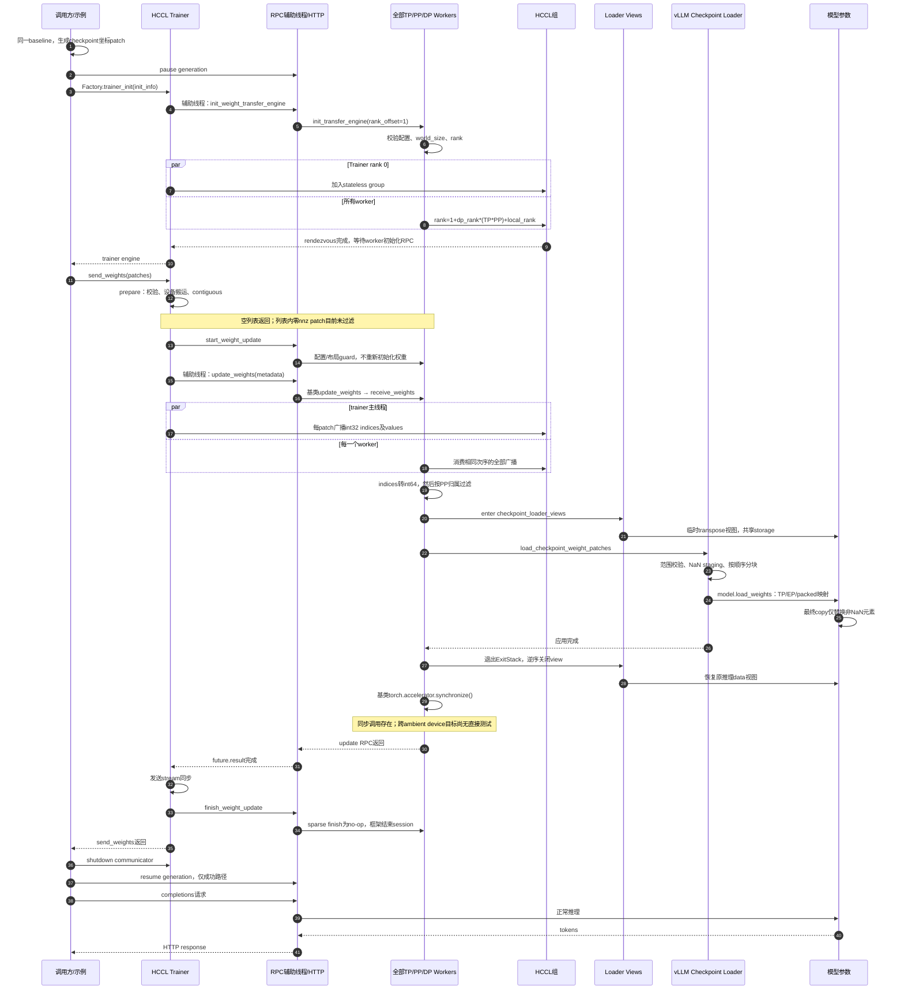
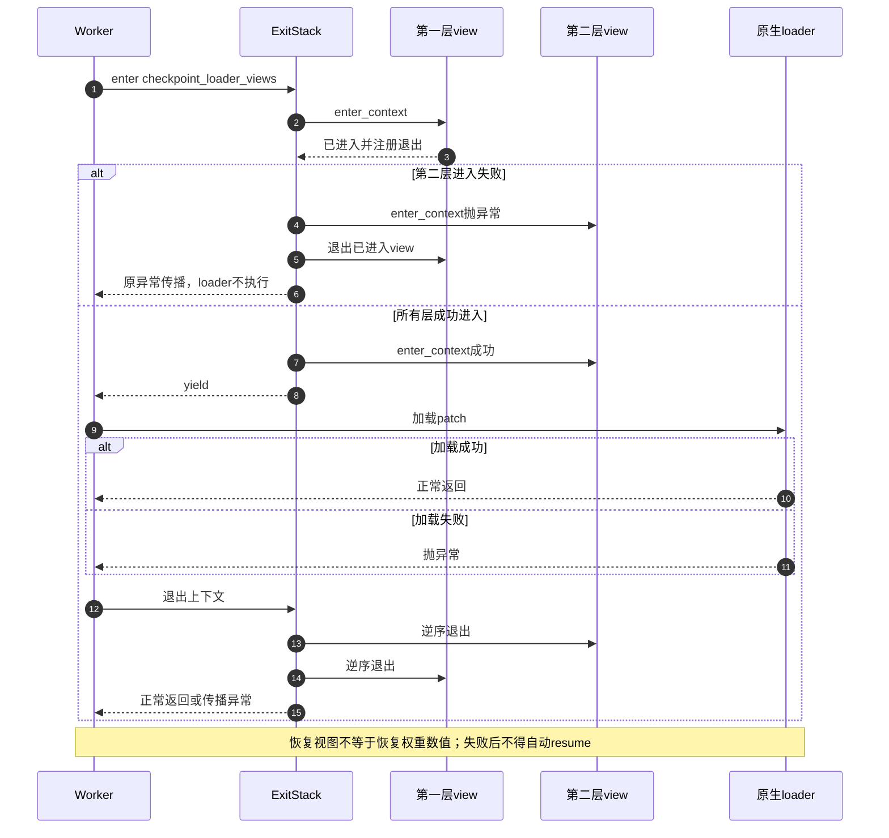
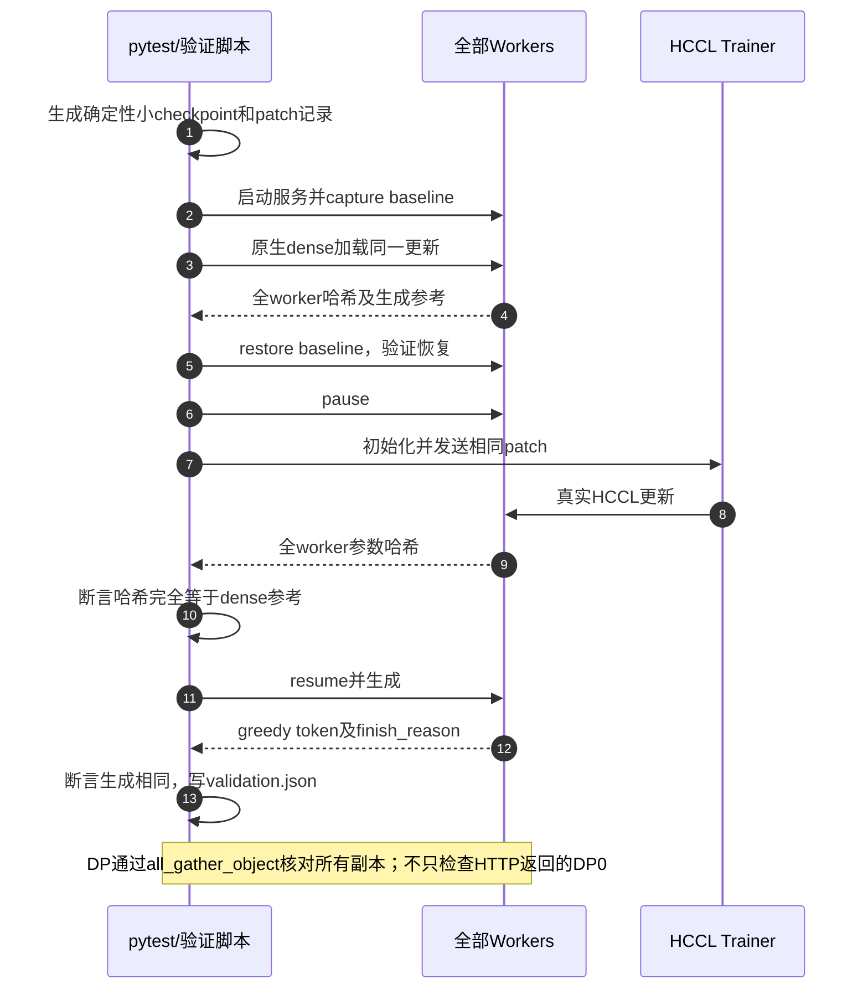

# 整体 UML 时序流程

PR [#18915](https://github.com/vllm-project/vllm-ascend/pull/18915)，Ascend 提交 `ee1f30111881795103af01a0fe19caf41d20a5ac`；上游 vLLM 固定 `c4df37dfcc7f72ca41cd43801a468526ecf99a2b`。本材料按 2026-10-21 验证版本整理，不代表自动更新后的其他上游版本。

## 阅读说明

实线箭头表示调用或发送消息，虚线箭头表示返回；`par` 表示双方必须并发进入 collective。图按当前 HTTP 示例的单次 send_weights 路径组织，不表示 HCCL 数据经 HTTP 传输：HTTP 是控制面，HCCL 是数据面。

独立 trainer rank=0；worker rank=1+dp_rank×(TP×PP)+rank_within_dp；总参与者=1+TP×PP×DP，EP 不再额外乘一次。每个参与者独占 NPU。

## 1. 建组、稀疏更新与恢复推理

图注：recv 的 NPU 上下文在返回前退出，随后基类做同步；图只标出真实调用，未对尚未直接测试的跨设备同步作保证。只有成功路径才 finish/resume。send_weights 失败会跳过 finish；示例 finally 关闭 engine，异常继续传播而不执行 resume。

## 2. 多层 view 的进入与异常清理

图注：单层 view 用 finally 恢复 parameter.data；外层 ExitStack 管理已进入 view 的逆序退出。失败不提供权重事务回滚。

## 3. E2E 的 dense 参考对比

## 分块更新与示例差别

示例用 send_weights：prepare → start → broadcast → finish。checkpoint E2E 用调用方持有的 session：start → 多次 send_weight_chunk → finish。chunk 入口本身不自动 start/finish；不能把两种生命周期嵌套。

E2E 每四条记录构成一个 chunk；重复 q_proj 名称用于验证按输入顺序覆盖。PP=2 时创建两层模型，分别覆盖两个 stage。真实示例单独生成首尾层的 expert gate row-swap patch。

`01-sequence.puml` 是可编辑的标准 PlantUML 主时序图；`01-sequence.mmd` 是 Mermaid 主图源文件；`01-sequence.svg` 是可直接查看的概览。细节及异常路径以本文和核心代码为准。
