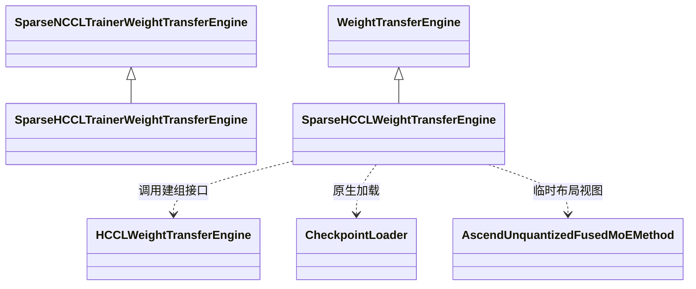

# 核心代码与接口流程

PR [#18915](https://github.com/vllm-project/vllm-ascend/pull/18915)，Ascend 提交 `ee1f30111881795103af01a0fe19caf41d20a5ac`；上游 vLLM 固定 `c4df37dfcc7f72ca41cd43801a468526ecf99a2b`。本材料按 2026-10-21 验证版本整理，不代表自动更新后的其他上游版本。

## 职责与继承关系

`SparseHCCLTrainerWeightTransferEngine` 继承上游 `SparseNCCLTrainerWeightTransferEngine`：复用构造、sender 选择、公开 send 生命周期和 patch 类型，覆盖 HCCL 初始化、校验、设备归一化和广播。

`SparseHCCLWeightTransferEngine` 直接继承通用 `WeightTransferEngine`，不是继承上游 NCCL worker engine；它调用既有 `HCCLWeightTransferEngine` 的建组辅助接口，接收后复用上游 checkpoint loader。`SparseWeightPatch` 是上游类型的别名。



顺序：生成 checkpoint 坐标 patch → pause → trainer/worker 并发建组 → 校验和传输 → 接收端转 int64 → PP 过滤 → 临时布局视图 → 上游 loader → 退出视图 → 基类同步 → finish → shutdown → resume。

## 1. 示例生成 patch

从同一 HF checkpoint 的首尾层、expert 0 和中间 expert 交换 gate projection 前两行。发送的是完整 checkpoint 名称、形状和扁平索引，不是本地运行时 tensor 名称。

来源：[examples/rl/rlhf_sparse_hccl.py:35](https://github.com/wangx700/vllm-ascend/blob/ee1f30111881795103af01a0fe19caf41d20a5ac/examples/rl/rlhf_sparse_hccl.py#L35)。以下为原文摘录，类方法保留原缩进，不是独立可运行文件。

```python
@torch.no_grad()
def make_patches(model: torch.nn.Module) -> list[SparseWeightPatch]:
    """Convert HF fused/per-expert storage to full checkpoint gate coordinates."""
    config = model.config
    if config.model_type != "qwen3_moe" or config.num_experts < 2 or config.moe_intermediate_size < 2:
        raise ValueError("Requires Qwen3 MoE with at least two experts and two intermediate rows")
    patches = []
    for layer in sorted({0, config.num_hidden_layers - 1}):
        prefix = f"model.layers.{layer}.mlp.experts"
        for expert in (0, config.num_experts // 2):
            name = f"{prefix}.{expert}.gate_proj.weight"
            try:
                weight = model.get_parameter(name)
            except AttributeError:
                fused = model.get_parameter(f"{prefix}.gate_up_proj")
                expected = (config.num_experts, 2 * config.moe_intermediate_size, config.hidden_size)
                if tuple(fused.shape) != expected:
                    raise ValueError(f"Unexpected fused expert shape: {tuple(fused.shape)} != {expected}") from None
                weight = fused[expert, : config.moe_intermediate_size]
            if tuple(weight.shape) != (config.moe_intermediate_size, config.hidden_size):
                raise ValueError(f"Unexpected checkpoint shape for {name}: {tuple(weight.shape)}")
            replacement = weight[:2].clone().flip(0)
            if torch.equal(weight[:2], replacement):
                raise ValueError(f"Row swap would be a no-op: {name}")
            weight[:2].copy_(replacement)
            patches.append(
                SparseWeightPatch(
                    name=name,
                    full_shape=tuple(weight.shape),
                    indices=torch.arange(replacement.numel(), dtype=torch.int32, device=weight.device),
                    values=replacement.flatten().contiguous(),
                )
            )
    return patches
```

## 2. trainer 初始化与独立 rank

trainer 为 HCCL rank 0，worker rank_offset=1。先在辅助线程发起 worker 初始化 RPC，再让 trainer 加入 rendezvous，避免双方串行等待。

来源：[vllm_ascend/distributed/weight_transfer/sparse_hccl_engine.py:242](https://github.com/wangx700/vllm-ascend/blob/ee1f30111881795103af01a0fe19caf41d20a5ac/vllm_ascend/distributed/weight_transfer/sparse_hccl_engine.py#L242)。以下为原文摘录，类方法保留原缩进，不是独立可运行文件。

```python
    @classmethod
    def trainer_init(
        cls,
        init_info: SparseHCCLTrainerInitInfo,
        *,
        client: VLLMWeightSyncClient,
        source: WeightSource | None = None,
    ) -> "SparseHCCLTrainerWeightTransferEngine":
        engine = cls(client=client, source=source, is_sender=init_info.is_sender)
        if not engine.is_sender:
            return engine
        if init_info.world_size < 2:
            raise ValueError("Sparse HCCL needs a trainer and at least one worker")

        # Workers sit at rank_offset 1, after the single trainer sender rank 0.
        # Sparse transfers are never packed, so the worker keeps the unpacked
        # defaults on its init info.
        worker_init_info = HCCLWeightTransferInitInfo(
            master_address=init_info.master_address,
            master_port=init_info.master_port,
            rank_offset=1,
            world_size=init_info.world_size,
        )

        # The inference workers block inside init_weight_transfer_engine waiting
        # for the HCCL rendezvous, so we kick that off on a side thread while we
        # open the trainer endpoint (rank 0); both sides must rendezvous together.
        with ThreadPoolExecutor(max_workers=1) as exe:
            future = exe.submit(
                engine.client.init_weight_transfer_engine,
                asdict(worker_init_info),
            )
            # Open the trainer endpoint as HCCL rank 0 on the current device
            # (the init info satisfies the helper's rendezvous protocol).
            engine.model_update_group = HCCLWeightTransferEngine.trainer_init(asdict(init_info))
            future.result()  # surface any inference-side init error

        return engine
```

## 3. 复用上游单次更新生命周期

先 prepare；空列表直接返回；成功时 start → broadcast → finish。广播异常会跳过 finish。暂停/恢复生成由调用方负责。

来源：[vllm/distributed/weight_transfer/sparse_nccl_engine.py:269](https://github.com/vllm-project/vllm/blob/c4df37dfcc7f72ca41cd43801a468526ecf99a2b/vllm/distributed/weight_transfer/sparse_nccl_engine.py#L269)。以下为原文摘录，类方法保留原缩进，不是独立可运行文件。

```python
    def send_weights(self, patches: Iterable[SparseWeightPatch] | None = None) -> None:
        """Broadcast one sparse update through a one-shot lifecycle."""
        patches = self._prepare_patches(patches)
        if not patches:
            return

        self.client.start_weight_update()
        self._broadcast_chunk(patches)
        self.client.finish_weight_update()
```

## 4. 调用方持有分块生命周期

send_weight_chunk 只 prepare 和广播，不自动 start/finish；E2E 使用该模式，调用方在循环外 start/finish。

来源：[vllm/distributed/weight_transfer/sparse_nccl_engine.py:279](https://github.com/vllm-project/vllm/blob/c4df37dfcc7f72ca41cd43801a468526ecf99a2b/vllm/distributed/weight_transfer/sparse_nccl_engine.py#L279)。以下为原文摘录，类方法保留原缩进，不是独立可运行文件。

```python
    def send_weight_chunk(
        self, patches: Iterable[SparseWeightPatch] | None = None
    ) -> None:
        """Broadcast one chunk inside a caller-owned weight update lifecycle."""
        patches = self._prepare_patches(patches)
        if not patches:
            return
        self._broadcast_chunk(patches)
```

## 5. Ascend 预处理与校验

上游遍历 patch 并调用本类校验器，随后将 CPU 或非连续 payload 归一化到 communicator 的 NPU。当前只对空列表 no-op，尚未过滤列表中的零 nnz patch。

来源：[vllm_ascend/distributed/weight_transfer/sparse_hccl_engine.py:281](https://github.com/wangx700/vllm-ascend/blob/ee1f30111881795103af01a0fe19caf41d20a5ac/vllm_ascend/distributed/weight_transfer/sparse_hccl_engine.py#L281)。以下为原文摘录，类方法保留原缩进，不是独立可运行文件。

```python
    def _prepare_patches(self, patches: Iterable[SparseWeightPatch] | None) -> list[SparseWeightPatch]:
        prepared = super()._prepare_patches(patches)
        if not prepared:
            return []
        assert self.model_update_group is not None
        device = self.model_update_group.device
        # Normalize views and CPU payloads before workers enter collectives.
        with torch.npu.device(device):
            return [
                SparseWeightPatch(
                    name=patch.name,
                    full_shape=tuple(patch.full_shape),
                    indices=patch.indices.to(device=device).contiguous(),
                    values=patch.values.to(device=device).contiguous(),
                )
                for patch in prepared
            ]
```

## 6. patch 边界校验

线上 indices 要求 int32；校验时临时转 int64，避免大形状比较溢出。拒绝非法名称/形状、重复和越界索引、NaN 值。

来源：[vllm_ascend/distributed/weight_transfer/sparse_weight_patch.py:14](https://github.com/wangx700/vllm-ascend/blob/ee1f30111881795103af01a0fe19caf41d20a5ac/vllm_ascend/distributed/weight_transfer/sparse_weight_patch.py#L14)。以下为原文摘录，类方法保留原缩进，不是独立可运行文件。

```python
def validate_sparse_patch(patch: SparseWeightPatch) -> None:
    """Reject invalid payloads before starting a worker lifecycle or collective."""
    # Keep this standalone validator complete while sharing the trainer's
    # structural checks for shape presence, int32 indices and flattened payloads.
    SparseNCCLTrainerWeightTransferEngine._validate_patch(patch)
    if not isinstance(patch.name, str) or not patch.name:
        raise ValueError("Sparse checkpoint name must be non-empty")
    if any(type(dim) is not int or dim < 0 for dim in patch.full_shape):
        raise ValueError(f"Invalid checkpoint full_shape for {patch.name}")
    if patch.values.dtype not in SPARSE_HCCL_VALUE_DTYPES:
        raise ValueError(f"Sparse values require an HCCL-supported floating dtype: {patch.name}")
    numel = math.prod(patch.full_shape)
    if numel > torch.iinfo(torch.int64).max:
        raise ValueError(f"Checkpoint shape exceeds int64 indexing: {patch.name}")
    # Host reads are required before workers enter HCCL.
    # Keep the bounds/duplicate checks together instead of reading each index.
    indices = patch.indices
    if indices.numel():
        ordered = indices.sort().values
        # Comparing an int32 tensor with a larger Python scalar wraps the
        # scalar into int32. Keep the wire dtype, but widen bounds arithmetic.
        wide_indices = indices.to(dtype=torch.int64)
        invalid = torch.stack(
            [
                ((wide_indices < 0) | (wide_indices >= numel)).any(),
                (ordered[1:] == ordered[:-1]).any(),
            ]
        ).any()
        if invalid.item():
            raise ValueError(f"Sparse indices out of range or duplicated: {patch.name}")
    if torch.isnan(patch.values).any().item():
        raise ValueError(f"Sparse values cannot contain NaN: {patch.name}")
```

## 7. 控制面与数据面并发

辅助线程用 HTTP RPC 通知 worker 接收；主线程按顺序广播 indices/values。所有参与者必须消费相同 collective 序列。future.result 传播 worker 异常，发送端同步后才能释放或重建 payload。

来源：[vllm_ascend/distributed/weight_transfer/sparse_hccl_engine.py:299](https://github.com/wangx700/vllm-ascend/blob/ee1f30111881795103af01a0fe19caf41d20a5ac/vllm_ascend/distributed/weight_transfer/sparse_hccl_engine.py#L299)。以下为原文摘录，类方法保留原缩进，不是独立可运行文件。

```python
    def _broadcast_chunk(self, patches: list[SparseWeightPatch]) -> None:
        assert self.model_update_group is not None
        device = self.model_update_group.device
        with torch.npu.device(device):
            update_info = SparseHCCLWeightTransferUpdateInfo(
                names=[patch.name for patch in patches],
                dtype_names=[str(patch.values.dtype).split(".")[-1] for patch in patches],
                shapes=[list(patch.full_shape) for patch in patches],
                num_updates_list=[patch.indices.numel() for patch in patches],
            )

            # update_weights (workers receive) must run concurrently with the
            # trainer-side broadcasts — both rendezvous inside the same HCCL calls.
            executor = ThreadPoolExecutor(max_workers=1)
            try:
                future = executor.submit(self.client.update_weights, asdict(update_info))
                # Surface an RPC that failed before the worker entered HCCL rather
                # than broadcasting to a peer that will never receive.
                if future.done():
                    future.result()
                stream = torch.npu.current_stream()
                for patch in patches:
                    if not patch.indices.numel():
                        continue
                    self.model_update_group.broadcast(patch.indices, src=0, stream=stream)
                    self.model_update_group.broadcast(patch.values, src=0, stream=stream)
                future.result()  # surface inference-side errors
            finally:
                # A failed broadcast can leave the RPC blocked in the matching
                # receive. Waiting for that thread would hide the original error.
                executor.shutdown(wait=False, cancel_futures=True)
            self._post_send_sync()
```

## 8. worker 接收、int64 和 PP

HCCL 接收缓冲区仍是 int32；构造 CheckpointWeightPatch 时转 int64。全部广播完成后才按 PP stage 过滤，避免 foreign-stage 参数导致 collective 次序不一致。

来源：[vllm_ascend/distributed/weight_transfer/sparse_hccl_engine.py:177](https://github.com/wangx700/vllm-ascend/blob/ee1f30111881795103af01a0fe19caf41d20a5ac/vllm_ascend/distributed/weight_transfer/sparse_hccl_engine.py#L177)。以下为原文摘录，类方法保留原缩进，不是独立可运行文件。

```python
    def receive_weights(self, update_info: SparseHCCLWeightTransferUpdateInfo) -> None:
        """Receive sparse flat-index patches from the trainer and apply them."""
        if self.model_update_group is None:
            raise RuntimeError("HCCL weight transfer not initialized. Call init_transfer_engine() first.")

        # Receive on the communicator's device rather than relying on the
        # ambient current device in the RPC thread.
        device = self.model_update_group.device
        with torch.npu.device(device):
            stream = torch.npu.current_stream(device=device)
            patches = []
            for name, dtype_name, shape, num_updates in zip(
                update_info.names,
                update_info.dtype_names,
                update_info.shapes,
                update_info.num_updates_list,
                strict=True,
            ):
                dtype = getattr(torch, dtype_name)
                indices = torch.empty(num_updates, dtype=torch.int32, device=device)
                values = torch.empty(num_updates, dtype=dtype, device=device)
                if num_updates:
                    self.model_update_group.broadcast(indices, src=0, stream=stream)
                    self.model_update_group.broadcast(values, src=0, stream=stream)
                patches.append(
                    CheckpointWeightPatch(
                        name=name,
                        shape=tuple(shape),
                        dtype=dtype,
                        values=values,
                        indices=indices.to(dtype=torch.int64),
                    )
                )
            # Every rank must consume every broadcast before selecting its PP
            # weights. Reuse the native model's missing-stage ownership rules.
            patches = [patch for patch in patches if not is_pp_missing_parameter(patch.name, self.model)]
            with checkpoint_loader_views(self.model):
                load_checkpoint_weight_patches(self.model, patches)
```

## 9. 多层 view 的资源管理

@contextmanager + ExitStack 在 yield 期间持有各层 view。进入中途失败会退出已成功进入的 view；加载失败会逆序退出全部 view。

来源：[vllm_ascend/distributed/weight_transfer/sparse_hccl_engine.py:59](https://github.com/wangx700/vllm-ascend/blob/ee1f30111881795103af01a0fe19caf41d20a5ac/vllm_ascend/distributed/weight_transfer/sparse_hccl_engine.py#L59)。以下为原文摘录，类方法保留原缩进，不是独立可运行文件。

```python
@contextmanager
def checkpoint_loader_views(model: torch.nn.Module) -> Iterator[None]:
    """Expose loader layouts while preserving the inference tensor storage."""
    with ExitStack() as stack:
        for layer in model.modules():
            method = getattr(layer, "quant_method", None)
            view = getattr(method, "checkpoint_weight_loader_view", None)
            if view is not None:
                stack.enter_context(view(layer))
        yield
```

## 10. 单层 view 与底层存储

原生 expert loader 期望 [expert, output, input]，Ascend GMM 使用 [expert, input, output]。临时 transpose 视图共享底层存储，finally 恢复原 data；恢复的是布局，不是撤销已写入的权重。

来源：[vllm_ascend/ops/fused_moe/routed_experts.py:112](https://github.com/wangx700/vllm-ascend/blob/ee1f30111881795103af01a0fe19caf41d20a5ac/vllm_ascend/ops/fused_moe/routed_experts.py#L112)。以下为原文摘录，类方法保留原缩进，不是独立可运行文件。

```python
    @contextmanager
    def checkpoint_weight_loader_view(self, layer):
        """Temporarily undo the inference transpose without replacing storage.

        The upstream expert loader expects [expert, output, input], whereas
        Ascend GMM consumes [expert, input, output]. Restoring the original
        views in finally also preserves graph addresses and parameter loaders.
        Split expert lists and NZ tensors need a different update mechanism.
        """
        self.validate_checkpoint_weight_loader_view(layer)
        parameters = [layer.w13_weight, layer.w2_weight]
        originals = [parameter.data for parameter in parameters]
        try:
            for parameter, original in zip(parameters, originals):
                parameter.data = original.transpose(1, 2)
            yield
        finally:
            for parameter, original in zip(parameters, originals):
                parameter.data = original
```

## 11. 上游 worker 完成同步

receive_weights 返回后基类调用 torch.accelerator.synchronize()。注意这里没有显式 device 参数；当前测试尚未证明“线程 ambient device 与 communicator 不同”时仍同步目标设备，不应把同步调用存在写成对任意线程设备状态的保证。

来源：[vllm/distributed/weight_transfer/base.py:491](https://github.com/vllm-project/vllm/blob/c4df37dfcc7f72ca41cd43801a468526ecf99a2b/vllm/distributed/weight_transfer/base.py#L491)。以下为原文摘录，类方法保留原缩进，不是独立可运行文件。

```python
    def update_weights(self, update_info: dict[str, Any]) -> None:
        """Receive one weight update chunk and load it into the model.

        Args:
            update_info: Dictionary containing backend-specific update info

        """
        typed_update_info = self.parse_update_info(update_info)
        self.receive_weights(typed_update_info)
        # NCCL broadcast / IPC paths may be asynchronous. Synchronize here so the
        # next step uses the new weights.
        torch.accelerator.synchronize()
```

## 12. 上游 sparse 最终写入

上游 staging 用 NaN 标记未更新元素，临时替换 copy_，最终同形浮点 copy 只替换非 NaN 元素。TP/EP/packed mapping 仍交给 model.load_weights。finally 恢复原始 copy_。

来源：[vllm/model_executor/model_loader/checkpoint_weight_patch.py:49](https://github.com/vllm-project/vllm/blob/c4df37dfcc7f72ca41cd43801a468526ecf99a2b/vllm/model_executor/model_loader/checkpoint_weight_patch.py#L49)。以下为原文摘录，类方法保留原缩进，不是独立可运行文件。

```python
def _load_nan_masked_weights(
    model: torch.nn.Module,
    weights: list[tuple[str, torch.Tensor]],
) -> Iterable[str] | None:
    """Load NaN-masked checkpoint tensors while preserving runtime values at NaNs."""
    # Save the original copy_ so it can be restored after loading.
    original_copy = torch.Tensor.copy_

    # Enforce the sparse-loader contract and preserve destination values where
    # the corresponding source is NaN.
    def copy_non_nan_(
        destination: torch.Tensor,
        source: torch.Tensor,
        non_blocking: bool = False,
    ) -> torch.Tensor:
        if not (
            destination.is_floating_point()
            and source.is_floating_point()
            and destination.shape == source.shape
        ):
            raise NotImplementedError(
                "Sparse checkpoint patches require a same-shaped "
                "floating-point final copy"
            )
        source = source.to(dtype=destination.dtype, device=destination.device)
        return torch.where(
            torch.isnan(source),
            destination,
            source,
            out=destination,
        )

    torch.Tensor.copy_ = copy_non_nan_
    try:
        return model.load_weights(weights)
    finally:
        torch.Tensor.copy_ = original_copy
```

## 限制与当前未采用的建议

- 初始权重必须相同；values 是替换值，不是加法 delta。
- 仅 unquantized、ND、静态 expert placement；EPLB、NZ/split expert 布局和 draft 更新不在支持范围。
- 线上数据量 O(nnz)，但上游 checkpoint staging 仍为 O(N)，单张量可能超过批处理目标。
- view 清理不等于权重事务回滚。失败后保持 pause，恢复已知 baseline 或重启后再继续。
- 只完成了 contextmanager 和接收端 int64 两项 review 修改；零 nnz 过滤建议尚未实施。
- `core-source/` 保留完整源码快照及文件路径；以上摘录用于阅读接口，不能单独复制为完整模块运行。
