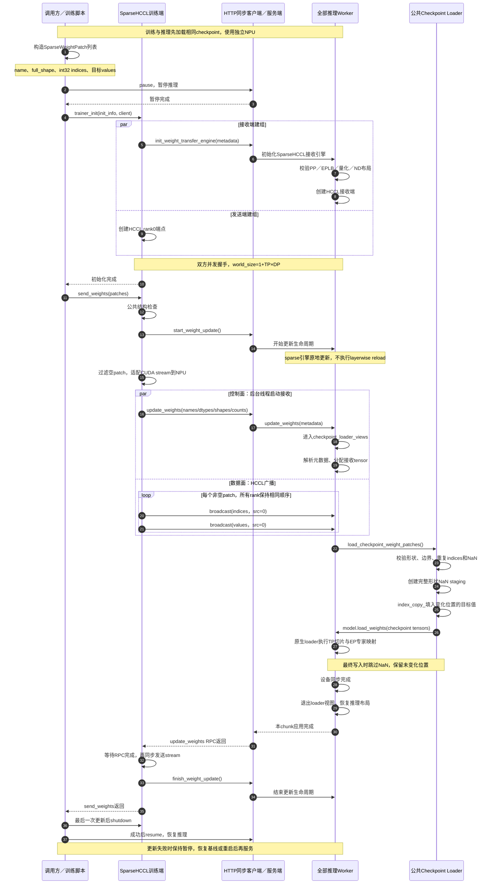

# PR #18915：Sparse HCCL 当前版本时序与接口说明

核对日期：2026-10-24（北京时间）。

- PR：[vLLM-Ascend #18915](https://github.com/vllm-project/vllm-ascend/pull/18915)。
- Ascend 固定提交：[`f6ad8bd53aeb81a419e371a856288000e4d498db`](https://github.com/vllm-project/vllm-ascend/commit/f6ad8bd53aeb81a419e371a856288000e4d498db)。
- 上游复用逻辑按 PR 标注的 vLLM [`c0b6f74bee518aeaf5d72b200a0216e72fbb5e7c`](https://github.com/vllm-project/vllm/commit/c0b6f74bee518aeaf5d72b200a0216e72fbb5e7c) 核对。
- 本文是代码与 PR 验证记录说明，本次整理没有重新运行 NPU 测试。
- [独立 Mermaid 源文件](04-current-sequence-20261024.mmd)。

## 1. 整体机制

训练端和推理端先加载**同一初始 checkpoint**。之后，训练端发送 checkpoint 坐标下的“参数名＋完整形状＋变化位置＋目标值”，推理端通过原生模型 loader，将这些目标值覆盖到本地 TP/EP 权重。

#18915 主要负责 HCCL 建组、NPU stream 适配、MoE 加载视图和通信资源释放；稀疏协议与公共加载流程复用 vLLM。它本身不负责训练侧 diff/gather，也没有 VIME #480 的首轮 dense seed 和 MoE 直写扩展。[引擎继承与公共类型复用](https://github.com/vllm-project/vllm-ascend/blob/f6ad8bd53aeb81a419e371a856288000e4d498db/vllm_ascend/distributed/weight_transfer/sparse_hccl_engine.py#L20-L35)

这与本目录旧材料固定的 Ascend `ee1f30111` / vLLM `c4df37d` 不同。旧文档、源码快照、测试清单和图片保留为历史记录；其中 PP 支持、int64 规范化和 80 项测试数量不能直接套用到本文版本。

## 2. 完整时序图



图注：表示接口调用顺序和并发关系，不表示阶段实际耗时。图中使用 `send_weights()` 管理一次完整更新；`shutdown()` 放在最后一次更新后，持续训练时可复用通信组。所有推理 worker 按相同顺序参加广播，之后由原生 loader 处理本地 TP/EP 所有权。当前不支持 PP，因此没有 PP 参数过滤步骤。

## 3. 关键接口与逻辑

### 3.1 初始化：两边必须并发建组

`SparseHCCLTrainerWeightTransferEngine.trainer_init()` 在后台线程调用接收端初始化，同时在当前线程打开 trainer rank0 端点，再等待双方握手完成。初始化使用相同的 master address、port 和 world size，worker 的 `rank_offset=1`。

当前实现通过 `ExitStack` 注册训练端清理：初始化异常退出时调用 `engine.shutdown()`，成功时取消这项异常清理。这不代表任何故障都能自动恢复或回滚。[初始化代码](https://github.com/vllm-project/vllm-ascend/blob/f6ad8bd53aeb81a419e371a856288000e4d498db/vllm_ascend/distributed/weight_transfer/sparse_hccl_engine.py#L110-L140)

通信组包含一个 trainer 与全部 TP×DP 推理 worker，大小为：

```text
world_size = 1 + TP × DP
trainer HCCL rank = 0
worker HCCL rank = 1 + dp_rank × TP + rank_within_dp
```

上式按本版本 PP=1 展开。EP 使用这些推理 worker，不额外乘一次设备数。[worker rank 计算](https://github.com/vllm-project/vllm-ascend/blob/f6ad8bd53aeb81a419e371a856288000e4d498db/vllm_ascend/distributed/weight_transfer/hccl_engine.py#L141-L169)

### 3.2 控制面 RPC 与 HCCL 数据面并发

元数据包含 `names`、`dtype_names`、`shapes`、`num_updates_list`。训练端在后台线程发起 `client.update_weights(metadata)`，接收端据此分配 tensor；发送线程同时进入 HCCL 广播。

每个非空 patch 依次广播 int32 indices 和 values，双方 collective 顺序必须一致。Ascend wrapper 先过滤空 patch，并通过 `torch_cuda_wrapper()` 将上游 CUDA stream API 适配到 NPU。当前 wrapper 不替调用方移动或连续化 payload；tensor 应提前位于 communicator device 且连续。[Ascend 广播适配](https://github.com/vllm-project/vllm-ascend/blob/f6ad8bd53aeb81a419e371a856288000e4d498db/vllm_ascend/distributed/weight_transfer/sparse_hccl_engine.py#L142-L156)、[公共发送并发逻辑](https://github.com/vllm-project/vllm/blob/c0b6f74bee518aeaf5d72b200a0216e72fbb5e7c/vllm/distributed/weight_transfer/sparse_nccl_engine.py#L303-L345)

接收端完整接收本 chunk 的 patch 列表后，再调用 `load_checkpoint_weight_patches()`。[公共接收流程](https://github.com/vllm-project/vllm/blob/c0b6f74bee518aeaf5d72b200a0216e72fbb5e7c/vllm/distributed/weight_transfer/sparse_nccl_engine.py#L150-L185)

### 3.3 Patch 语义：新值覆盖

`SparseWeightPatch` 包含：

- `name`：原始 checkpoint 参数名；
- `full_shape`：完整 checkpoint 参数形状；
- `indices`：完整 checkpoint tensor 展平后的坐标，传输使用 int32；
- `values`：对应位置更新后的目标值。

例如 indices 为 `[2, 7]`、values 为 `[0.5, 0.0]`，表示把 checkpoint 第 2、7 个位置分别替换为 `0.5`、`0.0`，其他位置保持不变；不是执行 `weight += delta`。

公共发送端先检查索引类型、维度、形状是否提供、indices/values 长度是否匹配；接收公共 loader 再进行结构与数值校验，包括索引越界、同一 patch 内重复索引以及 NaN。[发送结构检查](https://github.com/vllm-project/vllm/blob/c0b6f74bee518aeaf5d72b200a0216e72fbb5e7c/vllm/distributed/weight_transfer/sparse_nccl_engine.py#L347-L363)、[接收校验](https://github.com/vllm-project/vllm/blob/c0b6f74bee518aeaf5d72b200a0216e72fbb5e7c/vllm/model_executor/model_loader/checkpoint_weight_patch.py#L185-L225)

### 3.4 NaN staging 与原生 loader

接收端为每个涉及的 checkpoint 参数构造完整形状的 NaN tensor，再用 `index_copy_` 填入变化位置的目标值。NaN 表示“保留原值”，因此不能作为 sparse 新值。

随后调用 `model.load_weights()`，由原生 loader 执行 checkpoint 名称映射、TP 切片和 EP 专家放置；最终浮点同形状 copy 使用 NaN mask 保留未变化位置。公共 sparse loader 对最终 copy 形式有约束，不能据此推断所有模型自定义加载路径都已支持。[staging 和加载](https://github.com/vllm-project/vllm/blob/c0b6f74bee518aeaf5d72b200a0216e72fbb5e7c/vllm/model_executor/model_loader/checkpoint_weight_patch.py#L233-L273)、[NaN masked 写入](https://github.com/vllm-project/vllm/blob/c0b6f74bee518aeaf5d72b200a0216e72fbb5e7c/vllm/model_executor/model_loader/checkpoint_weight_patch.py#L45-L84)

### 3.5 MoE 临时 loader 视图

Ascend 推理专家权重使用 `[expert, input, output]`，checkpoint loader 期望 `[expert, output, input]`。更新期间临时转置 `w13_weight/w2_weight` 的视图，沿用原生 TP/EP 映射；退出时通过 `finally` 恢复推理视图，底层 storage 地址不变。

当前 wrapper 在整个 `super().update_weights()` 外包围 `checkpoint_loader_views()`，其范围包含元数据解析、接收、加载和设备同步；不是仅在最终 loader 调用附近切换视图。[接收入口](https://github.com/vllm-project/vllm-ascend/blob/f6ad8bd53aeb81a419e371a856288000e4d498db/vllm_ascend/distributed/weight_transfer/sparse_hccl_engine.py#L90-L96)、[MoE 视图实现](https://github.com/vllm-project/vllm-ascend/blob/f6ad8bd53aeb81a419e371a856288000e4d498db/vllm_ascend/ops/fused_moe/routed_experts.py#L104-L131)

### 3.6 完成同步、恢复推理与异常行为

接收端加载后执行 `torch.accelerator.synchronize()`；退出 loader 视图后接收 RPC 返回。训练端等待 RPC 完成，再通过 `_post_send_sync()` 同步发送 stream，之后才结束更新生命周期。[接收同步](https://github.com/vllm-project/vllm/blob/c0b6f74bee518aeaf5d72b200a0216e72fbb5e7c/vllm/distributed/weight_transfer/base.py#L491-L502)、[发送同步](https://github.com/vllm-project/vllm-ascend/blob/f6ad8bd53aeb81a419e371a856288000e4d498db/vllm_ascend/distributed/weight_transfer/sparse_hccl_engine.py#L154-L156)

`send_weights()` 管理 start/update/finish，但不会替调用方执行 pause/resume。示例在更新前调用 `/pause`，只在成功后调用 `/resume`；失败时保留暂停状态。Sparse 引擎的 start/finish 不运行 dense 的 layerwise reload，权重直接原地更新。[公共生命周期](https://github.com/vllm-project/vllm/blob/c0b6f74bee518aeaf5d72b200a0216e72fbb5e7c/vllm/distributed/weight_transfer/sparse_nccl_engine.py#L142-L148)、[示例调用流程](https://github.com/vllm-project/vllm-ascend/blob/f6ad8bd53aeb81a419e371a856288000e4d498db/examples/rl/rlhf_sparse_hccl.py#L93-L120)

更新不具备事务回滚；异常发生前的部分权重可能已经改变，应恢复已知基线或重启后再服务。

## 4. 一轮多个 chunk 的接口流程

```text
调用方 pause
  → client.start_weight_update()
  → engine.send_weight_chunk(chunk_1)
  → engine.send_weight_chunk(chunk_2)
  → …
  → client.finish_weight_update()
  → 调用方 resume
```

`send_weight_chunk()` 不重复执行 start/finish，生命周期由调用方包住；`send_weights()` 则自己执行一次 start/finish。空 patch 列表不发数据。[两种发送接口](https://github.com/vllm-project/vllm/blob/c0b6f74bee518aeaf5d72b200a0216e72fbb5e7c/vllm/distributed/weight_transfer/sparse_nccl_engine.py#L269-L286)

## 5. 支持范围与性能边界

- 支持范围要求未量化 ND 权重、静态专家放置、关闭 EPLB，训练与推理使用独立设备并共享初始 checkpoint。
- PP、draft model、NZ、拆分的 MC2 专家权重列表及 packed sparse 更新不受支持。[配置检查](https://github.com/vllm-project/vllm-ascend/blob/f6ad8bd53aeb81a419e371a856288000e4d498db/vllm_ascend/distributed/weight_transfer/sparse_hccl_engine.py#L72-L88)、[PR 支持范围](https://github.com/vllm-project/vllm-ascend/pull/18915)
- 通信量随变化元素数增长，但接收端仍为涉及的参数创建完整形状 NaN staging，再走原生 loader。通信量减少不等于整轮同步耗时同比减少。
- 当前代码记录了上游 int32 大张量边界检查限制：完整 checkpoint tensor 含 `2**31` 个元素时，合法索引可能被边界比较错误拒绝；本文版本没有把该修复描述为已实现。[已知限制注释](https://github.com/vllm-project/vllm-ascend/blob/f6ad8bd53aeb81a419e371a856288000e4d498db/vllm_ascend/distributed/weight_transfer/sparse_hccl_engine.py#L90-L96)
- 本流程不提供自动 diff、训练多 rank gather、首轮 dense seed 或 VIME 专用 MoE 直写。

## 6. PR 报告的验证范围

PR 描述报告 35 项单测，包括 10 项 sparse engine 与 25 项 routed-expert 测试；另有 2 项 checkpoint E2E，使用小型合成 Qwen3-MoE checkpoint，比较全部 worker 参数哈希与 greedy generation：

| E2E配置 | TP | DP | EP | 总NPU数 |
| --- | ---: | ---: | ---: | ---: |
| 场景一 | 4 | 1 | 4 | 5 |
| 场景二 | 2 | 2 | 4 | 5 |

表注：两个场景分别运行；总设备数为一个独立 trainer 加 TP×DP 个推理 worker，EP 不额外增加设备。以上来自 PR 的已有验证报告，本次文档整理未重跑硬件测试；单测和 E2E 数量分别统计，不与本目录旧版 80 项清单合并。测试会话总耗时不是一次权重同步延迟。

该证据支持这些受限配置下的正确性结论，不代表 PP、真实大模型训练同步性能或其他权重布局已验证。[PR 验证记录](https://github.com/vllm-project/vllm-ascend/pull/18915)
