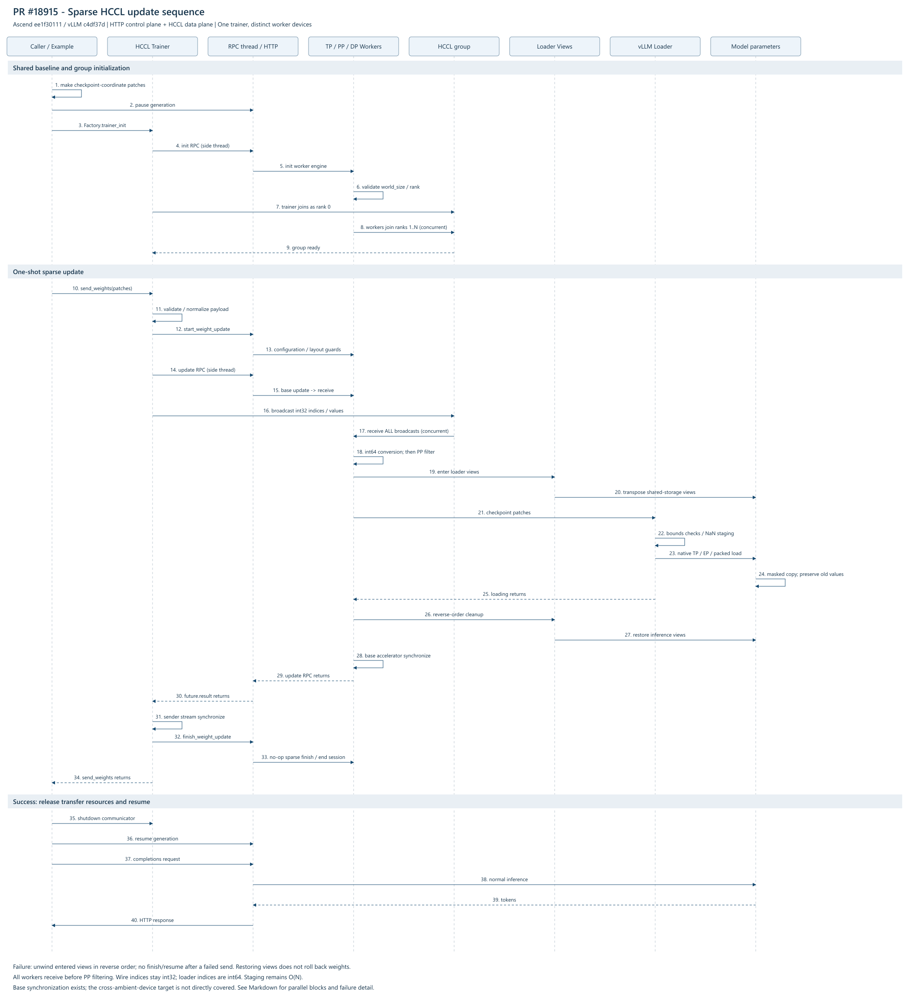

# PR #18915：Sparse HCCL 权重更新

## 当前版本说明（2026-10-24）

- [当前版本时序图与接口说明](04-current-sequence-20261024.md)：固定 Ascend `f6ad8bd5`、vLLM `c0b6f74b`，包含建组、收发并发、NaN staging、MoE loader 视图、生命周期及支持边界。
- [当前 Mermaid 源文件](04-current-sequence-20261024.mmd)。

下方原有图集、源码和测试材料固定于旧版本 `ee1f30111` / `c4df37d`，作为历史归档；旧版 PP、int64 转换和 80 项测试数量不能套用到上面的当前版本说明。

配套 [vllm-ascend PR #18915](https://github.com/vllm-project/vllm-ascend/pull/18915) 的时序图、核心代码与逐项测试说明。

材料固定在 Ascend 提交 [ee1f30111](https://github.com/wangx700/vllm-ascend/commit/ee1f30111)，上游 vLLM 固定为 [c4df37d](https://github.com/vllm-project/vllm/commit/c4df37dfcc7f72ca41cd43801a468526ecf99a2b)。验证日期为 2026-10-21；后续 PR 内容请按提交差异核对。

## 阅读顺序

1. [整体 UML 时序流程](01-sequence.md)：建组、更新、PP 参数筛选、int64 转换、异常清理及恢复推理。
2. [核心代码与接口说明](02-core-code.md)：原文代码摘录、继承关系、HCCL 控制/数据面与上游 loader 复用。
3. [逐项测试说明](03-test-cases.md)：80 个真实 pytest nodeid 逐项列出输入、步骤、断言和覆盖局限；另列真实示例与反向回归两项独立验证。
4. [验证说明及记录](validation/README.md)：原始日志、关键命令、退出码、源码摘要和测试范围。

## UML 图与可编辑源文件

- [PNG](01-sequence.png) · [SVG 矢量图](01-sequence.svg)
- [PlantUML 源文件](01-sequence.puml) · [Mermaid 源文件](01-sequence.mmd)

概览图为英文接口名称；中文主时序、异常路径和 dense 参考流程见[完整说明](01-sequence.md)。

## 测试数量与证据

74 个 UT 由 sparse engine 的 49 项和 routed experts 的 25 项组成，包含已有相邻回归；不是 74 个新增用例。6 个 pytest E2E 由 4 个真实 HCCL 场景和 2 个 CPU 示例布局项组成，全部通过且无跳过。真实示例 CLI 单独验证，不混入这 6 项计数；移除 int64 转换后的失败为预期反向回归。

[test-case-inventory.json](test-case-inventory.json) 提供可检索清单，[case-inventory.log](case-inventory.log) 是远端 collect-only 原始输出。

## 核心源码快照

- [Ascend 源码](core-source/ascend/)：engine、validator、专家布局、示例和测试。
- [上游 vLLM 源码](core-source/upstream/)：公共生命周期和 checkpoint loader。

源码用于对照阅读，不是可直接安装的完整工程；保留各文件原有版权头，并附 Apache 2.0 LICENSE。文件摘要见 [manifest.json](manifest.json)。
